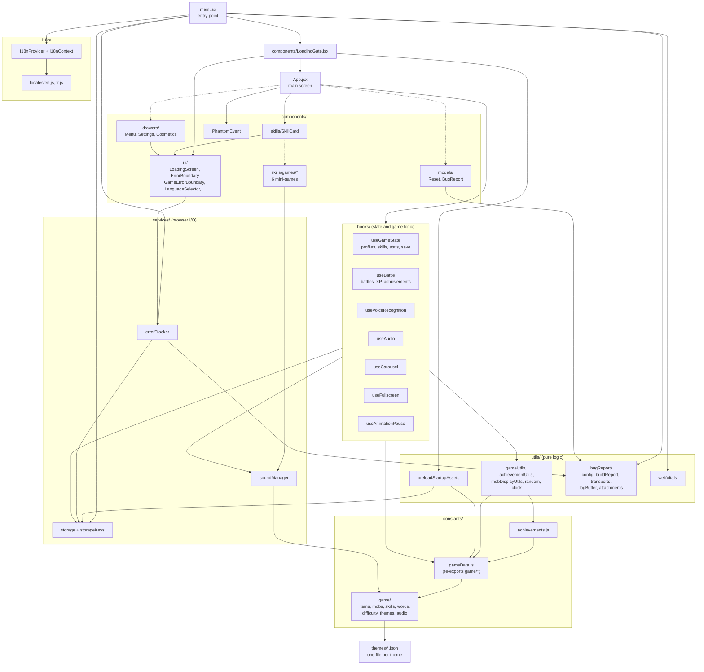

# Architecture

This page shows how Level Up RPG is built today. It is written from the code on `main`, so it can be read in a few minutes before opening any file. The map of the code as the team received it is kept in [DEBT.md section 1](DEBT.md#1-codebase-map) as the "received version".

The game is a React 19 single-page app built with Vite. The same build runs in a browser, in the nginx Docker image, and in an Electron window. There is no server. Everything the game saves stays in `localStorage`.

## The system in one picture

Each box is a folder or a file under `src/`. An arrow means "imports". Dashed arrows are imports loaded on demand (`React.lazy` or a dynamic `import()`).

The graph comes from `npx madge@8.0.0 --json --extensions js,jsx --exclude '__tests__|\.test\.' src`, grouped by folder. Run it again to see every file.

Three rules hold in the current code:

- `App.jsx` only wires hooks to components. The game rules live in `src/hooks/` and `src/utils/`.
- Code that talks to the browser (`localStorage`, `Audio`) lives in `src/services/`. The exceptions are listed under [Where I/O happens](#where-io-happens).
- `src/utils/` holds pure functions. Randomness and time come in as arguments ([ADR-008](adr/008-inject-randomness-and-clock.md)).

## Where the state lives

| State | Owner | Saved where |
|-------|-------|-------------|
| Current profile, profile names, parent status | `useGameState` | `currentProfile_v1`, `heroProfileNames_v1`, `heroParentStatus_v1` |
| Skills, XP, levels, mobs, stats, active theme (per profile) | `useGameState` | `heroSkills_v23_p{id}`, one JSON object `{ skills, theme, stats }` |
| Card border and border color (per profile) | `useGameState` | `borderEffect_p{id}`, `borderColor_p{id}` |
| Battle: current skill, challenge, player health, damage numbers, loot, toasts | `useBattle` | Not saved |
| Voice recognition: listening flag, spoken text | `useVoiceRecognition` | Not saved |
| Music and sound volume | `useAudio`, then `soundManager` | Not saved (reset to 30% and 50% on each start) |
| Carousel position and drag | `useCarousel` | Not saved |
| Open drawers and modals | `App.jsx` | Not saved |
| Language | `I18nProvider` (React context) | `language_v1` |
| Last time the phantom event appeared | `PhantomEvent` | `phantomEvent_lastSpawn_v1` |
| Last 20 errors | `errorTracker` | `errorLog_v1` |
| Last 50 console warnings and errors | `bugReport/logBuffer` | Memory only, until a bug report is sent |
| Theme catalog | `constants/game/themes.js` | Built at load time from `src/themes/*.json` |

Every key name is defined once, in `src/services/storageKeys.js`. A test fails if a key is typed anywhere else. `migrateStorage()` runs before the first render. It moves old keys to new ones and renames old theme ids and creature names inside each save.

## Where I/O happens

| I/O | Code | Notes |
|-----|------|-------|
| `localStorage` reads and writes | `services/storage.js` (`readJSON`, `writeJSON`, `parseJSON`, `backupCorrupted`) | A corrupted save falls back to defaults and is copied once to `<key>_corrupted_backup`. `useGameState`, `PhantomEvent` and `preloadStartupAssets` still call `localStorage.getItem` and `setItem` for plain strings. |
| Sound effects and music | `services/soundManager.js` | A new `Audio` object for each sound. One `BGMManager` plays the theme music in random order. `setSoundTheme` switches the files when the theme changes. |
| Image and sound preloading | `utils/preloadStartupAssets.js` | `Image` and `Audio` objects, at startup only. |
| Speech recognition | `hooks/useVoiceRecognition.js` | `webkitSpeechRecognition`, Reading game only, language fixed to `en-US` because the reading words are English (`READING_SPEECH_LANGUAGE`). See [microphone](features/microphone.md). |
| Network | `utils/bugReport/transports.js` | The only network call in the game. A bug report is a `fetch` POST to `VITE_BUG_REPORT_ENDPOINT`. Without an endpoint, the game opens a `mailto:` link. Fonts and textures are self-hosted, and a test fails on any external URL in `src/`. |
| Error tracking | `services/errorTracker.js` | Listens to `error` and `unhandledrejection` on `window`. The two error boundaries also report to it. Emails and credentials are hidden before saving. |
| Console capture | `utils/bugReport/logBuffer.js` | Wraps `console.warn` and `console.error` to keep recent messages for bug reports. |
| Performance | `utils/webVitals.js` | Prints FCP, LCP and CLS in the console. |
| Fullscreen | `hooks/useFullscreen.js` | Browser Fullscreen API. |
| Electron | `electron/main.cjs` | Opens the window, blocks devtools shortcuts in the packaged app, and sends `mailto:` links to the system mail app. |

Direct calls to `Math.random()` and `Date.now()` are still present in `useBattle`, `PhantomEvent`, `MemoryGame`, `PatternGame` and `soundManager` (DEBT-023).

## Main flows

### Startup and loading screen

1. `main.jsx` runs `migrateStorage()`, then starts the console capture and the error tracking.
2. It renders `I18nProvider`, then `ErrorBoundary`, then `LoadingGate`.
3. `LoadingGate` renders `App` at once, under the `LoadingScreen` overlay. It also loads `GlobalStyles.css` and calls `preloadStartupAssets`.
4. `preloadStartupAssets` reads the saved theme of the current profile. It loads the background, logo, card back, skill icons and the images already on screen. Progress goes to the loading bar. Theme sounds load in the background and never block startup.
5. When all images are loaded, the overlay fades out in 450 ms. If some fail, the screen shows how many and a "Continue" button.
6. `App` receives the load time and unlocks the "So... So fast !?" achievement.

Drawers, modals and the six mini-games are not in the startup bundle. They load the first time they open. A test checks this ([performance report](missions/performance.md)).

### Battle

1. The player picks a skill card in the carousel (`useCarousel`). `SkillCard` calls `startBattle` from `useBattle`.
2. `useBattle` builds the challenge for the skill and the difficulty: a word, a math problem, a pattern or a memory deck. The words and creatures come from the active theme.
3. The mini-game in `components/skills/games/` loads on demand inside a `GameErrorBoundary`. In the Reading game, `useVoiceRecognition` listens and compares the spoken word.
4. A right answer calls `handleSuccessHit`. It computes damage and XP with `utils/gameUtils.js`, updates `skills` and `stats` through updater functions, and plays sounds through `soundManager`.
5. A wrong answer removes one heart. At zero hearts the player loses one level and the battle ends. Against a boss, a wrong answer heals the boss instead.
6. After each stats change, an effect in `useBattle` checks achievements (`utils/achievementUtils.js`) and shows a toast.
7. `useGameState` saves `skills` and `stats` to `localStorage` after every change.

If a mini-game crashes, `GameErrorBoundary` ends the battle and saves the error. The rest of the game keeps running.

### Theme switch

1. The player picks a theme in `CosmeticsDrawer`. `App.handleThemeChange` sets `activeTheme` and counts the change in `stats.themeChanges`.
2. `getTheme(activeTheme)` returns the theme object built from `src/themes/<id>.json`. Missing fields fall back to the defaults.
3. An effect in `App` calls `setSoundTheme`, which swaps the sounds and the music playlist.
4. Pictures, creature names and skill texts are read from the theme object at render time. `useGameState` saves the new theme id in the profile save.

Adding a theme means adding one JSON file and one folder of pictures. See [themes](features/themes.md) and [ADR-013](adr/013-themes-as-data-folders.md).

### Language switch

1. `LanguageSelector` sits in `SettingsDrawer`. It calls `setLanguage` from the i18n context.
2. `I18nProvider` checks that the code exists in `locales/`, saves it under `language_v1`, and sets `<html lang>`.
3. A new `t()` function goes to every component through the context, so all screens render again in the new language. Theme texts use `i18n/gameText.js`, which reads the translations stored in each theme file.
4. At the next start, `getInitialLanguage()` uses the saved choice, then the browser language, then English.

A new language is one more file in `src/i18n/locales/`, found by `import.meta.glob`. See [translation](features/translation.md) and [ADR-012](adr/012-translation.md).

### Bug report

1. The bug button in `App` opens `BugReportModal`, loaded on demand.
2. The player writes a description and optional steps. An email, images or text files, and the recent console logs can be added.
3. `buildReport` adds the game version, the profile, the theme, the user agent, the browser language and the screen size. Emails and secrets in the logs were hidden when they were captured.
4. `createTransport` picks the HTTP transport when `VITE_BUG_REPORT_ENDPOINT` is set, or the `mailto:` transport with `VITE_BUG_REPORT_EMAIL`.
5. The player can also download the full report as JSON. This helps with `mailto:`, which cannot carry attachments.

See [bug reporting](features/bug-reporting.md) and [ADR-009](adr/009-bug-reporting.md).

### Error tracking

1. An uncaught error or a rejected promise reaches the listeners from `installErrorTracking`.
2. A render crash reaches `ErrorBoundary` (full page) or `GameErrorBoundary` (one skill card).
3. Each one calls `trackError`, which keeps the last 20 errors in `errorLog_v1`. The same error twice in a row raises its count.

The [runbook](handover/RUNBOOK.md#white-screen-or-something-went-wrong) explains how to read the saved errors.

## Folder map

| Folder | What it holds |
|--------|---------------|
| `src/main.jsx` | Entry point: storage migration, error tracking, log capture, Web Vitals, providers. |
| `src/App.jsx` | Main screen. Wires the hooks to the components and owns the open/closed state of drawers and modals. |
| `src/hooks/` | `useGameState` (profiles and save data), `useBattle` (battle rules, XP, achievements), `useVoiceRecognition`, `useAudio`, `useCarousel`, `useFullscreen`, `useAnimationPause`. |
| `src/components/` | `LoadingGate`, `PhantomEvent`, and the folders `skills/` (`SkillCard` and `games/` with one file per mini-game), `drawers/`, `modals/`, `profile/`, `ui/`. |
| `src/services/` | Browser I/O: `storage`, `storageKeys`, `soundManager`, `errorTracker`. |
| `src/utils/` | Pure logic: `gameUtils`, `achievementUtils`, `mobDisplayUtils`, `random`, `clock`, `preloadStartupAssets`, `webVitals`, and `bugReport/`. |
| `src/i18n/` | `I18nProvider`, `I18nContext`, `useTranslation`, `translate`, `locales.js`, `gameText.js`, and `locales/` with one file per language. |
| `src/constants/game/` | Game data split by topic: `items`, `mobs`, `skills`, `words`, `difficulty`, `themes`, `audio`. `constants/gameData.js` re-exports them. |
| `src/constants/` | Also `achievements.js`, and the dead file `assets.js` (DEBT-004). |
| `src/themes/` | One JSON file per theme. Their pictures and sounds are in `public/assets/themes/<id>/`. |
| `src/styles/` | Global CSS shared by several components (`base.css`, `animation-pause.css`, loaded through `components/ui/GlobalStyles.css`) and the border effects module shared by `SkillCard` and `CosmeticsDrawer`. Styles used by one component live in a CSS module next to it (`*.module.css`, DEBT-002). |
| `src/assets/` | Self-hosted font and textures. |
| `src/__tests__/` | Vitest suites. Coverage is 100% with 100% thresholds. |
| `electron/` | Electron main process. |
| `tools/` | Measurement scripts: `measure-metrics.mjs` (debt metrics), `measure-animations.mjs` (performance). |

The full `src/features/` layout of [ADR-006](adr/006-feature-based-file-structure.md) was not done. Files are still grouped by kind (hooks, components, utils). See DEBT-020.

## Decisions and feature docs

| ADR | Decision |
|-----|----------|
| [001](adr/001-vitest-jsdom-test-framework.md) | Vitest and jsdom as test framework |
| [002](adr/002-testing-library-component-tests.md) | Testing Library for component tests |
| [003](adr/003-conservative-coverage-thresholds.md) | Coverage thresholds that only go up |
| [004](adr/004-github-actions-ci-pipeline.md) | GitHub Actions as CI pipeline |
| [005](adr/005-characterization-tests-before-refactoring.md) | Characterization tests before refactoring |
| [006](adr/006-feature-based-file-structure.md) | Feature-based file structure (not done, see above) |
| [007](adr/007-prettier-code-formatting.md) | Prettier for code formatting |
| [008](adr/008-inject-randomness-and-clock.md) | Inject randomness and the clock |
| [009](adr/009-bug-reporting.md) | Bug reporting |
| [010](adr/010-pause-offscreen-animations.md) | Pause animations nobody can see |
| [011](adr/011-animated-webp-instead-of-gif.md) | Animated WebP instead of GIF |
| [012](adr/012-translation.md) | Translation with a small in-house i18n module |
| [013](adr/013-themes-as-data-folders.md) | Themes as one folder and one JSON file each |

Feature docs: [bug reporting](features/bug-reporting.md), [microphone](features/microphone.md), [themes](features/themes.md), [translation](features/translation.md). Performance work: [performance report](missions/performance.md). Remaining debt: [DEBT.md](DEBT.md).

## Showing the system in five minutes

1. Open this page and walk through the picture above, from `main.jsx` down to `services/`.
2. Run `npm run dev`. Show the loading screen, then win one battle in the Math card.
3. Switch the theme in the cosmetics drawer, then the language in the settings drawer. The music, pictures and texts change with no reload.
4. Open the bug report form and show the JSON download.
5. Run `npm run metrics` to show the numbers of [DEBT.md "Final metrics"](DEBT.md#8-final-metrics).
