# Technical debt register

> Living document. Last updated: 2026-11-26.
>
> Status values: **Done ✓** (fixed on `main`), **Partly done** (the main fix is merged, a residual part stays), **Open** (not started). Partly done and Open items are the residual debt handed to the next team, listed in [section 9](#9-residual-debt-handed-over).

---

## 1. Codebase map

This section is the **received version**: the codebase as the team got it, before any refactoring. It describes commit `f12cd74` (initial push) plus `MenuDrawer_old.jsx`, which came in the next commit `a4f337f` with the other original files. All paths, line counts and graphs reflect that baseline. The current system is described in [ARCHITECTURE.md](ARCHITECTURE.md).

### 1.1 Module overview

| Module | Role | Path (init) | Lines | Cyclomatic complexity |
|--------|------|-------------|-------|-----------------------|
| **App** | God component. All game state, logic, and orchestration: battles, XP, voice recognition, carousel navigation, profiles, difficulty, achievements, challenges, fullscreen. | `src/App.jsx` | 1,492 | ~218 |
| **GlobalStyles** | Single `<style>` block. All CSS: animations, layouts, themes, aura effects. No scoping. | `src/components/ui/GlobalStyles.jsx` | 1,302 | ~8 |
| **SkillCard** | Renders all 6 skill mini-games (patterns, math, reading, writing, memory, cleaning) in one component. Heavy branching per game type. | `src/components/skills/SkillCard.jsx` | 778 | ~119 |
| **gameData** | Mixed constants file. Contains mob definitions, skill configs, theme palettes, word lists, and display names. Imported by 6 modules. | `src/constants/gameData.jsx` | 416 | — |
| **gameUtils** | Pure utility functions for battle math, XP curves, level thresholds, and item generation. | `src/utils/gameUtils.js` | 363 | ~28 |
| **CosmeticsDrawer** | UI drawer for equipping borders, auras, and achievement-locked effects. Duplicated render blocks internally. | `src/components/drawers/CosmeticsDrawer.jsx` | 322 | ~8 |
| **achievements** | Achievement definitions: names, descriptions, unlock conditions, icons. Imported by 4 modules. | `src/constants/achievements.js` | 318 | ~5 |
| **soundManager** | Audio playback singleton. BGM shuffle, SFX triggers. Module-level mutable state. No pooling. | `src/utils/soundManager.js` | 287 | ~23 |
| **MenuDrawer** | Main menu drawer. Shows stats, achievements summary, and navigation. | `src/components/drawers/MenuDrawer.jsx` | 262 | ~5 |
| **MenuDrawer_old** | Dead file. Previous version of MenuDrawer, never imported. | `src/components/drawers/MenuDrawer_old.jsx` | 231 | — |
| **achievementUtils** | Functions to check achievement unlock conditions and format achievement data. | `src/utils/achievementUtils.js` | 217 | ~28 |
| **PhantomEvent** | Random event overlay during gameplay. Plays sound, shows animated mob. | `src/components/PhantomEvent.jsx` | 150 | ~17 |
| **ProfileCard** | Player profile display: avatar, name, level, XP bar, parental controls. | `src/components/profile/ProfileCard.jsx` | 142 | ~14 |
| **ParentalVerificationModal** | Modal for parental code verification before accessing restricted features. | `src/components/ui/ParentalVerificationModal.jsx` | 125 | ~11 |
| **ResetModal** | Confirmation dialog for resetting player progress. Contains unsafe `JSON.parse`. | `src/components/modals/ResetModal.jsx` | 107 | ~5 |
| **PixelHeart** | Animated pixel-art health indicator used in battle view. | `src/components/ui/PixelHeart.jsx` | 93 | ~10 |
| **AchievementToast** | Toast notification for achievement unlocks. Reads from achievements constants. | `src/components/ui/AchievementToast.jsx` | 82 | — |
| **SettingsDrawer** | Settings panel. Only renders ProfileCard. Minimal logic. | `src/components/drawers/SettingsDrawer.jsx` | 67 | — |
| **MobWithAura** | Displays a mob sprite with an equipped aura effect overlay. | `src/components/ui/MobWithAura.jsx` | 57 | ~7 |
| **mobDisplayUtils** | Helper to pick mob display images and aura overlays. | `src/utils/mobDisplayUtils.js` | 44 | — |
| **assets** | Dead file. Placeholder asset paths, nothing imports it. | `src/constants/assets.js` | 36 | — |
| **SafeImage** | `` wrapper with error fallback. Leaf component, imported by 6 modules. | `src/components/ui/SafeImage.jsx` | 19 | — |
| **BugReportModal** | Stub modal for in-app bug reporting. | `src/components/modals/BugReportModal.jsx` | 19 | — |
| **main** | Vite entry point. Renders `<App />` into DOM root. | `src/main.jsx` | 9 | — |
| **electron/main** | Electron shell. Window creation and lifecycle only. | `electron/main.cjs` | 54 | — |

**Total:** 6,938 source lines across 25 files (.js/.jsx/.cjs)

### 1.2 Init call graph (commit `f12cd74`)

> Snapshot of the original codebase before any refactoring.

```
main.jsx
└── App.jsx (GOD COMPONENT — 1,492 lines, 15 direct imports)
    ├── GlobalStyles .............. pure CSS-in-JS, no logic
    ├── SkillCard ── gameUtils, soundManager, MobWithAura, SafeImage, ParentalVerificationModal
    ├── CosmeticsDrawer ── achievements, SafeImage
    ├── SettingsDrawer ── ProfileCard ── SafeImage, ParentalVerificationModal
    ├── MenuDrawer ── achievementUtils, gameUtils, SafeImage
    ├── ResetModal
    ├── BugReportModal
    ├── AchievementToast ── achievements
    └── PhantomEvent ── soundManager
```

### 1.3 Init dependency graph (Mermaid, commit `f12cd74`)

```mermaid
graph TD
    subgraph entrypoint
        main["main.jsx (9)"]
    end

    subgraph app ["App — god component"]
        App["App.jsx (1,492)"]
    end

    subgraph components
        GlobalStyles["GlobalStyles.jsx (1,302)"]
        SkillCard["SkillCard.jsx (778)"]
        CosmeticsDrawer["CosmeticsDrawer.jsx (322)"]
        MenuDrawer["MenuDrawer.jsx (262)"]
        SettingsDrawer["SettingsDrawer.jsx (67)"]
        PhantomEvent["PhantomEvent.jsx (150)"]
        ResetModal["ResetModal.jsx (107)"]
        BugReportModal["BugReportModal.jsx (19)"]
        ProfileCard["ProfileCard.jsx (142)"]
        AchievementToast["AchievementToast.jsx (82)"]
        MobWithAura["MobWithAura.jsx (57)"]
        SafeImage["SafeImage.jsx (19)"]
        PixelHeart["PixelHeart.jsx (93)"]
        ParentalVerif["ParentalVerificationModal.jsx (125)"]
    end

    subgraph constants ["constants — config & data"]
        gameData["gameData.jsx (416)"]
        achievements["achievements.js (318)"]
        assets["assets.js (36) ⚠ DEAD"]
    end

    subgraph utils ["utils — helpers"]
        gameUtils["gameUtils.js (363)"]
        achievementUtils["achievementUtils.js (217)"]
        mobDisplayUtils["mobDisplayUtils.js (44)"]
        soundManager["soundManager.js (287)"]
    end

    subgraph electron
        electronMain["electron/main.cjs (54)"]
    end

    %% Entrypoint
    main --> App

    %% App imports
    App --> GlobalStyles
    App --> SafeImage
    App --> PixelHeart
    App --> ResetModal
    App --> BugReportModal
    App --> SettingsDrawer
    App --> CosmeticsDrawer
    App --> MenuDrawer
    App --> SkillCard
    App --> PhantomEvent
    App --> AchievementToast
    App --> gameUtils
    App --> mobDisplayUtils
    App --> gameData
    App --> soundManager
    App --> achievementUtils

    %% SkillCard imports
    SkillCard --> SafeImage
    SkillCard --> MobWithAura
    SkillCard --> ParentalVerif
    SkillCard --> gameData
    SkillCard --> soundManager
    SkillCard --> gameUtils
    SkillCard --> mobDisplayUtils

    %% CosmeticsDrawer imports
    CosmeticsDrawer --> SafeImage
    CosmeticsDrawer --> gameData
    CosmeticsDrawer --> achievements

    %% MenuDrawer imports
    MenuDrawer --> SafeImage
    MenuDrawer --> gameData
    MenuDrawer --> achievements
    MenuDrawer --> achievementUtils
    MenuDrawer --> gameUtils

    %% SettingsDrawer imports
    SettingsDrawer --> ProfileCard

    %% ProfileCard imports
    ProfileCard --> SafeImage
    ProfileCard --> ParentalVerif
    ProfileCard --> gameData

    %% AchievementToast imports
    AchievementToast --> achievements

    %% PhantomEvent imports
    PhantomEvent --> gameData
    PhantomEvent --> soundManager

    %% MobWithAura imports
    MobWithAura --> SafeImage

    %% Utils cross-deps
    gameUtils --> gameData
    achievementUtils --> achievements
```



#### Observations from init graph

| Problem | Detail |
|---------|--------|
| Star coupling | `App.jsx` imports 15 internal modules directly |
| Hub constants | `gameData.jsx` imported by 6 files, 416 lines, mixes mobs/skills/themes/words |
| Hub UI | `SafeImage` imported by 6 files (leaf, acceptable) |
| Deep chains | `App` → `SkillCard` → `gameData` and `App` → `gameData` (redundant coupling) |
| Dead nodes | `assets.js` has zero inbound edges, `MenuDrawer_old.jsx` unreferenced |
| No isolation | Utils and constants freely cross-import with no barrel files or boundaries |
| Monolith app | All state, logic, and orchestration in single `App.jsx` node |

### 1.4 State at baseline (all in App.jsx)

| What | Persisted |
|------|-----------|
| Skills, XP, levels, mobs, health, difficulty | localStorage per profile |
| Player stats (kills, logins, achievements) | localStorage per profile |
| Profile names, parent status | localStorage |
| Theme, cosmetics | localStorage per profile |
| UI state (drawers, modals, carousel) | No |
| BGM/SFX volume | No (`useState` in `App.jsx`) |
| Voice recognition, battle state | No |

### 1.5 I/O boundaries

- **Storage:** localStorage only. Keys scattered in App.jsx (`heroSkills_v23_p{id}`, etc.)
- **Audio:** `new Audio()` per play. BGM shuffle in soundManager.js.
- **Speech:** Web Speech API (`webkitSpeechRecognition`). Reading skill only.
- **Network:** None. Fully offline.
- **Electron:** Window management only.

---

## 2. Debt items

Each item links to its GitHub issue for full context and to the PR that addresses it. Convention: every refactoring PR references its debt item with `Fixes #XX` so GitHub closes the issue on merge.

> **Numbering.** Issue and PR links point to this repository (`0x11semprez/codewash`). Work done before the move from the Epitech organization repository is cited as "Epitech PR #N" with its merge commit, because those PR numbers do not exist here.

### DEBT-001: God component — App.jsx [P1] [Done ✓]

- **Issue:** [#24](https://github.com/0x11semprez/codewash/issues/24) — **PR:** [#45](https://github.com/0x11semprez/codewash/pull/45) (merged)
- **Location:** `src/App.jsx` (1,492 lines, ~218 decision points)
- **Smell:** God class. Single component holds all game state, all game logic (battles, XP, voice, carousel, profiles, difficulty, achievements, challenges, fullscreen), and all orchestration.
- **Impact:** Every feature change touches this file. Merge conflicts on every parallel PR. Impossible to test in isolation.
- **Risk:** High impact, high likelihood. Central bottleneck for all development.
- **Fix:** Extract custom hooks (`useBattle`, `useProfile`, `useVoiceRecognition`, `useCarousel`, `useAchievements`), move state into context providers.
- **Effort:** L

### DEBT-002: GlobalStyles monolith [P2] [Done ✓]

- **Issue:** [#25](https://github.com/0x11semprez/codewash/issues/25) — **PR:** [#65](https://github.com/0x11semprez/codewash/pull/65) (merged), `refactor/debt-002-css-modules`
- **Location:** one CSS module per component (`App.module.css`, `MobWithAura.module.css`, `AchievementToast.module.css`, `SkillCard.module.css`, `MemoryGame.module.css`, `ProfileCard.module.css`, `CosmeticsDrawer.module.css`) and `src/styles/borderEffects.module.css` (shared by `SkillCard` and `CosmeticsDrawer`). `src/styles/base.css` and `src/styles/animation-pause.css` stay global, loaded through `src/components/ui/GlobalStyles.css`.
- **Smell:** Monolith. All CSS was in one `<style>` tag: animations, layouts, themes, aura effects. No scoping, no tree-shaking.
- **Done:**
  - The CSS moved out of `GlobalStyles.jsx` into a stylesheet, then was split into 5 files by topic ([#65](https://github.com/0x11semprez/codewash/pull/65)).
  - Every class used by one component moved to a CSS module next to it. Vite gives module classes a unique name, so a style change no longer reaches another component.
  - Dead CSS was removed (the CSS went from 1,814 to 1,392 lines): the `.aura-*` classes (about 450 lines) (the game draws auras with `[data-aura]` on `MobWithAura`, and nothing ever applied these classes), `.selected-card-glow`, `.animate-spin-aura`, and the `toast-slide`, `aura-breathe` and `aura-pulse-spiky` keyframes.
  - `base.css` keeps only what several components share: the page body, the range slider, `scrollbar-hide`, `text-rainbow`, `animate-bob`, `animate-knockback`, `animate-shake` and `perspective-1000`. A test fails if a class in it is used by fewer than two files, if a module keeps an unused class, or if the border effect list and its classes drift apart.
  - Checked in the production build: the computed styles of 47 elements (every moved class, every aura, every border effect, with their `::before` and `::after`) are identical before and after, except one unused Tailwind variable (`--tw-rotate-y`) that the final `transform` does not use. The 748 elements of the main screen have the same position and size. Screenshots of five screens match, apart from anti-aliasing on a few image edges.
- **Remaining:** nothing for this item. Shared animation classes stay global on purpose (see above).
- **Side effect:** the styles of the main screen now load with the first CSS file instead of the lazy global file: +3.2 kB gzip at startup. The total CSS went from 16.3 kB to 16.2 kB gzip.
- **Effort:** M

### DEBT-003: SkillCard does too much [P1] [Done ✓]

- **Issue:** [#26](https://github.com/0x11semprez/codewash/issues/26) — **PR:** [#48](https://github.com/0x11semprez/codewash/pull/48) (merged)
- **Location:** `src/components/skills/SkillCard.jsx` (778 lines, ~119 decision points)
- **Smell:** Divergent change. 6 skill types (patterns, math, reading, writing, memory, cleaning) in one component with complex branching.
- **Impact:** Adding or modifying one skill type risks breaking others. Hard to test one game mode alone.
- **Risk:** High impact, high likelihood.
- **Fix:** Extract per-skill components (`PatternGame`, `MathGame`, `ReadingGame`, etc.) with shared interface.
- **Effort:** M

### DEBT-004: Dead code [P0] [Partly done]

- **Issue:** [#27](https://github.com/0x11semprez/codewash/issues/27) — **PR:** commit `883e02f` (Epitech PR #43)
- **Location:** Scattered across 5 files
- **Items removed:**
  - `getItemsForLength()` — gameUtils.js:321
  - `playMobSay()` — soundManager.js:276
  - `recordLoginDate()` — achievementUtils.js:189
  - `generateMobWithAura()` — mobDisplayUtils.js:32
  - `getAchievementsByCategory()` — achievements.js:316
  - `formatDisplayName()` — gameData.jsx:279
  - `WRITING_ITEMS_BY_LENGTH` — gameData.jsx:397
  - `assets.js` — entire dead file
  - `MenuDrawer_old.jsx` — entire dead file
- **Residual:** commit `883e02f` did not delete `src/constants/assets.js`. Nothing imports it (`npm run metrics` lists it as the only dead file). It is also excluded from coverage in `vitest.config.js` and skipped in `assetPaths.test.js`, so removing it means editing those two places too.
- **Why it stays:** it costs nothing at run time and is not in the bundle. It is a two-minute task for the next team.
- **Effort:** XS

### DEBT-005: No tests [P0] [Done ✓]

- **Issue:** [#28](https://github.com/0x11semprez/codewash/issues/28) — **PR:** [#3](https://github.com/0x11semprez/codewash/pull/3), [#4](https://github.com/0x11semprez/codewash/pull/4), [#6](https://github.com/0x11semprez/codewash/pull/6), [#46](https://github.com/0x11semprez/codewash/pull/46) (merged). Coverage is now 100% on every metric, with 100% thresholds ([#17](https://github.com/0x11semprez/codewash/issues/17))
- **Location:** Entire codebase
- **Smell:** Zero test coverage. No testing framework was present in the original project.
- **Impact:** No safety net for refactoring. Bugs from DEBT-014, 015, 016 were only caught by manual code review.
- **Risk:** High impact, high likelihood. Every refactoring PR is a blind change.
- **Fix:** Vitest + React Testing Library. Start with pure functions in `gameUtils.js`, then component tests.
- **Effort:** L

### DEBT-006: No CI/CD pipeline [P0] [Done ✓]

- **Issue:** [#29](https://github.com/0x11semprez/codewash/issues/29) — **PR:** [#5](https://github.com/0x11semprez/codewash/pull/5) (merged), originally Epitech PR #37
- **Location:** `.github/workflows/`
- **Smell:** Only workflow was `build-exe.yml` for Electron packaging. No lint, test, or build verification on push/PR.
- **Impact:** Broken code could be merged without detection.
- **Fix:** Added CI workflow: ESLint, Vitest, Vite build on every push and PR.
- **Effort:** S

### DEBT-007: macOS metadata files [P0] [Done ✓]

- **Issue:** [#30](https://github.com/0x11semprez/codewash/issues/30) — **PR:** [#47](https://github.com/0x11semprez/codewash/pull/47) (merged)
- **Location:** 112 `._*` files scattered across repo
- **Smell:** Committed OS artifacts. Cause ESLint parse errors on CI.
- **Impact:** False positives in lint, noise in git history.
- **Risk:** Low impact, high likelihood.
- **Fix:** `git rm` + add `._*` to `.gitignore`.
- **Effort:** XS

### DEBT-008: Duplicated code [P2] [Done ✓]

- **Issue:** [#31](https://github.com/0x11semprez/codewash/issues/31) (open) — **PR:** none
- **Location:**
  - `CosmeticsDrawer.jsx` lines 108-224 vs 227-314 (near-identical border/achievement effect render blocks)
  - `MenuDrawer.jsx` / `MenuDrawer_old.jsx` (massive overlap). Fixed: the old file was deleted by DEBT-004.
  - Still there today (`npm run metrics`): the three CosmeticsDrawer clones, plus clones listed in [section 8](#8-final-metrics).
- **Smell:** Copy-paste. Same rendering logic duplicated within one file.
- **Impact:** Bug fixes must be applied twice. Divergence risk.
- **Fix:** Extract shared `BorderEffectCard` component.
- **Done:** the badge effects and the achievement effects now render through one `BorderEffectCard` component (`src/components/drawers/BorderEffectCard.jsx`). Only the preview style, the color picker and the tooltip differ, and they are passed as props. The three CosmeticsDrawer clones are gone. The drawer tests cover every border, the color picker and both tooltips.
- **Remaining:** small clones elsewhere (MathGame and WritingGame headers, ResetModal and ParentalVerificationModal buttons, two SettingsDrawer sliders) are a few lines each. `npm run metrics` lists them.
- **Effort:** S

### DEBT-009: Hardcoded localStorage keys [P2] [Done ✓]

- **Issue:** [#32](https://github.com/0x11semprez/codewash/issues/32) — **PR:** [#70](https://github.com/0x11semprez/codewash/pull/70) (merged)
- **Location (before):** `useGameState.js`, `preloadStartupAssets.js` and `PhantomEvent.jsx` (21 occurrences of key names typed by hand)
- **Smell:** Scattered magic strings. No central registry. No migration path.
- **Impact:** Renaming a key silently loses all saved player data.
- **Fix:** All keys live in `src/services/storageKeys.js`. `migrateKey` and `migrateStorage` move old data to a new key at startup. The save of the original game is moved to profile 1 by the migration. A test fails if a key name is typed anywhere else.
- **Evidence:** [bug report](bugs/Bugs.md#debt-009-hardcoded-localstorage-keys), with screenshots of the bug and of the fix.
- **Effort:** S

### DEBT-010: No error boundaries [P1] [Done ✓]

- **Issue:** [#33](https://github.com/0x11semprez/codewash/issues/33) — **PR:** [#49](https://github.com/0x11semprez/codewash/pull/49) (merged)
- **Location:** Entire React tree
- **Smell:** Missing fault isolation. Any render error crashes the whole app to a white screen.
- **Impact:** Particularly risky with Web Speech API and Audio API, which can throw at runtime.
- **Risk:** High impact, low likelihood.
- **Fix:** Add React `ErrorBoundary` with fallback UI at key subtree boundaries.
- **Effort:** S

### DEBT-011: Sound manager — singleton + no audio pooling [P3] [Open]

- **Issue:** [#34](https://github.com/0x11semprez/codewash/issues/34) (open) — **PR:** none
- **Location:** `src/services/soundManager.js` (273 lines)
- **Smell:** Module-level mutable state (`sfxVolume`, `bgmManager`). Creates a new `Audio()` object on every play call. No pooling.
- **Impact:** Not testable in isolation. Dozens of `Audio` objects during rapid battles increase memory pressure.
- **Risk:** Low impact, low likelihood.
- **Fix:** Refactor to class or React context. Add audio pooling with fixed pool size.
- **Why it stays:** low impact and low likelihood. No player reported a sound problem. Every caller goes through the `play*` functions, so a pool can be added later inside `soundManager.js` without touching the callers.
- **Effort:** M

### DEBT-012: No containerization [P0] [Done ✓]

- **Issue:** [#35](https://github.com/0x11semprez/codewash/issues/35) — **PR:** Epitech PR #37 (merged). The image only builds since [#81](https://github.com/0x11semprez/codewash/pull/81) (DEBT-022).
- **Location:** Project root
- **Smell:** No Dockerfile. No reproducible build environment.
- **Fix:** Added multi-stage Dockerfile (Node build + nginx serve) and docker-compose.
- **Effort:** S

### DEBT-013: No monitoring [P2] [Done ✓]

- **Issue:** [#36](https://github.com/0x11semprez/codewash/issues/36) — **PR:** [#83](https://github.com/0x11semprez/codewash/pull/83) (merged)
- **Location:** Entire app
- **Smell:** No error tracking, no metrics, no crash reporting. Errors vanish silently.
- **Impact:** Cannot detect production issues without user reports.
- **Risk:** Medium impact, medium likelihood.
- **Fix:** Add basic error tracking (window.onerror / React ErrorBoundary reporting).
- **Done:** `src/services/errorTracker.js` saves the last 20 errors in `localStorage` (`errorLog_v1`): uncaught errors, unhandled promise rejections, and the crashes caught by `ErrorBoundary` and `GameErrorBoundary`. Each entry has the time, the source, the message, the stack and a count (a repeated error raises the count). Emails and credentials are hidden. The Web Vitals were already measured in `src/utils/webVitals.js`. See [RUNBOOK](handover/RUNBOOK.md#white-screen-or-something-went-wrong).
- **Remaining:** nothing is sent to a server, because the game has none. A developer reads the errors from the browser, or asks the player for them.
- **Effort:** M

### DEBT-014: `perfectMemoryGames` never incremented [P1] [Done ✓]

- **Issue:** [#37](https://github.com/0x11semprez/codewash/issues/37) — **PR:** [#82](https://github.com/0x11semprez/codewash/pull/82) (merged)
- **Location (before):** `achievements.js` read the counter, but no code raised it
- **Smell:** Dead achievement. `stats.perfectMemoryGames >= 1` checked for "Perfectionist" unlock, but no code path increments this counter.
- **Impact:** Achievement was unreachable for all players.
- **Fix:** `MemoryGame` counts its mismatches and reports `{ perfect }` with the win. `handleSuccessHit` adds one to `perfectMemoryGames` for a perfect memory win. Tests cover both.
- **Evidence:** [bug report](bugs/Bugs.md#debt-014-perfectmemorygames-never-incremented), with screenshots before and after.
- **Effort:** XS

### DEBT-015: `battlesThisSession` never resets [P2] [Done ✓]

- **Issue:** [#38](https://github.com/0x11semprez/codewash/issues/38) — **PR:** Epitech PR #46 (merge `a9e408a`)
- **Location:** `App.jsx` (stats loading)
- **Smell:** `speed_demon` achievement checks `battlesThisSession >= 10` per session. Counter persisted to localStorage, never reset on load. Once lifetime battles exceeded 10, achievement unlocked permanently on next app open.
- **Fix:** Reset counter to 0 on component mount.
- **Effort:** XS

### DEBT-016: Stale state in `handleSuccessHit` [P2] [Done ✓]

- **Issue:** [#39](https://github.com/0x11semprez/codewash/issues/39) — **PR:** Epitech PR #45 (merge `7b82098`)
- **Location:** `App.jsx:448`, `App.jsx:532`
- **Smell:** Reads `skills[battlingSkillId]` outside the `setSkills` updater callback. During rapid answers, React batching causes `skills` to be stale.
- **Fix:** Moved all reads inside `setSkills(prev => ...)` callback.
- **Effort:** S

### DEBT-017: `setTimeout` for achievement checks [P2] [Done ✓]

- **Issue:** [#40](https://github.com/0x11semprez/codewash/issues/40) — **PR:** Epitech PR #44 (merge `7fa5858`)
- **Location:** `App.jsx` lines 490, 652, 836, 854
- **Smell:** `setTimeout(() => checkAchievements(...), 100)` used to defer checks after `setStats`. Fragile timing workaround that races with React batching.
- **Fix:** Replaced with `useEffect` watching `stats` changes.
- **Effort:** S

### DEBT-018: Unsafe JSON.parse in handleReset [P3] [Done ✓]

- **Issue:** [#41](https://github.com/0x11semprez/codewash/issues/41) — **PR:** [#58](https://github.com/0x11semprez/codewash/pull/58), merged to `main` with [#66](https://github.com/0x11semprez/codewash/pull/66)
- **Location:** `src/hooks/useGameState.js:233,237` (`handleReset`, moved from `App.jsx:971-972` by DEBT-001)
- **Smell:** `JSON.parse()` without try-catch. Other parse calls in the same file are wrapped.
- **Impact:** Corrupted localStorage value crashes the reset flow.
- **Risk:** Low impact, low likelihood.
- **Fix:** Add try-catch or use a shared safe-parse helper.
- **Done:** `src/utils/storage.js` adds `readJSON`, `parseJSON` and `backupCorrupted`. `useGameState.js` and `preloadStartupAssets.js` read every saved value through them. A corrupted save now falls back to defaults and is copied once to `<key>_corrupted_backup` before the game overwrites it. New tests also render the six mini-games for real, so a broken import in a game fails CI.
- **Effort:** XS

### DEBT-019: External resources in component render [P3] [Done ✓]

- **Issue:** [#42](https://github.com/0x11semprez/codewash/issues/42) — **PR:** [#68](https://github.com/0x11semprez/codewash/pull/68) (merged)
- **Location:**
  - `src/index.css:1` — Google Fonts `@import`. A second copy lived in `GlobalStyles.jsx` and was fetched again on every remount. That file is now deleted (DEBT-002).
  - `ProfileCard.jsx:81`, `SkillCard.jsx:277` — `transparenttextures.com` pattern URLs
- **Smell:** External HTTP requests triggered during render. Blocks first paint. Breaks fully-offline promise.
- **Fix:** The VT323 font is self-hosted in `src/assets/fonts/` with a local `@font-face` (SIL Open Font License file included). The two textures are stored in `src/assets/textures/` and imported by the components. The unused `placehold.co` prop was removed. `noExternalResources.test.js` fails if a source file points to an external website again.
- **Effort:** XS

### DEBT-020: Flat file structure — no feature boundaries [P1] [Partly done]

- **Issue:** [#11](https://github.com/0x11semprez/codewash/issues/11) (closed) — **PR:** [#72](https://github.com/0x11semprez/codewash/pull/72) (merged). Before that: Epitech PR #48 (merge `f69df57`) for the init graph, then hooks and per-game folders in [#45](https://github.com/0x11semprez/codewash/pull/45) and [#48](https://github.com/0x11semprez/codewash/pull/48)
- **Location:** `src/` root
- **Smell:** All components in flat `src/components/` folders by UI type (drawers, modals, ui). Constants and utils mixed across unrelated domains. No feature boundaries.
- **Impact:** Cannot reason about which files belong to which feature. Imports cross every boundary.
- **Fix:** Reorganize into `src/features/{battle,skills,achievements,cosmetics,profile,settings,menu,events}/` with co-located components, constants, and utils. Shared code in `src/shared/`.
- **Done:** `src/constants/gameData.js` (702 lines) is split into six topic files under `src/constants/game/` (items, mobs, difficulty, themes, words, skills). `gameData.js` re-exports them, so no import had to change. Code that talks to the browser (`soundManager`, `storage`, `storageKeys`) moved from `src/utils/` to `src/services/`. `src/utils/` now holds pure game logic only.
- **Remaining:** the full `src/features/` layout from ADR-006 is not started.
- **Why it stays:** moving every file at once would break all open branches and the history of each file. The current layout already separates hooks, services, pure utils, i18n and theme data (see [ARCHITECTURE.md](ARCHITECTURE.md#folder-map)). The next team can move one feature at a time.
- **Effort:** M

### DEBT-021: Missing theme assets [P2] [Done ✓]

- **Issue:** [#53](https://github.com/0x11semprez/codewash/issues/53) — **PR:** [#79](https://github.com/0x11semprez/codewash/pull/79) (merged)
- **Location:** `src/constants/game/themes.js` (`THEME_CONFIG`), `public/assets/themes/`
- **Smell:** Broken references. Four images used by themes do not exist: `spy_logo.png`, `spy_memorycard.jpg`, `kpop_memorycard.jpg`, `pokemon_memorycard.jpg`.
- **Impact:** With the spy, kpop or pokemon theme, the loading screen reports failed critical images and the player has to press Continue. In game, the logo or the memory card back is missing.
- **Risk:** Medium impact, high likelihood: every player who picks one of these themes sees it.
- **Fix:** Add the images or point to existing files. Add a test that checks every `THEMES` path exists under `public/`. Fits with the Themes mission (#21).
- **Done:** Done with the Themes mission (#21). Each theme now has its own folder with a logo and a card back, and the Spy theme has its own background. `src/__tests__/themeFiles.test.js` fails when a theme points to a missing file. See [ADR-013](adr/013-themes-as-data-folders.md).
- **Effort:** S

### DEBT-022: Docker build fails on `npm ci` [P1] [Done ✓]

- **Issue:** [#54](https://github.com/0x11semprez/codewash/issues/54) — **PR:** [#81](https://github.com/0x11semprez/codewash/pull/81) (merged)
- **Location:** `Dockerfile` line 4, `package.json` (`vitest`, `@vitest/coverage-v8`)
- **Smell:** Inconsistent install. CI and the README used `npm ci --legacy-peer-deps`, the `Dockerfile` used plain `npm ci`. npm stopped with `ERESOLVE could not resolve`.
- **Impact:** `docker build .` fails, so the container from DEBT-012 cannot be built today.
- **Risk:** Medium impact, high likelihood: every Docker build fails.
- **Fix:** Align the two Vitest package versions so no flag is needed, then add a `docker build` step to CI.
- **Done:** The real conflict was `@testing-library/jest-dom` 8, which wants Vitest 5. Version 7.0.1 accepts Vitest 3 and has the same `vitest` entry point, so `npm ci` now works with no flag. The flag is gone from CI and the docs. CI builds the Docker image on every pull request. A new `.dockerignore` keeps `node_modules`, `.git` and other local files out of the image.
- **Effort:** XS

### DEBT-023: Game logic calls `Math.random` and `Date` directly [P2] [Partly done]

- **Issue:** [#59](https://github.com/0x11semprez/codewash/issues/59) — **PR:** [#60](https://github.com/0x11semprez/codewash/pull/60), merged to `main` with [#66](https://github.com/0x11semprez/codewash/pull/66)
- **Location:** 36 calls to `Math.random`, `Date.now` or `new Date` in 8 files under `src/`, mostly in `gameUtils.js` and `mobDisplayUtils.js`
- **Smell:** Hidden I/O. Tests cannot choose the random value or the time, so they cannot check the first or last item of a pool.
- **Impact:** Edge cases are tested only by luck. One known bug hides in such a corner: at difficulty 3 and up, a subtraction can give `0 - 1 = -1`.
- **Risk:** Medium impact, medium likelihood.
- **Fix:** Pass the random source and the clock as arguments, with the real ones as defaults ([ADR-008](adr/008-inject-randomness-and-clock.md)).
- **Done:** `src/utils/random.js` and `src/utils/clock.js`. Game utilities take an optional `random`, and `useGameState` takes an optional `{ now }`. Direct calls went from 36 to 10 by the count used in that PR. The script of [section 8](#8-final-metrics) counts every `Math.random()`, `Date.now()` and `new Date(` call outside the two wrappers: 39 before, 16 today. A named test pins the `-1` subtraction bug, which is not fixed yet.
- **Remaining:** the direct calls left in `useBattle`, `soundManager`, `PhantomEvent`, `MemoryGame` and `PatternGame`, plus `Math.random` passed by hand from `useBattle` and `App.jsx` (see [section 8](#8-final-metrics) for the count). The `0 - 1 = -1` subtraction bug is still pinned by a test and not fixed.
- **Why it stays:** these calls sit in React components and hooks, where injecting a source means new props or hook arguments. The pure utilities, where the rules are, are done. Fixing the subtraction bug changes game behavior, so it needs a product decision first.
- **Effort:** M

---

## 3. Baseline metrics

All measurements taken at commit `f12cd74` (original codebase, before any refactoring). Tools listed so anyone can reproduce.

| Metric | Value | Tool |
|--------|-------|------|
| Source files | 25 (.js/.jsx/.cjs) | `find src -name '*.js' -o -name '*.jsx' \| wc -l` |
| Source lines | 6,938 | `find src -name '*.js' -o -name '*.jsx' \| xargs wc -l` |
| Largest file | App.jsx — 1,492 lines | `wc -l` |
| Max cyclomatic complexity | App.jsx — ~218 decision points | regex counter (if/else if/for/while/case/catch/&&/\|\|/?) |
| Second highest complexity | SkillCard.jsx — ~119 decision points | same tool |
| Total decision points | ~464 across codebase | same tool |
| Test coverage | 0% (no test files, no test framework) | — |
| ESLint errors | 0 real errors, 28 false positives from `._` files | `eslint src/ --format json` (ESLint 9) |
| Code duplication | 6 clones, 3.37% duplicated lines | `jscpd --min-lines 5 --min-tokens 50` |
| Dead functions | 7 unreachable functions | manual grep of exports vs imports |
| Dead files | 2 (MenuDrawer_old.jsx, assets.js) | `madge` + manual verification |
| macOS metadata files | 112 `._*` files in repo | `find . -name '._*' \| wc -l` |
| Production dependencies | 3 (react, react-dom, lucide-react) | `package.json` |
| Dev dependencies | 12 | `package.json` |

Complexity today, measured with ESLint on `src/` (2026-11-26): the highest cyclomatic complexity is 58 (`SkillCard.jsx`), the deepest nesting is 6 (`useBattle.js`), the most parameters is 5 and the longest function is 543 lines (`App.jsx`). ESLint fails CI if any of these grows ([ADR-014](adr/014-codeql-static-analysis.md)). The numbers are not comparable with the regex count above, which counted decision points per file.

Runtime performance (Lighthouse, Web Vitals, bundle size) is not a code metric. It is measured in the [performance report](missions/performance.md).

These are the numbers recorded at the time. [Section 8](#8-final-metrics) measures the received version again with one script, next to today's numbers.

---

## 4. Risk matrix

Placement is the impact and likelihood when the item was found. ✓ = done, ◐ = partly done (residual part listed in [section 9](#9-residual-debt-handed-over)), no mark = open.

```
              │ Low Likelihood │ Med Likelihood  │ High Likelihood │
──────────────┼────────────────┼─────────────────┼─────────────────┤
High Impact   │ DEBT-010 ✓     │ DEBT-002 ✓      │ DEBT-001 ✓      │
              │                │                 │ DEBT-003 ✓      │
              │                │                 │ DEBT-005 ✓      │
              │                │                 │ DEBT-006 ✓      │
──────────────┼────────────────┼─────────────────┼─────────────────┤
Med Impact    │ DEBT-011       │ DEBT-008 ✓      │ DEBT-009 ✓      │
              │                │ DEBT-013 ✓      │ DEBT-012 ✓      │
              │                │ DEBT-016 ✓      │ DEBT-014 ✓      │
              │                │ DEBT-017 ✓      │ DEBT-015 ✓      │
              │                │ DEBT-023 ◐      │ DEBT-020 ◐      │
              │                │                 │ DEBT-021 ✓      │
              │                │                 │ DEBT-022 ✓      │
──────────────┼────────────────┼─────────────────┼─────────────────┤
Low Impact    │ DEBT-018 ✓     │                 │ DEBT-004 ◐      │
              │ DEBT-019 ✓     │                 │ DEBT-007 ✓      │
──────────────┴────────────────┴─────────────────┴─────────────────┘
```

18 items done, 3 partly done, 2 open. No high-likelihood item is fully open, and every high-impact item is done.

---

## 5. Phased plan

### Phase 0: quick wins (week 1) — done

| # | Debt | Task | Status |
|---|------|------|--------|
| 1 | DEBT-007 | Remove `._` files + `.gitignore` | Done ✓ — [#47](https://github.com/0x11semprez/codewash/pull/47) (merged) |
| 2 | DEBT-004 | Delete dead code (7 functions + 2 files) | Partly done — commit `883e02f` (Epitech PR #43). `assets.js` is left. |
| 3 | DEBT-006 | CI pipeline (lint, test, build) | Done ✓ — [#5](https://github.com/0x11semprez/codewash/pull/5) (merged), originally Epitech PR #37 |
| 4 | DEBT-012 | Dockerfile + nginx | Done ✓ — Epitech PR #37 (merged), builds since [#81](https://github.com/0x11semprez/codewash/pull/81) |
| 5 | DEBT-015 | Fix `battlesThisSession` reset | Done ✓ — Epitech PR #46 (merge `a9e408a`) |
| 6 | DEBT-016 | Fix stale state reads | Done ✓ — Epitech PR #45 (merge `7b82098`) |
| 7 | DEBT-017 | Replace setTimeout achievement checks | Done ✓ — Epitech PR #44 (merge `7fa5858`) |
| 8 | DEBT-018 | Add try-catch to handleReset parse | Done ✓ — [#58](https://github.com/0x11semprez/codewash/pull/58), [#66](https://github.com/0x11semprez/codewash/pull/66) |
| 9 | DEBT-019 | Self-host the font and the textures | Done ✓ — [#68](https://github.com/0x11semprez/codewash/pull/68) (merged) |

### Phase 1: safety net + structure (week 2) — done except DEBT-020

| # | Debt | Task | Status |
|---|------|------|--------|
| 10 | DEBT-005 | Vitest + test game logic utils | Done ✓ — [#3](https://github.com/0x11semprez/codewash/pull/3), [#4](https://github.com/0x11semprez/codewash/pull/4), [#6](https://github.com/0x11semprez/codewash/pull/6), [#46](https://github.com/0x11semprez/codewash/pull/46), [#80](https://github.com/0x11semprez/codewash/pull/80) (merged) |
| 11 | DEBT-010 | Error boundaries | Done ✓ — [#49](https://github.com/0x11semprez/codewash/pull/49) (merged) |
| 12 | DEBT-020 | Reorganize into feature-based structure | Partly done — [#72](https://github.com/0x11semprez/codewash/pull/72) (merged). No `src/features/` yet. |
| 13 | DEBT-014 | Fix `perfectMemoryGames` counter | Done ✓ — [#82](https://github.com/0x11semprez/codewash/pull/82) (merged) |

### Phase 2: break god components (weeks 3-4) — done

| # | Debt | Task | Status |
|---|------|------|--------|
| 14 | DEBT-001 | Extract App.jsx into hooks + context | Done ✓ — [#45](https://github.com/0x11semprez/codewash/pull/45) (merged) |
| 15 | DEBT-003 | Split SkillCard per skill type | Done ✓ — [#48](https://github.com/0x11semprez/codewash/pull/48) (merged) |
| 16 | DEBT-009 | Extract storage layer | Done ✓ — [#70](https://github.com/0x11semprez/codewash/pull/70) (merged) |

### Phase 3: polish (week 5+)

| # | Debt | Task | Status |
|---|------|------|--------|
| 17 | DEBT-002 | Break GlobalStyles into modules | Done ✓ — [#65](https://github.com/0x11semprez/codewash/pull/65) (merged), CSS modules in `refactor/debt-002-css-modules` |
| 18 | DEBT-008 | Remove internal duplication | Done ✓ |
| 19 | DEBT-011 | Refactor sound manager + audio pooling | Open |
| 20 | DEBT-013 | Add error tracking | Done ✓ — [#83](https://github.com/0x11semprez/codewash/pull/83) (merged) |
| 21 | DEBT-021 | Add missing theme images + path test | Done ✓ — [#79](https://github.com/0x11semprez/codewash/pull/79) (merged) |
| 22 | DEBT-022 | Fix Docker build + add it to CI | Done ✓ — [#81](https://github.com/0x11semprez/codewash/pull/81) (merged) |
| 23 | DEBT-023 | Inject randomness and the clock | Partly done — [#60](https://github.com/0x11semprez/codewash/pull/60), [#66](https://github.com/0x11semprez/codewash/pull/66) (merged). Hooks and components still call `Math.random`. |

---

## 6. Tracking summary

| Debt | Issue | PR | Status |
|------|-------|----|--------|
| DEBT-001 | [#24](https://github.com/0x11semprez/codewash/issues/24) | [#45](https://github.com/0x11semprez/codewash/pull/45) (merged) | Done ✓ |
| DEBT-002 | [#25](https://github.com/0x11semprez/codewash/issues/25) | [#65](https://github.com/0x11semprez/codewash/pull/65) (merged), pending | Done ✓ |
| DEBT-003 | [#26](https://github.com/0x11semprez/codewash/issues/26) | [#48](https://github.com/0x11semprez/codewash/pull/48) (merged) | Done ✓ |
| DEBT-004 | [#27](https://github.com/0x11semprez/codewash/issues/27) | commit `883e02f` (Epitech PR #43) | Partly done |
| DEBT-005 | [#28](https://github.com/0x11semprez/codewash/issues/28) | [#3](https://github.com/0x11semprez/codewash/pull/3), [#4](https://github.com/0x11semprez/codewash/pull/4), [#6](https://github.com/0x11semprez/codewash/pull/6), [#46](https://github.com/0x11semprez/codewash/pull/46), [#80](https://github.com/0x11semprez/codewash/pull/80) (merged) | Done ✓ |
| DEBT-006 | [#29](https://github.com/0x11semprez/codewash/issues/29) | [#5](https://github.com/0x11semprez/codewash/pull/5) (merged), originally Epitech PR #37 | Done ✓ |
| DEBT-007 | [#30](https://github.com/0x11semprez/codewash/issues/30) | [#47](https://github.com/0x11semprez/codewash/pull/47) (merged) | Done ✓ |
| DEBT-008 | [#31](https://github.com/0x11semprez/codewash/issues/31) | [#90](https://github.com/0x11semprez/codewash/pull/90) | Done ✓ |
| DEBT-009 | [#32](https://github.com/0x11semprez/codewash/issues/32) | [#70](https://github.com/0x11semprez/codewash/pull/70) (merged) | Done ✓ |
| DEBT-010 | [#33](https://github.com/0x11semprez/codewash/issues/33) | [#49](https://github.com/0x11semprez/codewash/pull/49) (merged) | Done ✓ |
| DEBT-011 | [#34](https://github.com/0x11semprez/codewash/issues/34) (open) | — | Open |
| DEBT-012 | [#35](https://github.com/0x11semprez/codewash/issues/35) | Epitech PR #37 (merged), [#81](https://github.com/0x11semprez/codewash/pull/81) (merged) | Done ✓ |
| DEBT-013 | [#36](https://github.com/0x11semprez/codewash/issues/36) | [#83](https://github.com/0x11semprez/codewash/pull/83) (merged) | Done ✓ |
| DEBT-014 | [#37](https://github.com/0x11semprez/codewash/issues/37) | [#82](https://github.com/0x11semprez/codewash/pull/82) (merged) | Done ✓ |
| DEBT-015 | [#38](https://github.com/0x11semprez/codewash/issues/38) | Epitech PR #46 (merge `a9e408a`) | Done ✓ |
| DEBT-016 | [#39](https://github.com/0x11semprez/codewash/issues/39) | Epitech PR #45 (merge `7b82098`) | Done ✓ |
| DEBT-017 | [#40](https://github.com/0x11semprez/codewash/issues/40) | Epitech PR #44 (merge `7fa5858`) | Done ✓ |
| DEBT-018 | [#41](https://github.com/0x11semprez/codewash/issues/41) | [#58](https://github.com/0x11semprez/codewash/pull/58), [#66](https://github.com/0x11semprez/codewash/pull/66) (merged) | Done ✓ |
| DEBT-019 | [#42](https://github.com/0x11semprez/codewash/issues/42) | [#68](https://github.com/0x11semprez/codewash/pull/68) (merged) | Done ✓ |
| DEBT-020 | [#11](https://github.com/0x11semprez/codewash/issues/11) | [#72](https://github.com/0x11semprez/codewash/pull/72) (merged), Epitech PR #48 (merge `f69df57`) | Partly done |
| DEBT-021 | [#53](https://github.com/0x11semprez/codewash/issues/53) | [#79](https://github.com/0x11semprez/codewash/pull/79) (merged) | Done ✓ |
| DEBT-022 | [#54](https://github.com/0x11semprez/codewash/issues/54) | [#81](https://github.com/0x11semprez/codewash/pull/81) (merged) | Done ✓ |
| DEBT-023 | [#59](https://github.com/0x11semprez/codewash/issues/59) | [#60](https://github.com/0x11semprez/codewash/pull/60), [#66](https://github.com/0x11semprez/codewash/pull/66) (merged) | Partly done |

Issues #27, #11 and #59 are closed on GitHub, but their items keep a residual part here. The register is the reference for what is left.

---

## 7. Post-refactoring call graph

The current module graph, the state, the I/O points and the main flows are in [ARCHITECTURE.md](ARCHITECTURE.md). The graph of the received version stays in [section 1](#1-codebase-map) for comparison.

---

## 8. Final metrics

### How to measure

One command gives every number in the table below:

```sh
npm run metrics                       # today's tree, with tests and coverage (about 3 minutes)
npm run metrics -- --ref a4f337f      # the received version (f12cd74 plus MenuDrawer_old.jsx)
npm run metrics -- --json             # same numbers as JSON
npm run metrics -- --skip-coverage    # skip the test run
```

The script is `tools/measure-metrics.mjs`. With `--ref`, it copies the commit with `git archive` into a temporary folder and measures the copy. It runs these tools:

| Metric | Tool and options |
|--------|------------------|
| Files and lines | Node `fs`, counts newlines like `wc -l`. Scope: `.js` and `.jsx` under `src/`, without `__tests__/` and `*.test.*` |
| Decision points per file | Regex counter on the raw text: `if (`, `for (`, `while (`, `case`, `catch`, `&&`, `\|\|`, `??`, ternary `?` |
| Complexity per function | ESLint 9 `complexity` rule with a neutral config (`ecmaVersion: latest`, JSX on), so old and new code are parsed the same way |
| Duplication | `npx jscpd@4.3.0 --min-lines 5 --min-tokens 50 --format javascript,jsx --ignore "**/__tests__/**,**/*.test.*"` on `src` |
| Dead files | `npx madge@8.0.0 --orphans --extensions js,jsx` on `src`. `main.jsx` and files loaded by `import.meta.glob` are not counted |
| Direct random and clock calls | Regex `Math.random()`, `Date.now()`, `new Date(` outside `src/utils/random.js` and `src/utils/clock.js` |
| Tests and coverage | `vitest run --coverage` (v8), JSON summary |
| Lint | ESLint with the project config, like `npm run lint` |
| macOS metadata files | `git ls-files` (or `git ls-tree` for a commit), names starting with `._` |

### What could not be reproduced exactly

- **Source files and lines.** The recorded 6,938 lines include `MenuDrawer_old.jsx`, which is not in `f12cd74`. It was committed next, in `a4f337f`. Measured on `a4f337f`, the script gives exactly 24 files under `src/` plus `electron/main.cjs` (25 files) and 6,938 lines. So `a4f337f` is used as the "before" tree.
- **Decision points.** The original regex was not saved. The closest counter, run on `a4f337f`, gives App.jsx 233 (recorded ~218), SkillCard.jsx 169 (recorded ~119) and 718 in total (recorded ~464). The before/after table uses the new counter on both trees, so the comparison is fair. The ESLint `complexity` rule is added as a second, standard measure.
- **Duplication.** jscpd 4.3.0 and 3.5.10, with the recorded options, both find 9 clones (6.01% of lines) on `a4f337f`, not 6 clones (3.37%). The old jscpd version is unknown. The table uses jscpd 4.3.0 on both trees.
- **macOS metadata files.** The 112 `._*` files were in the folder the team received, not in any commit. Git shows 0 on both trees.
- **Dev dependencies.** `package.json` at `a4f337f` lists 14 dev dependencies, not 12.

### Before and after

"Recorded" is section 3. "Before" is `npm run metrics -- --ref a4f337f`. "After" is `npm run metrics` on `main` at merge `4e0388a`.

| Metric | Recorded | Before (`a4f337f`) | After (`main`) |
|--------|----------|--------------------|----------------|
| Test coverage (lines / statements / functions / branches) | 0% | 0% (no tests) | 100% / 100% / 100% / 100% |
| Tests | 0 | 0 | 736 tests in 57 files, 0 failed |
| Largest file | App.jsx, 1,492 lines | App.jsx, 1,492 lines | App.jsx, 607 lines |
| Second and third largest | GlobalStyles.jsx 1,302, SkillCard.jsx 778 | same | SkillCard.jsx 517, useBattle.js 436 |
| Files over 300 lines | not recorded | 7 | 10 |
| Source files (`src`, no tests) | 24 (+1 Electron) | 24 (+1 Electron) | 67 (+1 Electron) |
| Source lines (`src`, no tests) | 6,938 | 6,938 | 8,624 |
| Most decision points in one file | App.jsx ~218 | App.jsx 233 | useBattle.js 75 |
| Second most decision points | SkillCard.jsx ~119 | SkillCard.jsx 169 | useGameState.js 74 |
| Decision points, total | ~464 | 718 | 896 |
| Most complex function (ESLint) | not recorded | 107 (SkillCard component) | 58 (SkillCard component) |
| Functions with complexity over 10 / over 20 | not recorded | 14 / 5 of 396 functions | 22 / 6 of 644 functions |
| Duplication (jscpd) | 6 clones, 3.37% | 9 clones, 324 lines, 6.01% | 7 clones, 111 lines, 1.03% |
| Dead files | 2 | 2 (`MenuDrawer_old.jsx`, `assets.js`) | 1 (`assets.js`) |
| Direct `Math.random()` / `Date.now()` / `new Date(` calls | 36 (DEBT-023) | 39 | 16 |
| ESLint errors / warnings (project config) | 0 real, 28 false positives | not comparable (old config) | 0 / 0 |
| macOS metadata files | 112 | 0 in git | 0 |
| Dependencies / dev dependencies | 3 / 12 | 3 / 14 | 3 / 21 |

### Reading the numbers

- The code grew by 1,686 lines because the missions added features: French translation (the two locale files alone are 714 lines), bug reporting, error tracking, the loading screen and theme loading. Total decision points grew with it.
- The complexity is spread out now. The worst file went from 233 to 75 decision points, and the worst function from 107 to 58. App.jsx went from 1,492 to 607 lines.
- The 10 files over 300 lines include the two locale files and `achievements.js`, which are data. The worst code files are `App.jsx`, `SkillCard.jsx` and `useBattle.js`. They are the first candidates for the next team.
- Duplication dropped from 6.01% to 1.03%. Three of the 7 clones left were the CosmeticsDrawer blocks of DEBT-008. They were removed after this measure. Run `npm run metrics` for the current numbers.
- The SkillCard component (complexity 58) is the most complex function left. Its branches choose which mini-game to show and how to style the card.

Clones left today:

- `MathGame.jsx` 4 / `WritingGame.jsx` 4 (12 lines)
- `ResetModal.jsx` 69 / `ParentalVerificationModal.jsx` 87 (13 lines)
- `SettingsDrawer.jsx` 83 / 98 (13 lines)
- `useGameState.js` 192 / 207 (7 lines)

---

## 9. Residual debt handed over

These items stay open for the next team. Each one has its reason in section 2.

| Debt | What is left | Why it stays | Effort |
|------|--------------|--------------|--------|
| DEBT-004 | Dead file `src/constants/assets.js` | Harmless, not in the bundle. Also remove its entries in `vitest.config.js` and `assetPaths.test.js` | XS |
| DEBT-011 | `soundManager` singleton, a new `Audio` per sound | Low impact, no reported problem | M |
| DEBT-020 | No `src/features/` layout | A big move would break open branches. Move one feature at a time | M |
| DEBT-023 | 16 direct random and clock calls in hooks and components, and the `0 - 1 = -1` subtraction bug | Needs new hook arguments. The bug fix changes game rules | M |

Not in the register yet, seen while writing [ARCHITECTURE.md](ARCHITECTURE.md):

- Music and sound volumes are not saved. They go back to 30% and 50% at each start. This was already the case in the received version.
- `useGameState`, `PhantomEvent` and `preloadStartupAssets` still call `localStorage` directly for plain strings, next to the `storage.js` helpers.
