# Technical debt register

> Living document — Last updated: 2026-11-25

---

## 1. Codebase map

This section describes the original codebase at commit `f12cd74` (initial push, before any refactoring). All paths, line counts, and graphs reflect that baseline. A post-refactoring map will be added in [section 7](#7-post-refactoring-call-graph) once the cleanup is complete.

### 1.1 Module overview

| Module | Role | Path (init) | Lines | Cyclomatic complexity |
|--------|------|-------------|-------|-----------------------|
| **App** | God component. All game state, logic, and orchestration: battles, XP, voice recognition, carousel navigation, profiles, difficulty, achievements, challenges, fullscreen. | `src/App.jsx` | 1,492 | ~218 |
| **GlobalStyles** | Single `<style>` block. All CSS: animations, layouts, themes, aura effects. No scoping. | `src/components/ui/GlobalStyles.jsx` | 1,302 | ~8 |
| **SkillCard** | Renders all 6 skill mini-games (patterns, math, reading, writing, memory, cleaning) in one component. Heavy branching per game type. | `src/components/skills/SkillCard.jsx` | 778 | ~119 |
| **gameData** | Mixed constants file. Contains mob definitions, skill configs, theme palettes, word lists, and display names. Imported by 6 modules. | `src/constants/gameData.jsx` | 416 | — |
| **gameUtils** | Pure utility functions for battle math, XP curves, level thresholds, and item generation. | `src/utils/gameUtils.js` | 363 | ~28 |
| **CosmeticsDrawer** | UI drawer for equipping borders, auras, and achievement-locked effects. Duplicated render blocks internally. | `src/components/drawers/CosmeticsDrawer.jsx` | 322 | ~8 |
| **achievements** | Achievement definitions: names, descriptions, unlock conditions, icons. Imported by 4 modules. | `src/constants/achievements.js` | 318 | ~5 |
| **soundManager** | Audio playback singleton. BGM shuffle, SFX triggers. Module-level mutable state. No pooling. | `src/utils/soundManager.js` | 287 | ~23 |
| **MenuDrawer** | Main menu drawer. Shows stats, achievements summary, and navigation. | `src/components/drawers/MenuDrawer.jsx` | 262 | ~5 |
| **MenuDrawer_old** | Dead file. Previous version of MenuDrawer, never imported. | `src/components/drawers/MenuDrawer_old.jsx` | 231 | — |
| **achievementUtils** | Functions to check achievement unlock conditions and format achievement data. | `src/utils/achievementUtils.js` | 217 | ~28 |
| **PhantomEvent** | Random event overlay during gameplay. Plays sound, shows animated mob. | `src/components/PhantomEvent.jsx` | 150 | ~17 |
| **ProfileCard** | Player profile display: avatar, name, level, XP bar, parental controls. | `src/components/profile/ProfileCard.jsx` | 142 | ~14 |
| **ParentalVerificationModal** | Modal for parental code verification before accessing restricted features. | `src/components/ui/ParentalVerificationModal.jsx` | 125 | ~11 |
| **ResetModal** | Confirmation dialog for resetting player progress. Contains unsafe `JSON.parse`. | `src/components/modals/ResetModal.jsx` | 107 | ~5 |
| **PixelHeart** | Animated pixel-art health indicator used in battle view. | `src/components/ui/PixelHeart.jsx` | 93 | ~10 |
| **AchievementToast** | Toast notification for achievement unlocks. Reads from achievements constants. | `src/components/ui/AchievementToast.jsx` | 82 | — |
| **SettingsDrawer** | Settings panel. Only renders ProfileCard. Minimal logic. | `src/components/drawers/SettingsDrawer.jsx` | 67 | — |
| **MobWithAura** | Displays a mob sprite with an equipped aura effect overlay. | `src/components/ui/MobWithAura.jsx` | 57 | ~7 |
| **mobDisplayUtils** | Helper to pick mob display images and aura overlays. | `src/utils/mobDisplayUtils.js` | 44 | — |
| **assets** | Dead file. Placeholder asset paths, nothing imports it. | `src/constants/assets.js` | 36 | — |
| **SafeImage** | `` wrapper with error fallback. Leaf component, imported by 6 modules. | `src/components/ui/SafeImage.jsx` | 19 | — |
| **BugReportModal** | Stub modal for in-app bug reporting. | `src/components/modals/BugReportModal.jsx` | 19 | — |
| **main** | Vite entry point. Renders `<App />` into DOM root. | `src/main.jsx` | 9 | — |
| **electron/main** | Electron shell. Window creation and lifecycle only. | `electron/main.cjs` | 54 | — |

**Total:** 6,938 source lines across 25 files (.js/.jsx/.cjs)

### 1.2 Init call graph (commit `f12cd74`)

> Snapshot of the original codebase before any refactoring.

```
main.jsx
└── App.jsx (GOD COMPONENT — 1,492 lines, 15 direct imports)
    ├── GlobalStyles .............. pure CSS-in-JS, no logic
    ├── SkillCard ── gameUtils, soundManager, MobWithAura, SafeImage, ParentalVerificationModal
    ├── CosmeticsDrawer ── achievements, SafeImage
    ├── SettingsDrawer ── ProfileCard ── SafeImage, ParentalVerificationModal
    ├── MenuDrawer ── achievementUtils, gameUtils, SafeImage
    ├── ResetModal
    ├── BugReportModal
    ├── AchievementToast ── achievements
    └── PhantomEvent ── soundManager
```

### 1.3 Init dependency graph (Mermaid, commit `f12cd74`)

```mermaid
graph TD
    subgraph entrypoint
        main["main.jsx (9)"]
    end

    subgraph app ["App — god component"]
        App["App.jsx (1,492)"]
    end

    subgraph components
        GlobalStyles["GlobalStyles.jsx (1,302)"]
        SkillCard["SkillCard.jsx (778)"]
        CosmeticsDrawer["CosmeticsDrawer.jsx (322)"]
        MenuDrawer["MenuDrawer.jsx (262)"]
        SettingsDrawer["SettingsDrawer.jsx (67)"]
        PhantomEvent["PhantomEvent.jsx (150)"]
        ResetModal["ResetModal.jsx (107)"]
        BugReportModal["BugReportModal.jsx (19)"]
        ProfileCard["ProfileCard.jsx (142)"]
        AchievementToast["AchievementToast.jsx (82)"]
        MobWithAura["MobWithAura.jsx (57)"]
        SafeImage["SafeImage.jsx (19)"]
        PixelHeart["PixelHeart.jsx (93)"]
        ParentalVerif["ParentalVerificationModal.jsx (125)"]
    end

    subgraph constants ["constants — config & data"]
        gameData["gameData.jsx (416)"]
        achievements["achievements.js (318)"]
        assets["assets.js (36) ⚠ DEAD"]
    end

    subgraph utils ["utils — helpers"]
        gameUtils["gameUtils.js (363)"]
        achievementUtils["achievementUtils.js (217)"]
        mobDisplayUtils["mobDisplayUtils.js (44)"]
        soundManager["soundManager.js (287)"]
    end

    subgraph electron
        electronMain["electron/main.cjs (54)"]
    end

    %% Entrypoint
    main --> App

    %% App imports
    App --> GlobalStyles
    App --> SafeImage
    App --> PixelHeart
    App --> ResetModal
    App --> BugReportModal
    App --> SettingsDrawer
    App --> CosmeticsDrawer
    App --> MenuDrawer
    App --> SkillCard
    App --> PhantomEvent
    App --> AchievementToast
    App --> gameUtils
    App --> mobDisplayUtils
    App --> gameData
    App --> soundManager
    App --> achievementUtils

    %% SkillCard imports
    SkillCard --> SafeImage
    SkillCard --> MobWithAura
    SkillCard --> ParentalVerif
    SkillCard --> gameData
    SkillCard --> soundManager
    SkillCard --> gameUtils
    SkillCard --> mobDisplayUtils

    %% CosmeticsDrawer imports
    CosmeticsDrawer --> SafeImage
    CosmeticsDrawer --> gameData
    CosmeticsDrawer --> achievements

    %% MenuDrawer imports
    MenuDrawer --> SafeImage
    MenuDrawer --> gameData
    MenuDrawer --> achievements
    MenuDrawer --> achievementUtils
    MenuDrawer --> gameUtils

    %% SettingsDrawer imports
    SettingsDrawer --> ProfileCard

    %% ProfileCard imports
    ProfileCard --> SafeImage
    ProfileCard --> ParentalVerif
    ProfileCard --> gameData

    %% AchievementToast imports
    AchievementToast --> achievements

    %% PhantomEvent imports
    PhantomEvent --> gameData
    PhantomEvent --> soundManager

    %% MobWithAura imports
    MobWithAura --> SafeImage

    %% Utils cross-deps
    gameUtils --> gameData
    achievementUtils --> achievements
```



#### Observations from init graph

| Problem | Detail |
|---------|--------|
| Star coupling | `App.jsx` imports 15 internal modules directly |
| Hub constants | `gameData.jsx` imported by 6 files, 416 lines, mixes mobs/skills/themes/words |
| Hub UI | `SafeImage` imported by 6 files (leaf, acceptable) |
| Deep chains | `App` → `SkillCard` → `gameData` and `App` → `gameData` (redundant coupling) |
| Dead nodes | `assets.js` has zero inbound edges, `MenuDrawer_old.jsx` unreferenced |
| No isolation | Utils and constants freely cross-import with no barrel files or boundaries |
| Monolith app | All state, logic, and orchestration in single `App.jsx` node |

### 1.4 State at baseline (all in App.jsx)

| What | Persisted |
|------|-----------|
| Skills, XP, levels, mobs, health, difficulty | localStorage per profile |
| Player stats (kills, logins, achievements) | localStorage per profile |
| Profile names, parent status | localStorage |
| Theme, cosmetics | localStorage per profile |
| UI state (drawers, modals, carousel) | No |
| BGM/SFX volume | localStorage |
| Voice recognition, battle state | No |

### 1.5 I/O boundaries

- **Storage:** localStorage only. Keys scattered in App.jsx (`heroSkills_v23_p{id}`, etc.)
- **Audio:** `new Audio()` per play. BGM shuffle in soundManager.js.
- **Speech:** Web Speech API (`webkitSpeechRecognition`). Reading skill only.
- **Network:** None. Fully offline.
- **Electron:** Window management only.

---

## 2. Debt items

Each item links to its GitHub issue for full context and to the PR that addresses it. Convention: every refactoring PR references its debt item with `Fixes #XX` so GitHub closes the issue on merge.

> **Numbering.** Issue and PR links point to this repository (`0x11semprez/codewash`). Work done before the move from the Epitech organization repository is cited as "Epitech PR #N" with its merge commit, because those PR numbers do not exist here.

### DEBT-001: God component — App.jsx [P1] [Done ✓]

- **Issue:** [#24](https://github.com/0x11semprez/codewash/issues/24) — **PR:** [#45](https://github.com/0x11semprez/codewash/pull/45) (merged)
- **Location:** `src/App.jsx` (1,492 lines, ~218 decision points)
- **Smell:** God class. Single component holds all game state, all game logic (battles, XP, voice, carousel, profiles, difficulty, achievements, challenges, fullscreen), and all orchestration.
- **Impact:** Every feature change touches this file. Merge conflicts on every parallel PR. Impossible to test in isolation.
- **Risk:** High impact, high likelihood. Central bottleneck for all development.
- **Fix:** Extract custom hooks (`useBattle`, `useProfile`, `useVoiceRecognition`, `useCarousel`, `useAchievements`), move state into context providers.
- **Effort:** L

### DEBT-002: GlobalStyles monolith [P2] [In Progress]

- **Issue:** [#25](https://github.com/0x11semprez/codewash/issues/25) — **PR:** none yet
- **Location:** `src/styles/` (5 files, 1,777 lines), loaded through `src/components/ui/GlobalStyles.css`
- **Smell:** Monolith. All CSS was in one `<style>` tag: animations, layouts, themes, aura effects. No scoping, no tree-shaking.
- **Done:** the CSS moved out of `GlobalStyles.jsx` into a stylesheet, then was split into 5 files by topic (`base`, `card-borders`, `aura-animations`, `auras`, `achievement-borders`). The built CSS is byte-identical to the one before the split. The unused `GlobalStyles.jsx` copy was deleted.
- **Remaining:** class names are still global, so a style change can still affect unrelated components. No dead-CSS elimination.
- **Impact:** Any style change risks breaking unrelated components.
- **Risk:** High impact, medium likelihood.
- **Fix (next step):** CSS modules or Tailwind utilities per component.
- **Effort:** M

### DEBT-003: SkillCard does too much [P1] [Done ✓]

- **Issue:** [#26](https://github.com/0x11semprez/codewash/issues/26) — **PR:** [#48](https://github.com/0x11semprez/codewash/pull/48) (merged)
- **Location:** `src/components/skills/SkillCard.jsx` (778 lines, ~119 decision points)
- **Smell:** Divergent change. 6 skill types (patterns, math, reading, writing, memory, cleaning) in one component with complex branching.
- **Impact:** Adding or modifying one skill type risks breaking others. Hard to test one game mode alone.
- **Risk:** High impact, high likelihood.
- **Fix:** Extract per-skill components (`PatternGame`, `MathGame`, `ReadingGame`, etc.) with shared interface.
- **Effort:** M

### DEBT-004: Dead code [P0] [Done ✓]

- **Issue:** [#27](https://github.com/0x11semprez/codewash/issues/27) — **PR:** commit `883e02f` (Epitech PR #43)
- **Location:** Scattered across 5 files
- **Items removed:**
  - `getItemsForLength()` — gameUtils.js:321
  - `playMobSay()` — soundManager.js:276
  - `recordLoginDate()` — achievementUtils.js:189
  - `generateMobWithAura()` — mobDisplayUtils.js:32
  - `getAchievementsByCategory()` — achievements.js:316
  - `formatDisplayName()` — gameData.jsx:279
  - `WRITING_ITEMS_BY_LENGTH` — gameData.jsx:397
  - `assets.js` — entire dead file
  - `MenuDrawer_old.jsx` — entire dead file
- **Residual:** commit `883e02f` did not delete `src/constants/assets.js`. Nothing imports it. It still has to be removed.
- **Effort:** XS

### DEBT-005: No tests [P0] [Done ✓]

- **Issue:** [#28](https://github.com/0x11semprez/codewash/issues/28) — **PR:** [#3](https://github.com/0x11semprez/codewash/pull/3), [#4](https://github.com/0x11semprez/codewash/pull/4), [#6](https://github.com/0x11semprez/codewash/pull/6), [#46](https://github.com/0x11semprez/codewash/pull/46) (merged). Coverage target of 80% still tracked in [#17](https://github.com/0x11semprez/codewash/issues/17)
- **Location:** Entire codebase
- **Smell:** Zero test coverage. No testing framework was present in the original project.
- **Impact:** No safety net for refactoring. Bugs from DEBT-014, 015, 016 were only caught by manual code review.
- **Risk:** High impact, high likelihood. Every refactoring PR is a blind change.
- **Fix:** Vitest + React Testing Library. Start with pure functions in `gameUtils.js`, then component tests.
- **Effort:** L

### DEBT-006: No CI/CD pipeline [P0] [Done ✓]

- **Issue:** [#29](https://github.com/0x11semprez/codewash/issues/29) — **PR:** [#5](https://github.com/0x11semprez/codewash/pull/5) (merged), originally Epitech PR #37
- **Location:** `.github/workflows/`
- **Smell:** Only workflow was `build-exe.yml` for Electron packaging. No lint, test, or build verification on push/PR.
- **Impact:** Broken code could be merged without detection.
- **Fix:** Added CI workflow: ESLint, Vitest, Vite build on every push and PR.
- **Effort:** S

### DEBT-007: macOS metadata files [P0] [Done ✓]

- **Issue:** [#30](https://github.com/0x11semprez/codewash/issues/30) — **PR:** [#47](https://github.com/0x11semprez/codewash/pull/47) (merged)
- **Location:** 112 `._*` files scattered across repo
- **Smell:** Committed OS artifacts. Cause ESLint parse errors on CI.
- **Impact:** False positives in lint, noise in git history.
- **Risk:** Low impact, high likelihood.
- **Fix:** `git rm` + add `._*` to `.gitignore`.
- **Effort:** XS

### DEBT-008: Duplicated code [P2] [Open]

- **Issue:** [#31](https://github.com/0x11semprez/codewash/issues/31) — **PR:** none yet
- **Location:**
  - `CosmeticsDrawer.jsx` lines 108-224 vs 227-314 (near-identical border/achievement effect render blocks)
  - `MenuDrawer.jsx` / `MenuDrawer_old.jsx` (massive overlap, old file now deleted via DEBT-004)
- **Smell:** Copy-paste. Same rendering logic duplicated within one file.
- **Impact:** Bug fixes must be applied twice. Divergence risk.
- **Fix:** Extract shared `BorderEffectCard` component.
- **Effort:** S

### DEBT-009: Hardcoded localStorage keys [P2] [Done ✓]

- **Issue:** [#32](https://github.com/0x11semprez/codewash/issues/32) — **PR:** pending
- **Location (before):** `useGameState.js`, `preloadStartupAssets.js` and `PhantomEvent.jsx` (21 occurrences of key names typed by hand)
- **Smell:** Scattered magic strings. No central registry. No migration path.
- **Impact:** Renaming a key silently loses all saved player data.
- **Fix:** All keys live in `src/services/storageKeys.js`. `migrateKey` and `migrateStorage` move old data to a new key at startup. The save of the original game is moved to profile 1 by the migration. A test fails if a key name is typed anywhere else.
- **Evidence:** [bug report](bugs/Bugs.md#debt-009-hardcoded-localstorage-keys), with screenshots of the bug and of the fix.
- **Effort:** S

### DEBT-010: No error boundaries [P1] [Done ✓]

- **Issue:** [#33](https://github.com/0x11semprez/codewash/issues/33) — **PR:** [#49](https://github.com/0x11semprez/codewash/pull/49) (merged)
- **Location:** Entire React tree
- **Smell:** Missing fault isolation. Any render error crashes the whole app to a white screen.
- **Impact:** Particularly risky with Web Speech API and Audio API, which can throw at runtime.
- **Risk:** High impact, low likelihood.
- **Fix:** Add React `ErrorBoundary` with fallback UI at key subtree boundaries.
- **Effort:** S

### DEBT-011: Sound manager — singleton + no audio pooling [P3] [Open]

- **Issue:** [#34](https://github.com/0x11semprez/codewash/issues/34) — **PR:** none yet
- **Location:** `src/services/soundManager.js` (287 lines)
- **Smell:** Module-level mutable state (`sfxVolume`, `bgmManager`). Creates a new `Audio()` object on every play call. No pooling.
- **Impact:** Not testable in isolation. Dozens of `Audio` objects during rapid battles increase memory pressure.
- **Risk:** Low impact, low likelihood.
- **Fix:** Refactor to class or React context. Add audio pooling with fixed pool size.
- **Effort:** M

### DEBT-012: No containerization [P0] [Done ✓]

- **Issue:** [#35](https://github.com/0x11semprez/codewash/issues/35) — **PR:** Epitech PR #37 (merged)
- **Location:** Project root
- **Smell:** No Dockerfile. No reproducible build environment.
- **Fix:** Added multi-stage Dockerfile (Node build + nginx serve) and docker-compose.
- **Effort:** S

### DEBT-013: No monitoring [P2] [Open]

- **Issue:** [#36](https://github.com/0x11semprez/codewash/issues/36) — **PR:** none yet
- **Location:** Entire app
- **Smell:** No error tracking, no metrics, no crash reporting. Errors vanish silently.
- **Impact:** Cannot detect production issues without user reports.
- **Risk:** Medium impact, medium likelihood.
- **Fix:** Add basic error tracking (window.onerror / React ErrorBoundary reporting).
- **Effort:** M

### DEBT-014: `perfectMemoryGames` never incremented [P1] [Open]

- **Issue:** [#37](https://github.com/0x11semprez/codewash/issues/37) — **PR:** none yet
- **Location:** `achievements.js:243` / `App.jsx` (handleCardClick chain)
- **Smell:** Dead achievement. `stats.perfectMemoryGames >= 1` checked for "Perfectionist" unlock, but no code path increments this counter.
- **Impact:** Achievement is permanently unreachable for all players.
- **Risk:** Medium impact, high likelihood.
- **Fix:** Track zero-mismatch memory game completions in the battle success handler.
- **Effort:** XS

### DEBT-015: `battlesThisSession` never resets [P2] [Done ✓]

- **Issue:** [#38](https://github.com/0x11semprez/codewash/issues/38) — **PR:** Epitech PR #46 (merge `a9e408a`)
- **Location:** `App.jsx` (stats loading)
- **Smell:** `speed_demon` achievement checks `battlesThisSession >= 10` per session. Counter persisted to localStorage, never reset on load. Once lifetime battles exceeded 10, achievement unlocked permanently on next app open.
- **Fix:** Reset counter to 0 on component mount.
- **Effort:** XS

### DEBT-016: Stale state in `handleSuccessHit` [P2] [Done ✓]

- **Issue:** [#39](https://github.com/0x11semprez/codewash/issues/39) — **PR:** Epitech PR #45 (merge `7b82098`)
- **Location:** `App.jsx:448`, `App.jsx:532`
- **Smell:** Reads `skills[battlingSkillId]` outside the `setSkills` updater callback. During rapid answers, React batching causes `skills` to be stale.
- **Fix:** Moved all reads inside `setSkills(prev => ...)` callback.
- **Effort:** S

### DEBT-017: `setTimeout` for achievement checks [P2] [Done ✓]

- **Issue:** [#40](https://github.com/0x11semprez/codewash/issues/40) — **PR:** Epitech PR #44 (merge `7fa5858`)
- **Location:** `App.jsx` lines 490, 652, 836, 854
- **Smell:** `setTimeout(() => checkAchievements(...), 100)` used to defer checks after `setStats`. Fragile timing workaround that races with React batching.
- **Fix:** Replaced with `useEffect` watching `stats` changes.
- **Effort:** S

### DEBT-018: Unsafe JSON.parse in handleReset [P3] [Done ✓]

- **Issue:** [#41](https://github.com/0x11semprez/codewash/issues/41) — **PR:** [#58](https://github.com/0x11semprez/codewash/pull/58), merged to `main` with [#66](https://github.com/0x11semprez/codewash/pull/66)
- **Location:** `src/hooks/useGameState.js:233,237` (`handleReset`, moved from `App.jsx:971-972` by DEBT-001)
- **Smell:** `JSON.parse()` without try-catch. Other parse calls in the same file are wrapped.
- **Impact:** Corrupted localStorage value crashes the reset flow.
- **Risk:** Low impact, low likelihood.
- **Fix:** Add try-catch or use a shared safe-parse helper.
- **Done:** `src/utils/storage.js` adds `readJSON`, `parseJSON` and `backupCorrupted`. `useGameState.js` and `preloadStartupAssets.js` read every saved value through them. A corrupted save now falls back to defaults and is copied once to `<key>_corrupted_backup` before the game overwrites it. New tests also render the six mini-games for real, so a broken import in a game fails CI.
- **Effort:** XS

### DEBT-019: External resources in component render [P3] [Done ✓]

- **Issue:** [#42](https://github.com/0x11semprez/codewash/issues/42) — **PR:** none yet
- **Location:**
  - `src/index.css:1` — Google Fonts `@import`. A second copy lived in `GlobalStyles.jsx` and was fetched again on every remount. That file is now deleted (DEBT-002).
  - `ProfileCard.jsx:81`, `SkillCard.jsx:277` — `transparenttextures.com` pattern URLs
- **Smell:** External HTTP requests triggered during render. Blocks first paint. Breaks fully-offline promise.
- **Fix:** The VT323 font is self-hosted in `src/assets/fonts/` with a local `@font-face` (SIL Open Font License file included). The two textures are stored in `src/assets/textures/` and imported by the components. The unused `placehold.co` prop was removed. `noExternalResources.test.js` fails if a source file points to an external website again.
- **Effort:** XS

### DEBT-020: Flat file structure — no feature boundaries [P1] [In Progress]

- **Issue:** [#11](https://github.com/0x11semprez/codewash/issues/11) — **PR:** Epitech PR #48 (merge `f69df57`): init graph only; hooks and per-game folders done in [#45](https://github.com/0x11semprez/codewash/pull/45) and [#48](https://github.com/0x11semprez/codewash/pull/48)
- **Location:** `src/` root
- **Smell:** All components in flat `src/components/` folders by UI type (drawers, modals, ui). Constants and utils mixed across unrelated domains. No feature boundaries.
- **Impact:** Cannot reason about which files belong to which feature. Imports cross every boundary.
- **Fix:** Reorganize into `src/features/{battle,skills,achievements,cosmetics,profile,settings,menu,events}/` with co-located components, constants, and utils. Shared code in `src/shared/`.
- **Done:** `src/constants/gameData.js` (702 lines) is split into six topic files under `src/constants/game/` (items, mobs, difficulty, themes, words, skills). `gameData.js` re-exports them, so no import had to change. Code that talks to the browser (`soundManager`, `storage`, `storageKeys`) moved from `src/utils/` to `src/services/`. `src/utils/` now holds pure game logic only.
- **Remaining:** the full `src/features/` layout from ADR-006 is not started.
- **Effort:** M

### DEBT-021: Missing theme assets [P2] [Open]

- **Issue:** [#53](https://github.com/0x11semprez/codewash/issues/53) — **PR:** none yet
- **Location:** `src/constants/game/themes.js` (`THEME_CONFIG`), `public/assets/themes/`
- **Smell:** Broken references. Four images used by themes do not exist: `spy_logo.png`, `spy_memorycard.jpg`, `kpop_memorycard.jpg`, `pokemon_memorycard.jpg`.
- **Impact:** With the spy, kpop or pokemon theme, the loading screen reports failed critical images and the player has to press Continue. In game, the logo or the memory card back is missing.
- **Risk:** Medium impact, high likelihood: every player who picks one of these themes sees it.
- **Fix:** Add the images or point to existing files. Add a test that checks every `THEMES` path exists under `public/`. Fits with the Themes mission (#21).
- **Effort:** S

### DEBT-022: Docker build fails on `npm ci` [P1] [Open]

- **Issue:** [#54](https://github.com/0x11semprez/codewash/issues/54) — **PR:** none yet
- **Location:** `Dockerfile` line 4, `package.json` (`vitest`, `@vitest/coverage-v8`)
- **Smell:** Inconsistent install. CI and the README use `npm ci --legacy-peer-deps`, the `Dockerfile` uses plain `npm ci`. npm stops with `ERESOLVE could not resolve` because `@vitest/coverage-v8@3.2.7` wants `vitest@3.2.7` as a peer.
- **Impact:** `docker build .` fails, so the container from DEBT-012 cannot be built today.
- **Risk:** Medium impact, high likelihood: every Docker build fails.
- **Fix:** Align the two Vitest package versions so no flag is needed, then add a `docker build` step to CI.
- **Effort:** XS

### DEBT-023: Game logic calls `Math.random` and `Date` directly [P2] [Done ✓]

- **Issue:** [#59](https://github.com/0x11semprez/codewash/issues/59) — **PR:** [#60](https://github.com/0x11semprez/codewash/pull/60), merged to `main` with [#66](https://github.com/0x11semprez/codewash/pull/66)
- **Location:** 36 calls to `Math.random`, `Date.now` or `new Date` in 8 files under `src/`, mostly in `gameUtils.js` and `mobDisplayUtils.js`
- **Smell:** Hidden I/O. Tests cannot choose the random value or the time, so they cannot check the first or last item of a pool.
- **Impact:** Edge cases are tested only by luck. One known bug hides in such a corner: at difficulty 3 and up, a subtraction can give `0 - 1 = -1`.
- **Risk:** Medium impact, medium likelihood.
- **Fix:** Pass the random source and the clock as arguments, with the real ones as defaults ([ADR-008](adr/008-inject-randomness-and-clock.md)).
- **Done:** `src/utils/random.js` and `src/utils/clock.js`. Game utilities take an optional `random`, and `useGameState` takes an optional `{ now }`. Direct calls went from 36 to 10. A named test pins the `-1` subtraction bug, which is not fixed yet.
- **Remaining:** the 10 calls left in `useBattle`, `soundManager`, `PhantomEvent`, `MemoryGame` and `PatternGame`.
- **Effort:** M

---

## 3. Baseline metrics

All measurements taken at commit `f12cd74` (original codebase, before any refactoring). Tools listed so anyone can reproduce.

| Metric | Value | Tool |
|--------|-------|------|
| Source files | 25 (.js/.jsx/.cjs) | `find src -name '*.js' -o -name '*.jsx' \| wc -l` |
| Source lines | 6,938 | `find src -name '*.js' -o -name '*.jsx' \| xargs wc -l` |
| Largest file | App.jsx — 1,492 lines | `wc -l` |
| Max cyclomatic complexity | App.jsx — ~218 decision points | regex counter (if/else if/for/while/case/catch/&&/\|\|/?) |
| Second highest complexity | SkillCard.jsx — ~119 decision points | same tool |
| Total decision points | ~464 across codebase | same tool |
| Test coverage | 0% (no test files, no test framework) | — |
| ESLint errors | 0 real errors, 28 false positives from `._` files | `eslint src/ --format json` (ESLint 9) |
| Code duplication | 6 clones, 3.37% duplicated lines | `jscpd --min-lines 5 --min-tokens 50` |
| Dead functions | 7 unreachable functions | manual grep of exports vs imports |
| Dead files | 2 (MenuDrawer_old.jsx, assets.js) | `madge` + manual verification |
| macOS metadata files | 112 `._*` files in repo | `find . -name '._*' \| wc -l` |
| Production dependencies | 3 (react, react-dom, lucide-react) | `package.json` |
| Dev dependencies | 12 | `package.json` |

Runtime performance (Lighthouse, Web Vitals, bundle size) is not a code metric. It is measured in the [performance report](missions/performance.md).

---

## 4. Risk matrix

```
              │ Low Likelihood │ Med Likelihood  │ High Likelihood │
──────────────┼────────────────┼─────────────────┼─────────────────┤
High Impact   │ DEBT-010 ✓     │ DEBT-002        │ DEBT-001 ✓      │
              │                │                 │ DEBT-003 ✓      │
              │                │                 │ DEBT-005 ✓      │
              │                │                 │ DEBT-006 ✓      │
──────────────┼────────────────┼─────────────────┼─────────────────┤
Med Impact    │ DEBT-011       │ DEBT-008        │ DEBT-009        │
              │                │ DEBT-013        │ DEBT-012 ✓      │
              │                │ DEBT-016 ✓      │ DEBT-014        │
              │                │ DEBT-017 ✓      │ DEBT-015 ✓      │
              │                │                 │ DEBT-020        │
              │                │                 │ DEBT-021        │
              │                │                 │ DEBT-022        │
──────────────┼────────────────┼─────────────────┼─────────────────┤
Low Impact    │ DEBT-018 ✓, 019│                 │ DEBT-004 ✓      │
              │                │                 │ DEBT-007 ✓      │
──────────────┴────────────────┴─────────────────┴─────────────────┘
```

✓ = resolved

---

## 5. Phased plan

### Phase 0: quick wins (week 1) — done except DEBT-019

| # | Debt | Task | Status |
|---|------|------|--------|
| 1 | DEBT-007 | Remove `._` files + `.gitignore` | Done ✓ — [#47](https://github.com/0x11semprez/codewash/pull/47) (merged) |
| 2 | DEBT-004 | Delete dead code (7 functions + 2 files) | Done ✓ — commit `883e02f` (Epitech PR #43) |
| 3 | DEBT-006 | CI pipeline (lint, test, build) | Done ✓ — [#5](https://github.com/0x11semprez/codewash/pull/5) (merged), originally Epitech PR #37 |
| 4 | DEBT-012 | Dockerfile + nginx | Done ✓ — Epitech PR #37 (merged) |
| 5 | DEBT-015 | Fix `battlesThisSession` reset | Done ✓ — Epitech PR #46 (merge `a9e408a`) |
| 6 | DEBT-016 | Fix stale state reads | Done ✓ — Epitech PR #45 (merge `7b82098`) |
| 7 | DEBT-017 | Replace setTimeout achievement checks | Done ✓ — Epitech PR #44 (merge `7fa5858`) |
| 8 | DEBT-018 | Add try-catch to handleReset parse | Done ✓ — [#58](https://github.com/0x11semprez/codewash/pull/58), [#66](https://github.com/0x11semprez/codewash/pull/66) |
| 9 | DEBT-019 | Move font import to `<head>` | Open |

### Phase 1: safety net + structure (week 2) — done except DEBT-014, DEBT-020

| # | Debt | Task | Status |
|---|------|------|--------|
| 10 | DEBT-005 | Vitest + test game logic utils | Done ✓ — [#3](https://github.com/0x11semprez/codewash/pull/3), [#4](https://github.com/0x11semprez/codewash/pull/4), [#6](https://github.com/0x11semprez/codewash/pull/6), [#46](https://github.com/0x11semprez/codewash/pull/46) (merged) |
| 11 | DEBT-010 | Error boundaries | Done ✓ — [#49](https://github.com/0x11semprez/codewash/pull/49) (merged) |
| 12 | DEBT-020 | Reorganize into feature-based structure | In Progress — Epitech PR #48 (merge `f69df57`) |
| 13 | DEBT-014 | Fix `perfectMemoryGames` counter | Open |

### Phase 2: break god components (weeks 3-4) — done

| # | Debt | Task | Status |
|---|------|------|--------|
| 14 | DEBT-001 | Extract App.jsx into hooks + context | Done ✓ — [#45](https://github.com/0x11semprez/codewash/pull/45) (merged) |
| 15 | DEBT-003 | Split SkillCard per skill type | Done ✓ — [#48](https://github.com/0x11semprez/codewash/pull/48) (merged) |
| 16 | DEBT-009 | Extract storage layer | Done ✓ |

### Phase 3: polish (week 5+)

| # | Debt | Task | Status |
|---|------|------|--------|
| 17 | DEBT-002 | Break GlobalStyles into modules | In Progress |
| 18 | DEBT-008 | Remove internal duplication | Open |
| 19 | DEBT-011 | Refactor sound manager + audio pooling | Open |
| 20 | DEBT-013 | Add error tracking | Open |
| 21 | DEBT-021 | Add missing theme images + path test | Open |
| 22 | DEBT-022 | Fix Docker build + add it to CI | Open |

---

## 6. Tracking summary

| Debt | Issue | PR | Status |
|------|-------|----|--------|
| DEBT-001 | [#24](https://github.com/0x11semprez/codewash/issues/24) | [#45](https://github.com/0x11semprez/codewash/pull/45) (merged) | Done ✓ |
| DEBT-002 | [#25](https://github.com/0x11semprez/codewash/issues/25) | [#65](https://github.com/0x11semprez/codewash/pull/65) (merged) | In Progress |
| DEBT-003 | [#26](https://github.com/0x11semprez/codewash/issues/26) | [#48](https://github.com/0x11semprez/codewash/pull/48) (merged) | Done ✓ |
| DEBT-004 | [#27](https://github.com/0x11semprez/codewash/issues/27) | commit `883e02f` (Epitech PR #43) | Done ✓ |
| DEBT-005 | [#28](https://github.com/0x11semprez/codewash/issues/28) | [#3](https://github.com/0x11semprez/codewash/pull/3), [#4](https://github.com/0x11semprez/codewash/pull/4), [#6](https://github.com/0x11semprez/codewash/pull/6), [#46](https://github.com/0x11semprez/codewash/pull/46) (merged) | Done ✓ |
| DEBT-006 | [#29](https://github.com/0x11semprez/codewash/issues/29) | [#5](https://github.com/0x11semprez/codewash/pull/5) (merged), originally Epitech PR #37 | Done ✓ |
| DEBT-007 | [#30](https://github.com/0x11semprez/codewash/issues/30) | [#47](https://github.com/0x11semprez/codewash/pull/47) (merged) | Done ✓ |
| DEBT-008 | [#31](https://github.com/0x11semprez/codewash/issues/31) | — | Open |
| DEBT-009 | [#32](https://github.com/0x11semprez/codewash/issues/32) | pending | Done ✓ |
| DEBT-010 | [#33](https://github.com/0x11semprez/codewash/issues/33) | [#49](https://github.com/0x11semprez/codewash/pull/49) (merged) | Done ✓ |
| DEBT-011 | [#34](https://github.com/0x11semprez/codewash/issues/34) | — | Open |
| DEBT-012 | [#35](https://github.com/0x11semprez/codewash/issues/35) | Epitech PR #37 (merged) | Done ✓ |
| DEBT-013 | [#36](https://github.com/0x11semprez/codewash/issues/36) | — | Open |
| DEBT-014 | [#37](https://github.com/0x11semprez/codewash/issues/37) | — | Open |
| DEBT-015 | [#38](https://github.com/0x11semprez/codewash/issues/38) | Epitech PR #46 (merge `a9e408a`) | Done ✓ |
| DEBT-016 | [#39](https://github.com/0x11semprez/codewash/issues/39) | Epitech PR #45 (merge `7b82098`) | Done ✓ |
| DEBT-017 | [#40](https://github.com/0x11semprez/codewash/issues/40) | Epitech PR #44 (merge `7fa5858`) | Done ✓ |
| DEBT-018 | [#41](https://github.com/0x11semprez/codewash/issues/41) | [#58](https://github.com/0x11semprez/codewash/pull/58), [#66](https://github.com/0x11semprez/codewash/pull/66) (merged) | Done ✓ |
| DEBT-019 | [#42](https://github.com/0x11semprez/codewash/issues/42) | — | Open |
| DEBT-020 | [#11](https://github.com/0x11semprez/codewash/issues/11) | Epitech PR #48 (merge `f69df57`) | In Progress |
| DEBT-021 | [#53](https://github.com/0x11semprez/codewash/issues/53) | — | Open |
| DEBT-022 | [#54](https://github.com/0x11semprez/codewash/issues/54) | — | Open |
| DEBT-023 | [#59](https://github.com/0x11semprez/codewash/issues/59) | [#60](https://github.com/0x11semprez/codewash/pull/60), [#66](https://github.com/0x11semprez/codewash/pull/66) (merged) | Done ✓ |

---

## 7. Post-refactoring call graph

> To be produced after all phases are complete. Will show the new feature-based module structure, reduced coupling, and updated metrics for before/after comparison.
