# Technical debt register

> Living document — Last updated: 2026-11-21

---

## 1. Codebase map

This section describes the original codebase at commit `f12cd74` (initial push, before any refactoring). All paths, line counts, and graphs reflect that baseline. A post-refactoring map will be added in [section 7](#7-post-refactoring-call-graph) once the cleanup is complete.

### 1.1 Module overview

| Module | Role | Path (init) | Lines | Cyclomatic complexity |
|--------|------|-------------|-------|-----------------------|
| **App** | God component. All game state, logic, and orchestration: battles, XP, voice recognition, carousel navigation, profiles, difficulty, achievements, challenges, fullscreen. | `src/App.jsx` | 1,492 | ~218 |
| **GlobalStyles** | Single `<style>` block. All CSS: animations, layouts, themes, aura effects. No scoping. | `src/components/ui/GlobalStyles.jsx` | 1,302 | ~8 |
| **SkillCard** | Renders all 6 skill mini-games (patterns, math, reading, writing, memory, cleaning) in one component. Heavy branching per game type. | `src/components/skills/SkillCard.jsx` | 778 | ~119 |
| **gameData** | Mixed constants file. Contains mob definitions, skill configs, theme palettes, word lists, and display names. Imported by 6 modules. | `src/constants/gameData.jsx` | 416 | — |
| **gameUtils** | Pure utility functions for battle math, XP curves, level thresholds, and item generation. | `src/utils/gameUtils.js` | 363 | ~28 |
| **CosmeticsDrawer** | UI drawer for equipping borders, auras, and achievement-locked effects. Duplicated render blocks internally. | `src/components/drawers/CosmeticsDrawer.jsx` | 322 | ~8 |
| **achievements** | Achievement definitions: names, descriptions, unlock conditions, icons. Imported by 4 modules. | `src/constants/achievements.js` | 318 | ~5 |
| **soundManager** | Audio playback singleton. BGM shuffle, SFX triggers. Module-level mutable state. No pooling. | `src/utils/soundManager.js` | 287 | ~23 |
| **MenuDrawer** | Main menu drawer. Shows stats, achievements summary, and navigation. | `src/components/drawers/MenuDrawer.jsx` | 262 | ~5 |
| **MenuDrawer_old** | Dead file. Previous version of MenuDrawer, never imported. | `src/components/drawers/MenuDrawer_old.jsx` | 231 | — |
| **achievementUtils** | Functions to check achievement unlock conditions and format achievement data. | `src/utils/achievementUtils.js` | 217 | ~28 |
| **PhantomEvent** | Random event overlay during gameplay. Plays sound, shows animated mob. | `src/components/PhantomEvent.jsx` | 150 | ~17 |
| **ProfileCard** | Player profile display: avatar, name, level, XP bar, parental controls. | `src/components/profile/ProfileCard.jsx` | 142 | ~14 |
| **ParentalVerificationModal** | Modal for parental code verification before accessing restricted features. | `src/components/ui/ParentalVerificationModal.jsx` | 125 | ~11 |
| **ResetModal** | Confirmation dialog for resetting player progress. Contains unsafe `JSON.parse`. | `src/components/modals/ResetModal.jsx` | 107 | ~5 |
| **PixelHeart** | Animated pixel-art health indicator used in battle view. | `src/components/ui/PixelHeart.jsx` | 93 | ~10 |
| **AchievementToast** | Toast notification for achievement unlocks. Reads from achievements constants. | `src/components/ui/AchievementToast.jsx` | 82 | — |
| **SettingsDrawer** | Settings panel. Only renders ProfileCard. Minimal logic. | `src/components/drawers/SettingsDrawer.jsx` | 67 | — |
| **MobWithAura** | Displays a mob sprite with an equipped aura effect overlay. | `src/components/ui/MobWithAura.jsx` | 57 | ~7 |
| **mobDisplayUtils** | Helper to pick mob display images and aura overlays. | `src/utils/mobDisplayUtils.js` | 44 | — |
| **assets** | Dead file. Placeholder asset paths, nothing imports it. | `src/constants/assets.js` | 36 | — |
| **SafeImage** | `` wrapper with error fallback. Leaf component, imported by 6 modules. | `src/components/ui/SafeImage.jsx` | 19 | — |
| **BugReportModal** | Stub modal for in-app bug reporting. | `src/components/modals/BugReportModal.jsx` | 19 | — |
| **main** | Vite entry point. Renders `<App />` into DOM root. | `src/main.jsx` | 9 | — |
| **electron/main** | Electron shell. Window creation and lifecycle only. | `electron/main.cjs` | 54 | — |

**Total:** 6,938 source lines across 25 files (.js/.jsx/.cjs)

### 1.2 Init call graph (commit `f12cd74`)

> Snapshot of the original codebase before any refactoring.

```
main.jsx
└── App.jsx (GOD COMPONENT — 1,492 lines, 15 direct imports)
    ├── GlobalStyles .............. pure CSS-in-JS, no logic
    ├── SkillCard ── gameUtils, soundManager, MobWithAura, SafeImage, ParentalVerificationModal
    ├── CosmeticsDrawer ── achievements, SafeImage
    ├── SettingsDrawer ── ProfileCard ── SafeImage, ParentalVerificationModal
    ├── MenuDrawer ── achievementUtils, gameUtils, SafeImage
    ├── ResetModal
    ├── BugReportModal
    ├── AchievementToast ── achievements
    └── PhantomEvent ── soundManager
```

### 1.3 Init dependency graph (Mermaid, commit `f12cd74`)

```mermaid
graph TD
    subgraph entrypoint
        main["main.jsx (9)"]
    end

    subgraph app ["App — god component"]
        App["App.jsx (1,492)"]
    end

    subgraph components
        GlobalStyles["GlobalStyles.jsx (1,302)"]
        SkillCard["SkillCard.jsx (778)"]
        CosmeticsDrawer["CosmeticsDrawer.jsx (322)"]
        MenuDrawer["MenuDrawer.jsx (262)"]
        SettingsDrawer["SettingsDrawer.jsx (67)"]
        PhantomEvent["PhantomEvent.jsx (150)"]
        ResetModal["ResetModal.jsx (107)"]
        BugReportModal["BugReportModal.jsx (19)"]
        ProfileCard["ProfileCard.jsx (142)"]
        AchievementToast["AchievementToast.jsx (82)"]
        MobWithAura["MobWithAura.jsx (57)"]
        SafeImage["SafeImage.jsx (19)"]
        PixelHeart["PixelHeart.jsx (93)"]
        ParentalVerif["ParentalVerificationModal.jsx (125)"]
    end

    subgraph constants ["constants — config & data"]
        gameData["gameData.jsx (416)"]
        achievements["achievements.js (318)"]
        assets["assets.js (36) ⚠ DEAD"]
    end

    subgraph utils ["utils — helpers"]
        gameUtils["gameUtils.js (363)"]
        achievementUtils["achievementUtils.js (217)"]
        mobDisplayUtils["mobDisplayUtils.js (44)"]
        soundManager["soundManager.js (287)"]
    end

    subgraph electron
        electronMain["electron/main.cjs (54)"]
    end

    %% Entrypoint
    main --> App

    %% App imports
    App --> GlobalStyles
    App --> SafeImage
    App --> PixelHeart
    App --> ResetModal
    App --> BugReportModal
    App --> SettingsDrawer
    App --> CosmeticsDrawer
    App --> MenuDrawer
    App --> SkillCard
    App --> PhantomEvent
    App --> AchievementToast
    App --> gameUtils
    App --> mobDisplayUtils
    App --> gameData
    App --> soundManager
    App --> achievementUtils

    %% SkillCard imports
    SkillCard --> SafeImage
    SkillCard --> MobWithAura
    SkillCard --> ParentalVerif
    SkillCard --> gameData
    SkillCard --> soundManager
    SkillCard --> gameUtils
    SkillCard --> mobDisplayUtils

    %% CosmeticsDrawer imports
    CosmeticsDrawer --> SafeImage
    CosmeticsDrawer --> gameData
    CosmeticsDrawer --> achievements

    %% MenuDrawer imports
    MenuDrawer --> SafeImage
    MenuDrawer --> gameData
    MenuDrawer --> achievements
    MenuDrawer --> achievementUtils
    MenuDrawer --> gameUtils

    %% SettingsDrawer imports
    SettingsDrawer --> ProfileCard

    %% ProfileCard imports
    ProfileCard --> SafeImage
    ProfileCard --> ParentalVerif
    ProfileCard --> gameData

    %% AchievementToast imports
    AchievementToast --> achievements

    %% PhantomEvent imports
    PhantomEvent --> gameData
    PhantomEvent --> soundManager

    %% MobWithAura imports
    MobWithAura --> SafeImage

    %% Utils cross-deps
    gameUtils --> gameData
    achievementUtils --> achievements
```



#### Observations from init graph

| Problem | Detail |
|---------|--------|
| Star coupling | `App.jsx` imports 15 internal modules directly |
| Hub constants | `gameData.jsx` imported by 6 files, 416 lines, mixes mobs/skills/themes/words |
| Hub UI | `SafeImage` imported by 6 files (leaf, acceptable) |
| Deep chains | `App` → `SkillCard` → `gameData` and `App` → `gameData` (redundant coupling) |
| Dead nodes | `assets.js` has zero inbound edges, `MenuDrawer_old.jsx` unreferenced |
| No isolation | Utils and constants freely cross-import with no barrel files or boundaries |
| Monolith app | All state, logic, and orchestration in single `App.jsx` node |

### 1.4 State (all in App.jsx)

| What | Persisted |
|------|-----------|
| Skills, XP, levels, mobs, health, difficulty | localStorage per profile |
| Player stats (kills, logins, achievements) | localStorage per profile |
| Profile names, parent status | localStorage |
| Theme, cosmetics | localStorage per profile |
| UI state (drawers, modals, carousel) | No |
| BGM/SFX volume | localStorage |
| Voice recognition, battle state | No |

### 1.5 I/O boundaries

- **Storage:** localStorage only. Keys scattered in App.jsx (`heroSkills_v23_p{id}`, etc.)
- **Audio:** `new Audio()` per play. BGM shuffle in soundManager.js.
- **Speech:** Web Speech API (`webkitSpeechRecognition`). Reading skill only.
- **Network:** None. Fully offline.
- **Electron:** Window management only.

### Init Dependency Graph (commit `f12cd74`)

> Snapshot of the original codebase before any refactoring. A second graph will be produced after the full refactor is complete.


#### Observations from init graph

| Problem | Detail |
|---------|--------|
| Star coupling | `App.jsx` imports 15 internal modules directly |
| Hub constants | `gameData.jsx` imported by 6 files, 416 lines, mixes mobs/skills/themes/words |
| Hub UI | `SafeImage` imported by 6 files (leaf, acceptable) |
| Deep chains | `App` → `SkillCard` → `gameData` and `App` → `gameData` (redundant coupling) |
| Dead nodes | `assets.js` has zero inbound edges, `MenuDrawer_old.jsx` unreferenced |
| No isolation | Utils and constants freely cross-import with no barrel files or boundaries |
| Monolith app | All state, logic, and orchestration in single `App.jsx` node |

---

## 2. Debt items

Each item links to its GitHub issue for full context and to the PR that addresses it. Convention: every refactoring PR references its debt item with `Fixes #XX` so GitHub closes the issue on merge.

### DEBT-001: God component — App.jsx [P1] [Open]

- **Issue:** [#18](https://github.com/0x11semprez/codewash/issues/18) — **PR:** none yet
- **Location:** `src/App.jsx` (1,492 lines, ~218 decision points)
- **Smell:** God class. Single component holds all game state, all game logic (battles, XP, voice, carousel, profiles, difficulty, achievements, challenges, fullscreen), and all orchestration.
- **Impact:** Every feature change touches this file. Merge conflicts on every parallel PR. Impossible to test in isolation.
- **Risk:** High impact, high likelihood. Central bottleneck for all development.
- **Fix:** Extract custom hooks (`useBattle`, `useProfile`, `useVoiceRecognition`, `useCarousel`, `useAchievements`), move state into context providers.
- **Effort:** L

### DEBT-002: GlobalStyles monolith [P2] [Open]

- **Issue:** [#19](https://github.com/0x11semprez/codewash/issues/19) — **PR:** none yet
- **Location:** `src/components/ui/GlobalStyles.jsx` (1,302 lines)
- **Smell:** Monolith. All CSS in one `<style>` tag: animations, layouts, themes, aura effects. No scoping, no tree-shaking.
- **Impact:** Any style change risks breaking unrelated components. No dead-CSS elimination.
- **Risk:** High impact, medium likelihood.
- **Fix:** CSS modules or Tailwind utilities per component.
- **Effort:** M

### DEBT-003: SkillCard does too much [P1] [Open]

- **Issue:** [#20](https://github.com/0x11semprez/codewash/issues/20) — **PR:** none yet
- **Location:** `src/components/skills/SkillCard.jsx` (778 lines, ~119 decision points)
- **Smell:** Divergent change. 6 skill types (patterns, math, reading, writing, memory, cleaning) in one component with complex branching.
- **Impact:** Adding or modifying one skill type risks breaking others. Hard to test one game mode alone.
- **Risk:** High impact, high likelihood.
- **Fix:** Extract per-skill components (`PatternGame`, `MathGame`, `ReadingGame`, etc.) with shared interface.
- **Effort:** M

### DEBT-004: Dead code [P0] [Done ✓]

- **Issue:** [#21](https://github.com/0x11semprez/codewash/issues/21) — **PR:** [#43](https://github.com/0x11semprez/codewash/pull/43) (merged)
- **Location:** Scattered across 5 files
- **Items removed:**
  - `getItemsForLength()` — gameUtils.js:321
  - `playMobSay()` — soundManager.js:276
  - `recordLoginDate()` — achievementUtils.js:189
  - `generateMobWithAura()` — mobDisplayUtils.js:32
  - `getAchievementsByCategory()` — achievements.js:316
  - `formatDisplayName()` — gameData.jsx:279
  - `WRITING_ITEMS_BY_LENGTH` — gameData.jsx:397
  - `assets.js` — entire dead file
  - `MenuDrawer_old.jsx` — entire dead file
- **Effort:** XS

### DEBT-005: No tests [P0] [Open]

- **Issue:** [#22](https://github.com/0x11semprez/codewash/issues/22) — **PR:** none yet
- **Location:** Entire codebase
- **Smell:** Zero test coverage. No testing framework was present in the original project.
- **Impact:** No safety net for refactoring. Bugs from DEBT-014, 015, 016 were only caught by manual code review.
- **Risk:** High impact, high likelihood. Every refactoring PR is a blind change.
- **Fix:** Vitest + React Testing Library. Start with pure functions in `gameUtils.js`, then component tests.
- **Effort:** L

### DEBT-006: No CI/CD pipeline [P0] [Done ✓]

- **Issue:** [#23](https://github.com/0x11semprez/codewash/issues/23) — **PR:** [#37](https://github.com/0x11semprez/codewash/pull/37) (merged)
- **Location:** `.github/workflows/`
- **Smell:** Only workflow was `build-exe.yml` for Electron packaging. No lint, test, or build verification on push/PR.
- **Impact:** Broken code could be merged without detection.
- **Fix:** Added CI workflow: ESLint, Vitest, Vite build on every push and PR.
- **Effort:** S

### DEBT-007: macOS metadata files [P0] [Open]

- **Issue:** [#24](https://github.com/0x11semprez/codewash/issues/24) — **PR:** none yet
- **Location:** 112 `._*` files scattered across repo
- **Smell:** Committed OS artifacts. Cause ESLint parse errors on CI.
- **Impact:** False positives in lint, noise in git history.
- **Risk:** Low impact, high likelihood.
- **Fix:** `git rm` + add `._*` to `.gitignore`.
- **Effort:** XS

### DEBT-008: Duplicated code [P2] [Open]

- **Issue:** [#25](https://github.com/0x11semprez/codewash/issues/25) — **PR:** [#47](https://github.com/0x11semprez/codewash/pull/47) (closed, not merged)
- **Location:**
  - `CosmeticsDrawer.jsx` lines 108-224 vs 227-314 (near-identical border/achievement effect render blocks)
  - `MenuDrawer.jsx` / `MenuDrawer_old.jsx` (massive overlap, old file now deleted via DEBT-004)
- **Smell:** Copy-paste. Same rendering logic duplicated within one file.
- **Impact:** Bug fixes must be applied twice. Divergence risk.
- **Fix:** Extract shared `BorderEffectCard` component.
- **Effort:** S

### DEBT-009: Hardcoded localStorage keys [P2] [Open]

- **Issue:** [#26](https://github.com/0x11semprez/codewash/issues/26) — **PR:** none yet
- **Location:** `src/App.jsx` (keys like `heroSkills_v23_p${profileId}`)
- **Smell:** Scattered magic strings. No central registry. No migration path.
- **Impact:** Renaming a key silently loses all saved player data. No way to migrate between versions.
- **Risk:** Medium impact, high likelihood.
- **Fix:** Extract storage layer with key constants and version-aware migration.
- **Effort:** S

### DEBT-010: No error boundaries [P1] [Open]

- **Issue:** [#27](https://github.com/0x11semprez/codewash/issues/27) — **PR:** none yet
- **Location:** Entire React tree
- **Smell:** Missing fault isolation. Any render error crashes the whole app to a white screen.
- **Impact:** Particularly risky with Web Speech API and Audio API, which can throw at runtime.
- **Risk:** High impact, low likelihood.
- **Fix:** Add React `ErrorBoundary` with fallback UI at key subtree boundaries.
- **Effort:** S

### DEBT-011: Sound manager — singleton + no audio pooling [P3] [Open]

- **Issue:** [#28](https://github.com/0x11semprez/codewash/issues/28) — **PR:** none yet
- **Location:** `src/utils/soundManager.js` (287 lines)
- **Smell:** Module-level mutable state (`sfxVolume`, `bgmManager`). Creates a new `Audio()` object on every play call. No pooling.
- **Impact:** Not testable in isolation. Dozens of `Audio` objects during rapid battles increase memory pressure.
- **Risk:** Low impact, low likelihood.
- **Fix:** Refactor to class or React context. Add audio pooling with fixed pool size.
- **Effort:** M

### DEBT-012: No containerization [P0] [Done ✓]

- **Issue:** [#29](https://github.com/0x11semprez/codewash/issues/29) — **PR:** [#37](https://github.com/0x11semprez/codewash/pull/37) (merged)
- **Location:** Project root
- **Smell:** No Dockerfile. No reproducible build environment.
- **Fix:** Added multi-stage Dockerfile (Node build + nginx serve) and docker-compose.
- **Effort:** S

### DEBT-013: No monitoring [P2] [Open]

- **Issue:** [#30](https://github.com/0x11semprez/codewash/issues/30) — **PR:** none yet
- **Location:** Entire app
- **Smell:** No error tracking, no metrics, no crash reporting. Errors vanish silently.
- **Impact:** Cannot detect production issues without user reports.
- **Risk:** Medium impact, medium likelihood.
- **Fix:** Add basic error tracking (window.onerror / React ErrorBoundary reporting).
- **Effort:** M

### DEBT-014: `perfectMemoryGames` never incremented [P1] [Open]

- **Issue:** [#31](https://github.com/0x11semprez/codewash/issues/31) — **PR:** none yet
- **Location:** `achievements.js:243` / `App.jsx` (handleCardClick chain)
- **Smell:** Dead achievement. `stats.perfectMemoryGames >= 1` checked for "Perfectionist" unlock, but no code path increments this counter.
- **Impact:** Achievement is permanently unreachable for all players.
- **Risk:** Medium impact, high likelihood.
- **Fix:** Track zero-mismatch memory game completions in the battle success handler.
- **Effort:** XS

### DEBT-015: `battlesThisSession` never resets [P2] [Done ✓]

- **Issue:** [#32](https://github.com/0x11semprez/codewash/issues/32) — **PR:** [#46](https://github.com/0x11semprez/codewash/pull/46) (merged)
- **Location:** `App.jsx` (stats loading)
- **Smell:** `speed_demon` achievement checks `battlesThisSession >= 10` per session. Counter persisted to localStorage, never reset on load. Once lifetime battles exceeded 10, achievement unlocked permanently on next app open.
- **Fix:** Reset counter to 0 on component mount.
- **Effort:** XS

### DEBT-016: Stale state in `handleSuccessHit` [P2] [Done ✓]

- **Issue:** [#33](https://github.com/0x11semprez/codewash/issues/33) — **PR:** [#45](https://github.com/0x11semprez/codewash/pull/45) (merged)
- **Location:** `App.jsx:448`, `App.jsx:532`
- **Smell:** Reads `skills[battlingSkillId]` outside the `setSkills` updater callback. During rapid answers, React batching causes `skills` to be stale.
- **Fix:** Moved all reads inside `setSkills(prev => ...)` callback.
- **Effort:** S

### DEBT-017: `setTimeout` for achievement checks [P2] [Done ✓]

- **Issue:** [#34](https://github.com/0x11semprez/codewash/issues/34) — **PR:** [#44](https://github.com/0x11semprez/codewash/pull/44) (merged)
- **Location:** `App.jsx` lines 490, 652, 836, 854
- **Smell:** `setTimeout(() => checkAchievements(...), 100)` used to defer checks after `setStats`. Fragile timing workaround that races with React batching.
- **Fix:** Replaced with `useEffect` watching `stats` changes.
- **Effort:** S

### DEBT-018: Unsafe JSON.parse in handleReset [P3] [Open]

- **Issue:** [#35](https://github.com/0x11semprez/codewash/issues/35) — **PR:** none yet
- **Location:** `App.jsx:971-972`
- **Smell:** `JSON.parse()` without try-catch. Other parse calls in the same file are wrapped.
- **Impact:** Corrupted localStorage value crashes the reset flow.
- **Risk:** Low impact, low likelihood.
- **Fix:** Add try-catch or use a shared safe-parse helper.
- **Effort:** XS

### DEBT-019: External resources in component render [P3] [Open]

- **Issue:** [#36](https://github.com/0x11semprez/codewash/issues/36) — **PR:** none yet
- **Location:**
  - `GlobalStyles.jsx:5` — Google Fonts `@import` inside `<style>` (re-fetches on every remount)
  - `ProfileCard.jsx:69`, `SkillCard.jsx:440` — `transparenttextures.com` pattern URLs
- **Smell:** External HTTP requests triggered during render. Blocks first paint. Breaks fully-offline promise.
- **Impact:** Slower load, flaky appearance if CDN is down.
- **Risk:** Low impact, low likelihood.
- **Fix:** Move font import to `index.html` `<head>`. Inline or self-host texture images.
- **Effort:** XS

### DEBT-020: Flat file structure — no feature boundaries [P1] [In Progress]

- **Issue:** [#5](https://github.com/0x11semprez/codewash/issues/5) — **PR:** [#48](https://github.com/0x11semprez/codewash/pull/48) (open)
- **Location:** `src/` root
- **Smell:** All components in flat `src/components/` folders by UI type (drawers, modals, ui). Constants and utils mixed across unrelated domains. No feature boundaries.
- **Impact:** Cannot reason about which files belong to which feature. Imports cross every boundary.
- **Fix:** Reorganize into `src/features/{battle,skills,achievements,cosmetics,profile,settings,menu,events}/` with co-located components, constants, and utils. Shared code in `src/shared/`.
- **Effort:** M

---

## 3. Baseline metrics

All measurements taken at commit `f12cd74` (original codebase, before any refactoring). Tools listed so anyone can reproduce.

| Metric | Value | Tool |
|--------|-------|------|
| Source files | 25 (.js/.jsx/.cjs) | `find src -name '*.js' -o -name '*.jsx' \| wc -l` |
| Source lines | 6,938 | `find src -name '*.js' -o -name '*.jsx' \| xargs wc -l` |
| Largest file | App.jsx — 1,492 lines | `wc -l` |
| Max cyclomatic complexity | App.jsx — ~218 decision points | regex counter (if/else if/for/while/case/catch/&&/\|\|/?) |
| Second highest complexity | SkillCard.jsx — ~119 decision points | same tool |
| Total decision points | ~464 across codebase | same tool |
| Test coverage | 0% (no test files, no test framework) | — |
| ESLint errors | 0 real errors, 28 false positives from `._` files | `eslint src/ --format json` (ESLint 9) |
| Code duplication | 6 clones, 3.37% duplicated lines | `jscpd --min-lines 5 --min-tokens 50` |
| Dead functions | 7 unreachable functions | manual grep of exports vs imports |
| Dead files | 2 (MenuDrawer_old.jsx, assets.js) | `madge` + manual verification |
| macOS metadata files | 112 `._*` files in repo | `find . -name '._*' \| wc -l` |
| Production dependencies | 3 (react, react-dom, lucide-react) | `package.json` |
| Dev dependencies | 12 | `package.json` |

---

## 4. Risk matrix

```
              │ Low Likelihood │ Med Likelihood  │ High Likelihood │
──────────────┼────────────────┼─────────────────┼─────────────────┤
High Impact   │ DEBT-010       │ DEBT-002        │ DEBT-001        │
              │                │                 │ DEBT-003        │
              │                │                 │ DEBT-005        │
              │                │                 │ DEBT-006 ✓      │
──────────────┼────────────────┼─────────────────┼─────────────────┤
Med Impact    │ DEBT-011       │ DEBT-008        │ DEBT-009        │
              │                │ DEBT-013        │ DEBT-012 ✓      │
              │                │ DEBT-016 ✓      │ DEBT-014        │
              │                │ DEBT-017 ✓      │ DEBT-015 ✓      │
              │                │                 │ DEBT-020        │
──────────────┼────────────────┼─────────────────┼─────────────────┤
Low Impact    │ DEBT-018, 019  │                 │ DEBT-004 ✓      │
              │                │                 │ DEBT-007        │
──────────────┴────────────────┴─────────────────┴─────────────────┘
```

✓ = resolved

---

## 5. Phased plan

### Phase 0: quick wins (week 1) — mostly done

| # | Debt | Task | Status |
|---|------|------|--------|
| 1 | DEBT-007 | Remove `._` files + `.gitignore` | Open |
| 2 | DEBT-004 | Delete dead code (7 functions + 2 files) | Done ✓ PR [#43](https://github.com/0x11semprez/codewash/pull/43) |
| 3 | DEBT-006 | CI pipeline (lint, test, build) | Done ✓ PR [#37](https://github.com/0x11semprez/codewash/pull/37) |
| 4 | DEBT-012 | Dockerfile + nginx | Done ✓ PR [#37](https://github.com/0x11semprez/codewash/pull/37) |
| 5 | DEBT-015 | Fix `battlesThisSession` reset | Done ✓ PR [#46](https://github.com/0x11semprez/codewash/pull/46) |
| 6 | DEBT-016 | Fix stale state reads | Done ✓ PR [#45](https://github.com/0x11semprez/codewash/pull/45) |
| 7 | DEBT-017 | Replace setTimeout achievement checks | Done ✓ PR [#44](https://github.com/0x11semprez/codewash/pull/44) |
| 8 | DEBT-018 | Add try-catch to handleReset parse | Open |
| 9 | DEBT-019 | Move font import to `<head>` | Open |

### Phase 1: safety net + structure (week 2)

| # | Debt | Task | Status |
|---|------|------|--------|
| 10 | DEBT-005 | Vitest + test game logic utils | Open |
| 11 | DEBT-010 | Error boundaries | Open |
| 12 | DEBT-020 | Reorganize into feature-based structure | In Progress — PR [#48](https://github.com/0x11semprez/codewash/pull/48) |
| 13 | DEBT-014 | Fix `perfectMemoryGames` counter | Open |

### Phase 2: break god components (weeks 3-4)

| # | Debt | Task | Status |
|---|------|------|--------|
| 14 | DEBT-001 | Extract App.jsx into hooks + context | Open |
| 15 | DEBT-003 | Split SkillCard per skill type | Open |
| 16 | DEBT-009 | Extract storage layer | Open |

### Phase 3: polish (week 5+)

| # | Debt | Task | Status |
|---|------|------|--------|
| 17 | DEBT-002 | Break GlobalStyles into modules | Open |
| 18 | DEBT-008 | Remove internal duplication | Open |
| 19 | DEBT-011 | Refactor sound manager + audio pooling | Open |
| 20 | DEBT-013 | Add error tracking | Open |

---

## 6. Tracking summary

| Debt | Issue | PR | Status |
|------|-------|----|--------|
| DEBT-001 | [#18](https://github.com/0x11semprez/codewash/issues/18) | — | Open |
| DEBT-002 | [#19](https://github.com/0x11semprez/codewash/issues/19) | — | Open |
| DEBT-003 | [#20](https://github.com/0x11semprez/codewash/issues/20) | — | Open |
| DEBT-004 | [#21](https://github.com/0x11semprez/codewash/issues/21) | [#43](https://github.com/0x11semprez/codewash/pull/43) | Done ✓ |
| DEBT-005 | [#22](https://github.com/0x11semprez/codewash/issues/22) | — | Open |
| DEBT-006 | [#23](https://github.com/0x11semprez/codewash/issues/23) | [#37](https://github.com/0x11semprez/codewash/pull/37) | Done ✓ |
| DEBT-007 | [#24](https://github.com/0x11semprez/codewash/issues/24) | — | Open |
| DEBT-008 | [#25](https://github.com/0x11semprez/codewash/issues/25) | [#47](https://github.com/0x11semprez/codewash/pull/47) | Open (PR closed) |
| DEBT-009 | [#26](https://github.com/0x11semprez/codewash/issues/26) | — | Open |
| DEBT-010 | [#27](https://github.com/0x11semprez/codewash/issues/27) | — | Open |
| DEBT-011 | [#28](https://github.com/0x11semprez/codewash/issues/28) | — | Open |
| DEBT-012 | [#29](https://github.com/0x11semprez/codewash/issues/29) | [#37](https://github.com/0x11semprez/codewash/pull/37) | Done ✓ |
| DEBT-013 | [#30](https://github.com/0x11semprez/codewash/issues/30) | — | Open |
| DEBT-014 | [#31](https://github.com/0x11semprez/codewash/issues/31) | — | Open |
| DEBT-015 | [#32](https://github.com/0x11semprez/codewash/issues/32) | [#46](https://github.com/0x11semprez/codewash/pull/46) | Done ✓ |
| DEBT-016 | [#33](https://github.com/0x11semprez/codewash/issues/33) | [#45](https://github.com/0x11semprez/codewash/pull/45) | Done ✓ |
| DEBT-017 | [#34](https://github.com/0x11semprez/codewash/issues/34) | [#44](https://github.com/0x11semprez/codewash/pull/44) | Done ✓ |
| DEBT-018 | [#35](https://github.com/0x11semprez/codewash/issues/35) | — | Open |
| DEBT-019 | [#36](https://github.com/0x11semprez/codewash/issues/36) | — | Open |
| DEBT-020 | [#5](https://github.com/0x11semprez/codewash/issues/5) | [#48](https://github.com/0x11semprez/codewash/pull/48) | In Progress |

---

## 7. Post-refactoring call graph

> To be produced after all phases are complete. Will show the new feature-based module structure, reduced coupling, and updated metrics for before/after comparison.
