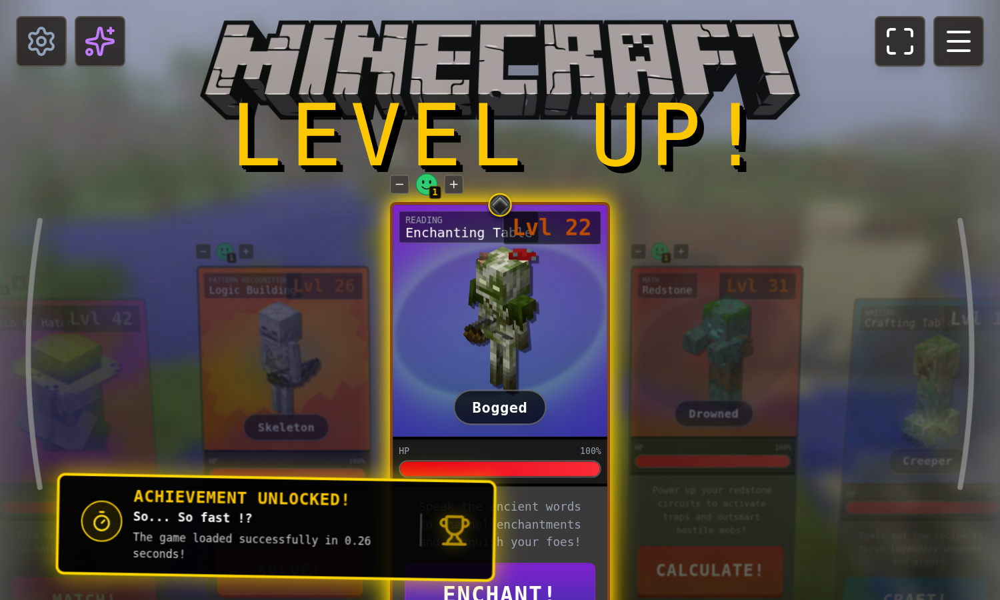
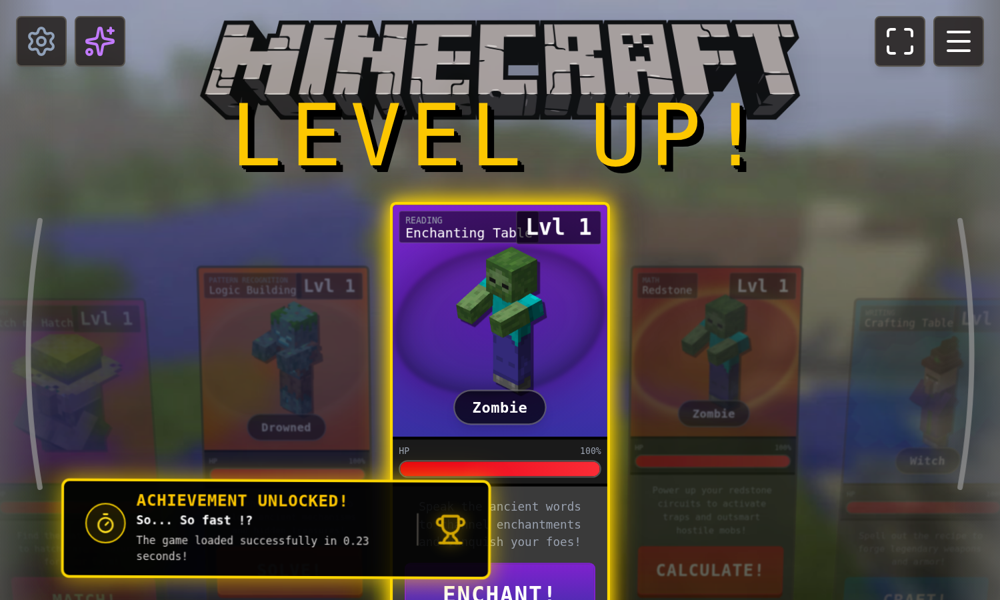
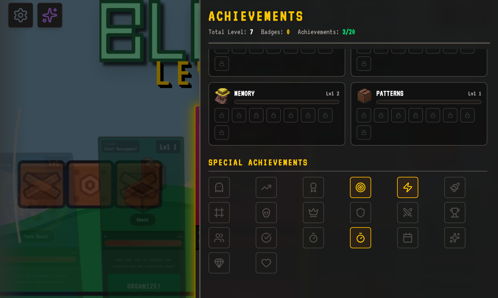
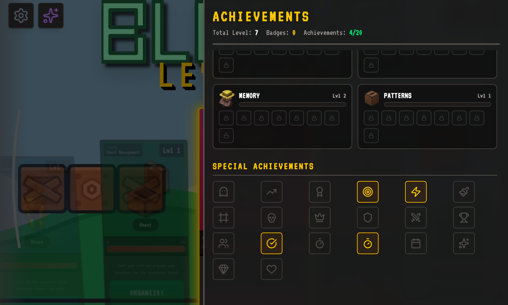
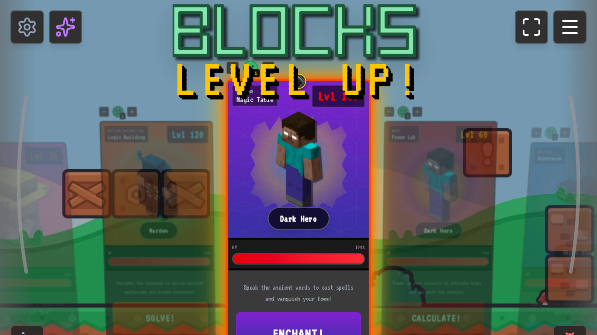
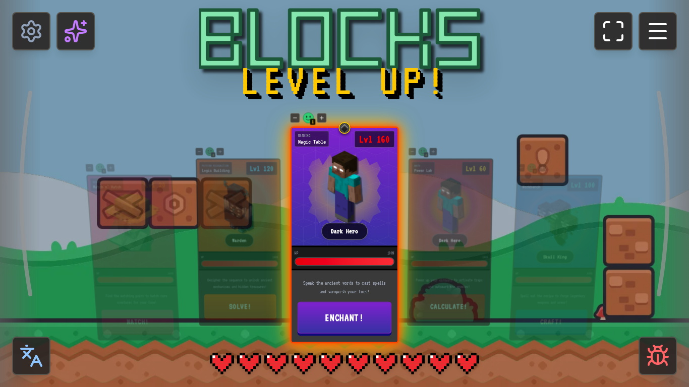
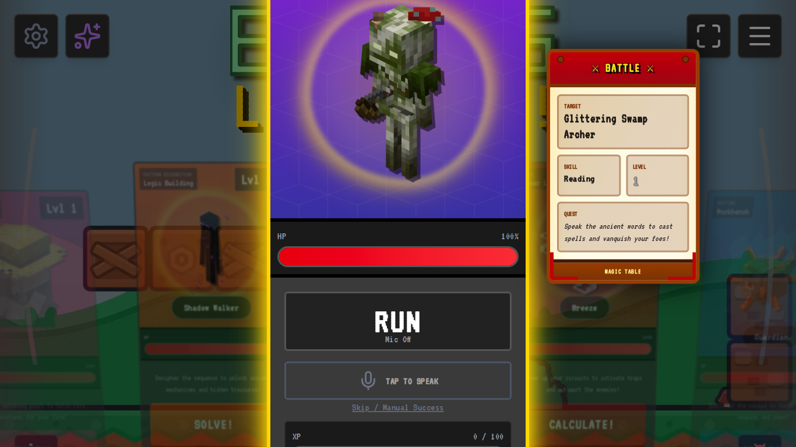
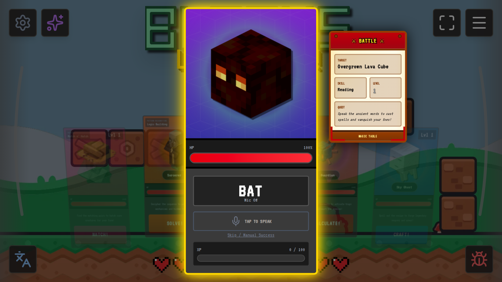

# Bug report

Bugs found in the code, with the proof, the cause, the fix and a before/after comparison. Same layout as the [performance report](../missions/performance.md). Screenshots are in [screens/](screens/).

## Summary

| Bug | Issue | Status | Outcome |
| --- | --- | --- | --- |
| Hardcoded localStorage keys | [#32](https://github.com/0x11semprez/codewash/issues/32) (DEBT-009) | Fixed (PR [#70](https://github.com/0x11semprez/codewash/pull/70)) | One file lists every key, and a migration moves old data |
| Corrupted save crashes the game | [#41](https://github.com/0x11semprez/codewash/issues/41) (DEBT-018) | Fixed (PR [#58](https://github.com/0x11semprez/codewash/pull/58), [#66](https://github.com/0x11semprez/codewash/pull/66)) | Not detailed here yet |
| Bottom of the screen cut on short windows | [#104](https://github.com/0x11semprez/codewash/issues/104) | Fixed, PR pending | The page, the cards and the battle card fit the window height |
| `perfectMemoryGames` never incremented | [#37](https://github.com/0x11semprez/codewash/issues/37) (DEBT-014) | Fixed, PR pending | A memory game won without a mismatch is counted, and "Perfectionist" can be unlocked |
| Missing theme images | [#53](https://github.com/0x11semprez/codewash/issues/53) (DEBT-021) | Fixed | Themes mission (#21), not merged yet |
| Docker build fails on `npm ci` | [#54](https://github.com/0x11semprez/codewash/issues/54) (DEBT-022) | Open | Not started |

Only the bugs with a section below are documented in detail. Every figure and screenshot says how it was produced.

---

## DEBT-009: hardcoded localStorage keys

### Problem

The game saves everything in the browser `localStorage`. The progress of each profile (levels, XP, theme, stats) is stored under a key such as `heroSkills_v23_p1` (`p1` is the profile number). The `v23` is a version number: when the format of the save changes, the key must change too.

Before the fix, key names were typed by hand in three files:

| File | Keys typed in the file |
| --- | --- |
| `src/hooks/useGameState.js` | `heroSkills_v23`, `currentProfile_v1`, `heroProfileNames_v1`, `heroParentStatus_v1`, `borderEffect_p`, `borderColor_p` |
| `src/utils/preloadStartupAssets.js` | `currentProfile_v1`, `heroSkills_v23` (a copy of the names above) |
| `src/components/PhantomEvent.jsx` | `phantomEvent_lastSpawn_v1` |

That is 21 occurrences. Two consequences:

1. **Silent data loss.** If a developer changes `v23` to `v24` in one place, the game looks for a key that does not exist, finds nothing and starts a new game. The old save stays in the browser, unused, and the player sees no error.
2. **Two files that must stay identical.** The loading screen reads the theme with its own copy of the key. If only one copy is updated, the loader preloads the wrong theme.

### Reproduction

The key rename is simulated in the browser: the save is moved from `heroSkills_v23_p1` to `heroSkills_v24_p1`, which is what the game sees after a rename in the code. Screenshots taken with the production build in headless Chromium, with a save built for the test.

**1. A player has a save: levels 22, 26, 31 and 42.**

**2. The key is renamed without a migration: every skill is back to level 1.**

The old save is still in `localStorage` under `heroSkills_v24_p1`, but nothing reads it. The game also wrote a new empty save under `heroSkills_v23_p1`.

### Fix

| Change | File |
| --- | --- |
| Every key name lives in one list (`STORAGE_KEYS`, `skillsKey(id)`, `borderEffectKey(id)`, `borderColorKey(id)`); the other files import it | `src/services/storageKeys.js` |
| `migrateKey(oldKey, newKey)` moves a saved value to a new key, never overwrites a value already saved under the new key, and does not crash if the storage is unavailable | `src/services/storageKeys.js` |
| `migrateStorage()` runs once at startup, before the game reads its saves. To rename a key in the future, add the old and new names there | `src/main.jsx` |
| The save of the original game (`heroSkills_v23`, no profile number) was read by three separate fallbacks. It is now moved to profile 1 by the migration, and the fallbacks are removed | `useGameState.js`, `preloadStartupAssets.js` |

**3. After the fix: the save under the original key is moved at startup and the levels are kept.**

In this run, the storage held only `heroSkills_v23` before the reload. After the reload it held only `heroSkills_v23_p1`, with the same levels.

### Before and after

| | Before | After |
| --- | --- | --- |
| Files that type a key name | 3 | 0 (only `storageKeys.js`) |
| Occurrences of a key name outside the list | 21 | 0 |
| Fallbacks for the original save | 3 | 0 (one migration) |
| Renaming a key | Silent loss of the save | Add one line to `migrateStorage()` |

### Tests

| Test (`src/__tests__/storageKeys.test.js`) | What it protects |
| --- | --- |
| Key names | The names saved on players computers do not change by accident |
| `migrateKey` | Moves the value, does nothing when empty, never overwrites, survives a blocked storage |
| `migrateStorage` | The original save moves to profile 1 |
| Rename scenario | Loses the save without a migration, keeps it with one |
| Source scan | No file except `storageKeys.js` types a key name |

### Limits

- The bug is a risk, not a visible failure today: nothing is lost until a key is renamed. The screenshot simulates the rename.
- `migrateStorage()` knows one migration only (the original save). A future rename needs its own line.
- The migration moves keys, not the shape of the saved data. A change in the structure of a save needs its own conversion.
- The screenshots use a headless browser and a save built for the test, not a real player save.

---

## DEBT-014: `perfectMemoryGames` never incremented

### Problem

The achievement "Perfectionist" (`src/constants/achievements.js`) says "Complete a memory game without any mismatches". It unlocks when `stats.perfectMemoryGames` is at least 1.

Nothing in the game ever raised that counter. Before the fix, the name appeared in two places only: the achievement that reads it, and the default value `0` in `src/utils/achievementUtils.js`. The memory game (`MemoryGame.jsx`) did not even count the mismatches of a game, and it reported a win with a bare `'WIN'`, so the battle code could not know whether the game was perfect.

Consequence: "Perfectionist" was impossible to unlock, for every player, however well they played.

### Reproduction

A perfect memory game is played in the game (all pairs found, no mismatch), then the menu is opened on the achievements. Production build of `main` before the fix, headless Chromium, new save, "Blocks" theme.

| | Before the fix | After the fix |
| --- | --- | --- |
| `stats.perfectMemoryGames` after the game | 0 | 1 |
| Achievements unlocked | 3 of 20 | 4 of 20 |

**Before the fix: the game was perfect, the counter stays at 0 and the Perfectionist icon (circle with a check mark) stays locked.**

**After the fix: the same game unlocks the Perfectionist achievement (4 of 20, the check mark icon is lit).**

### Fix

| Change | File |
| --- | --- |
| The memory game counts its mismatches (reset at the start of each game) and reports `onMathSubmit('WIN', { perfect })`, with `perfect` true when there was none | `src/components/skills/games/MemoryGame.jsx` |
| The result is passed on to the battle logic | `src/App.jsx` |
| When a memory game is won with `perfect: true`, `perfectMemoryGames` goes up by one. Other skills, and a win with no result, never change it | `src/hooks/useBattle.js` (`handleSuccessHit`) |

### Tests

| Test file | What it protects |
| --- | --- |
| `components/MemoryGame.test.jsx` | A game without a mismatch reports `perfect: true`; one mismatch makes it `perfect: false`; nothing is reported before every pair is found |
| `hooks/useBattle.perfectMemory.test.js` | The counter starts at 0, goes up on a perfect memory win, adds up over several games, ignores an imperfect win, a win with no result and other skills; "Perfectionist" unlocks |

The two test files failed before the fix (5 tests) and pass after.

### Limits

- The counter is raised when the game is won, so a game that is abandoned or lost is not counted, which is the intended rule.
- Players who already won perfect games before this fix are not credited: the game never recorded them, so there is nothing to recover.
- The screenshots use a headless browser that plays the game by itself, on a new save.

---

## Open work

| Item | Notes |
| --- | --- |
| [#37](https://github.com/0x11semprez/codewash/issues/37) `perfectMemoryGames` never incremented | The "Perfectionist" achievement cannot be unlocked |
| [#54](https://github.com/0x11semprez/codewash/issues/54) Docker build fails | `@testing-library/jest-dom` 8 wanted Vitest 5. Fixed: version 7.0.1 and a Docker build step in CI |

---

## Issue #104: bottom of the screen cut on short windows

### Problem

The skill cards have a fixed design size (300 x 600 px). On the main screen the centre card is drawn 1.1 times bigger, and during a battle it is zoomed 1.5 times (900 px high), whatever the window height. The page also grew with its content (`min-h-screen`), so the buttons placed at the bottom of the page (bug report, language, hearts) were pushed below the window.

#97 already made the logo, the title and the carousel area follow the window height, but not the cards, so they still overflowed.

### Reproduction

Production build in headless Chromium, new save, "Blocks" theme. "Cut" means a part is outside the window.

| Window | Before: page height | Before: centre card button | Before: battle card | After |
| --- | --- | --- | --- | --- |
| 1920 x 1080 | 1120 px (bug button at 1096) | visible | fits | everything fits |
| 1920 x 940 | 997 px | visible | fits | everything fits |
| 1536 x 730 | 812 px | cut (bottom at 790) | cut at the top (-85) | everything fits |
| 1366 x 768 | 846 px | cut (bottom at 812) | cut at the top (-66) | everything fits |
| 1280 x 720 | 804 px | cut (bottom at 785) | cut at the top (-90) | everything fits |

After the fix the page is exactly the window height in every case, and the bug report button, the language button, the centre card and the battle card are fully visible.

**Before the fix (1366 x 768): the card covers the title, its button is cut, and the bug report and language buttons are below the window.**

**After the fix (1366 x 768): the cards shrink to fit, every button is visible.**

**Before the fix (1366 x 768): the battle card goes out of the window at the top and at the bottom.**

**After the fix (1366 x 768): the battle card fits the window.**

### Fix

| Change | File |
| --- | --- |
| New hook `useViewportScale`: a card scale (the centre card uses 56% of the window height, never more than its design size) and a battle scale (the 1.5 zoom, reduced so the card fits with a 20 px margin), updated on resize | `src/hooks/useViewportScale.js` |
| The carousel height, the card positions and the card sizes use the card scale | `src/App.jsx` |
| The page is exactly the window height (`h-screen`), so the bottom buttons stay on screen | `src/App.jsx` |
| The title size also follows the window height (`min(10vw, 12vh)`) | `src/App.jsx` |
| The battle card and its info panel use the battle scale | `src/components/skills/SkillCard.jsx` |

### Tests

| Test (`hooks/useViewportScale.test.js`) | What it protects |
| --- | --- |
| Card scale | Full size on a tall window, smaller on shorter ones, never below 0.5 |
| Battle scale | 1.5 zoom when it fits, otherwise the card fits the window height |
| Hook | Gives the scales of the window and follows a resize |

The existing carousel and battle tests pass unchanged.

### Limits

- The cards are scaled as a whole, so on very short windows (below about 700 px) the text inside them gets small. The scale never goes below 0.5.
- Checked in headless Chromium at five window sizes, not on a real phone or in the Electron window.
