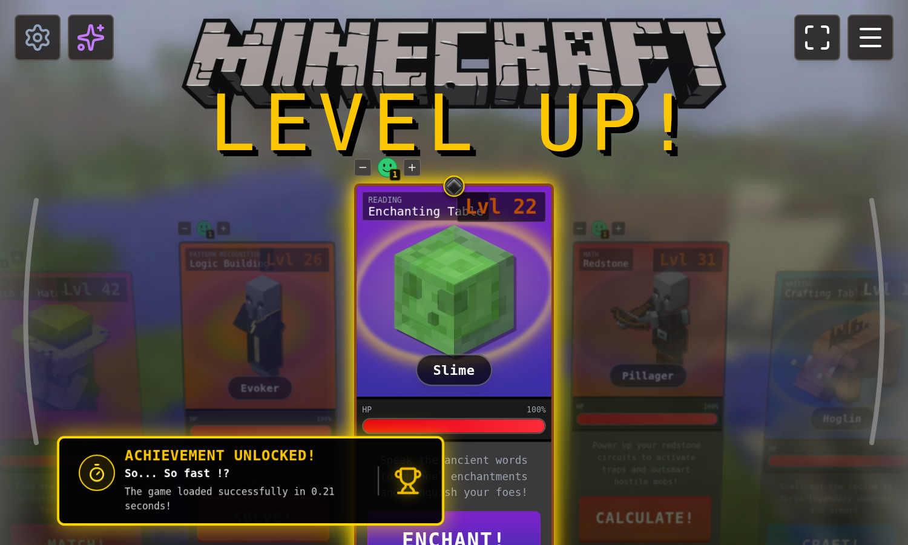

# Bug report

Bugs found in the code, with the proof, the cause, the fix and a before/after comparison. Same layout as the [performance report](../missions/performance.md). Screenshots are in [screens/](screens/).

## Summary

| Bug | Issue | Status | Outcome |
| --- | --- | --- | --- |
| Hardcoded localStorage keys | [#32](https://github.com/0x11semprez/codewash/issues/32) (DEBT-009) | Fixed, PR pending | One file lists every key, and a migration moves old data |
| Corrupted save crashes the game | [#41](https://github.com/0x11semprez/codewash/issues/41) (DEBT-018) | Fixed (PR [#58](https://github.com/0x11semprez/codewash/pull/58), [#66](https://github.com/0x11semprez/codewash/pull/66)) | Not detailed here yet |
| `perfectMemoryGames` never incremented | [#37](https://github.com/0x11semprez/codewash/issues/37) (DEBT-014) | Open | Not started |
| Missing theme images | [#53](https://github.com/0x11semprez/codewash/issues/53) (DEBT-021) | Fixed | Themes mission (#21), not merged yet |
| Docker build fails on `npm ci` | [#54](https://github.com/0x11semprez/codewash/issues/54) (DEBT-022) | Open | Not started |

Only the bugs with a section below are documented in detail. Every figure and screenshot says how it was produced.

---

## DEBT-009: hardcoded localStorage keys

### Problem

The game saves everything in the browser `localStorage`. The progress of each profile (levels, XP, theme, stats) is stored under a key such as `heroSkills_v23_p1` (`p1` is the profile number). The `v23` is a version number: when the format of the save changes, the key must change too.

Before the fix, key names were typed by hand in three files:

| File | Keys typed in the file |
| --- | --- |
| `src/hooks/useGameState.js` | `heroSkills_v23`, `currentProfile_v1`, `heroProfileNames_v1`, `heroParentStatus_v1`, `borderEffect_p`, `borderColor_p` |
| `src/utils/preloadStartupAssets.js` | `currentProfile_v1`, `heroSkills_v23` (a copy of the names above) |
| `src/components/PhantomEvent.jsx` | `phantomEvent_lastSpawn_v1` |

That is 21 occurrences. Two consequences:

1. **Silent data loss.** If a developer changes `v23` to `v24` in one place, the game looks for a key that does not exist, finds nothing and starts a new game. The old save stays in the browser, unused, and the player sees no error.
2. **Two files that must stay identical.** The loading screen reads the theme with its own copy of the key. If only one copy is updated, the loader preloads the wrong theme.

### Reproduction

The key rename is simulated in the browser: the save is moved from `heroSkills_v23_p1` to `heroSkills_v24_p1`, which is what the game sees after a rename in the code. Screenshots taken with the production build in headless Chromium, with a save built for the test.

**1. A player has a save: levels 22, 26, 31 and 42.**

**2. The key is renamed without a migration: every skill is back to level 1.**

The old save is still in `localStorage` under `heroSkills_v24_p1`, but nothing reads it. The game also wrote a new empty save under `heroSkills_v23_p1`.

### Fix

| Change | File |
| --- | --- |
| Every key name lives in one list (`STORAGE_KEYS`, `skillsKey(id)`, `borderEffectKey(id)`, `borderColorKey(id)`); the other files import it | `src/services/storageKeys.js` |
| `migrateKey(oldKey, newKey)` moves a saved value to a new key, never overwrites a value already saved under the new key, and does not crash if the storage is unavailable | `src/services/storageKeys.js` |
| `migrateStorage()` runs once at startup, before the game reads its saves. To rename a key in the future, add the old and new names there | `src/main.jsx` |
| The save of the original game (`heroSkills_v23`, no profile number) was read by three separate fallbacks. It is now moved to profile 1 by the migration, and the fallbacks are removed | `useGameState.js`, `preloadStartupAssets.js` |

**3. After the fix: the save under the original key is moved at startup and the levels are kept.**

In this run, the storage held only `heroSkills_v23` before the reload. After the reload it held only `heroSkills_v23_p1`, with the same levels.

### Before and after

| | Before | After |
| --- | --- | --- |
| Files that type a key name | 3 | 0 (only `storageKeys.js`) |
| Occurrences of a key name outside the list | 21 | 0 |
| Fallbacks for the original save | 3 | 0 (one migration) |
| Renaming a key | Silent loss of the save | Add one line to `migrateStorage()` |

### Tests

| Test (`src/__tests__/storageKeys.test.js`) | What it protects |
| --- | --- |
| Key names | The names saved on players computers do not change by accident |
| `migrateKey` | Moves the value, does nothing when empty, never overwrites, survives a blocked storage |
| `migrateStorage` | The original save moves to profile 1 |
| Rename scenario | Loses the save without a migration, keeps it with one |
| Source scan | No file except `storageKeys.js` types a key name |

### Limits

- The bug is a risk, not a visible failure today: nothing is lost until a key is renamed. The screenshot simulates the rename.
- `migrateStorage()` knows one migration only (the original save). A future rename needs its own line.
- The migration moves keys, not the shape of the saved data. A change in the structure of a save needs its own conversion.
- The screenshots use a headless browser and a save built for the test, not a real player save.

---

## Open work

| Item | Notes |
| --- | --- |
| [#37](https://github.com/0x11semprez/codewash/issues/37) `perfectMemoryGames` never incremented | The "Perfectionist" achievement cannot be unlocked |
| [#54](https://github.com/0x11semprez/codewash/issues/54) Docker build fails | The `Dockerfile` runs `npm ci` without `--legacy-peer-deps` |
