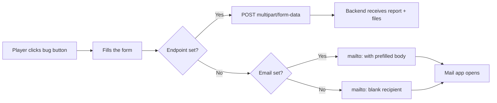
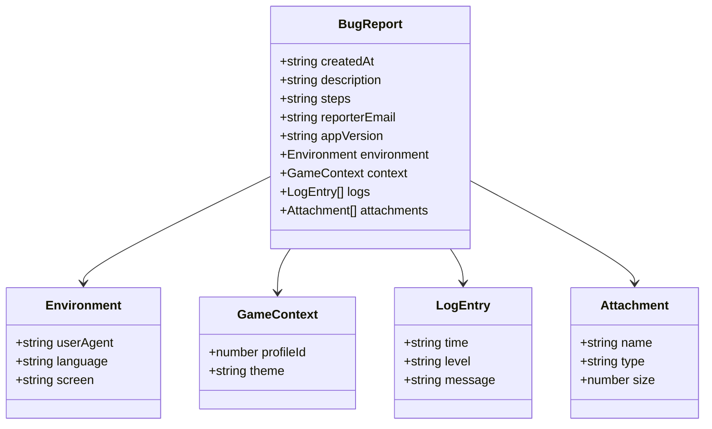
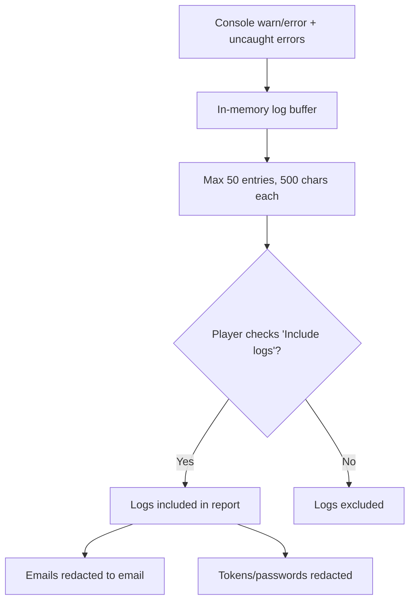

# Bug reporting

> Mission issue: [#19](https://github.com/0x11semprez/codewash/issues/19) | Implementation: [#77](https://github.com/0x11semprez/codewash/pull/77) | Design: [ADR-009](../adr/009-bug-reporting.md)

Players can report bugs from inside the game without leaving it. A floating button in the bottom right opens a form where they describe the problem, attach files and optionally include recent error logs. The report reaches the team through whichever channel was configured at build time.

## How the report travels



## Configure the contact

Copy `.env.example` to `.env.local` and set one or both values:

```
VITE_BUG_REPORT_ENDPOINT=https://example.com/bug-reports
VITE_BUG_REPORT_EMAIL=support@example.com
```

Vite reads these at build time. Restart `npm run dev` or rebuild after a change.

| Endpoint set | Email set | What happens on Send |
| --- | --- | --- |
| yes | any | Report posted to endpoint, with files |
| no | yes | Mail app opens with prefilled email |
| no | no | Mail app opens, player types recipient |

Invalid URLs or emails are silently ignored.

## What gets sent



The HTTP endpoint receives a `POST` with `multipart/form-data`: a `report` part (JSON) and an `attachments` part per file. Any 2xx counts as success. Timeout is 15 seconds. CORS must allow the game's origin if on another domain.

## Attachments

Up to 3 files, 5 MB each. Accepted: images, `.txt`, `.log`, `.json`.

A `mailto:` link cannot carry files. When using email, the form tells the player to attach files by hand. A "Save as JSON" button exports the full report as a downloadable file. Email body is capped at 1800 characters for mail-app compatibility.

## Privacy safeguards



- Nothing leaves the game until the player presses Send
- Logs live in memory only, lost when the game closes
- Only `console.warn`, `console.error`, uncaught errors and unhandled rejections are kept
- Email addresses in logs become `[email]`, sensitive tokens become `[redacted]`
- Player previews logs before sending and can opt out
- Reporter email is optional, used only to reply
- Save data, profile names and achievements are never sent

## Electron

In the portable app, the `mailto:` link goes through `shell.openExternal` to the system mail client.

## Tests

```
npx vitest run --dir src bugReport BugReportModal
```

| Test file | Coverage |
| --- | --- |
| `src/__tests__/bugReport.test.js` | Config, file checks, log buffer, report builder, both transports |
| `src/__tests__/components/BugReportModal.test.jsx` | Form validation, send flow, error state, file removal, log checkbox, JSON download |

**Manual check without a server:** leave both env values empty, `npm run dev`, click bug button, send. Mail app opens with report in body.

**Manual check with a server:** start a local server on port 8787 with `Access-Control-Allow-Origin: *`, set `VITE_BUG_REPORT_ENDPOINT=http://localhost:8787`, restart dev, send with a screenshot. Server receives `report` + `attachments` parts. Stop server, send again: form shows "Sending failed."
