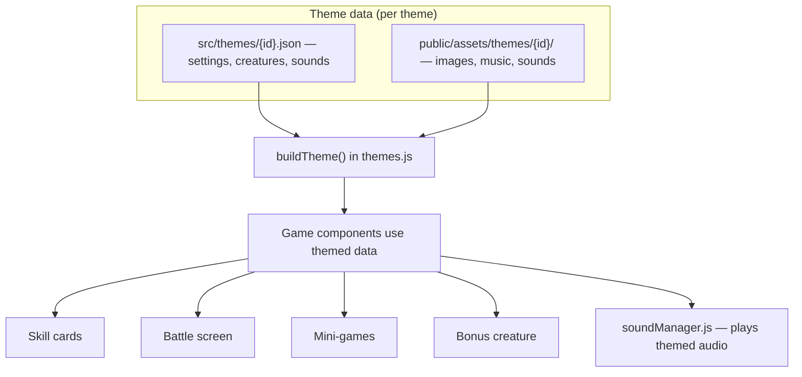

# Themes

> Mission issue: [#21](https://github.com/0x11semprez/codewash/issues/21) | Implementation: [#79](https://github.com/0x11semprez/codewash/pull/79) | Missing images: [#53](https://github.com/0x11semprez/codewash/issues/53) (DEBT-021) | Design: [ADR-013](../adr/013-themes-as-data-folders.md)

A theme changes everything the player sees and hears: backgrounds, logos, card backs, skill card names, enemies, mini-game visuals, the flying bonus creature, music and sound effects. Each profile keeps its own theme.

Six themes ship with the game: **Blocks** (default), **Idols**, **Monsters**, **Spy**, **Space** and **Ocean**.

## How themes work



Each theme has two parts:

1. **Settings file:** `src/themes/<id>.json` (names, creatures, sounds, translations)
2. **Asset folder:** `public/assets/themes/<id>/` (images, music, sound files)

The game reads every JSON file in `src/themes/` on startup. No list to maintain. File name = theme id, so `ocean.json` is the `ocean` theme.

A theme can omit any optional part. The game uses defaults for missing sections. Defaults come from the original Blocks theme.

## What each theme controls

A theme can replace any of these parts. Anything left out falls back to the Blocks default.

| Part | What changes | Required |
| --- | --- | --- |
| Background, logo, card back | The whole screen appearance | Yes |
| Skill card names, titles, descriptions | Text on each of the six cards | Optional |
| Skill icons | Small picture on each card | Optional |
| Enemies, minibosses, bosses | Battle screen opponents | Optional (min 2/1/1) |
| Friends | Memory card fronts | Optional (min 10) |
| Pattern pieces | The eight pieces of the pattern game | Optional (min 8) |
| Containers | Cleaning game buckets | Optional (min 3) |
| Bonus creature | Flying creature event | Optional |
| Music playlist | Background tracks | Optional |
| 12 sound effects | click, hit, fail, death, levelUp, etc. | Optional (per key) |
| Translations | Per-language overrides for all text | Optional |

## Audit: what we fixed

Before this work, many parts of the game ignored the active theme. We checked every screen and mini-game against the four original themes.

We found 16 problems, all fixed in [#79](https://github.com/0x11semprez/codewash/pull/79). Tests now guard against regression.

| Area | Problem | Fix |
| --- | --- | --- |
| Missing files | `spy_logo.png`, `spy_memorycard.jpg`, `kpop_memorycard.jpg`, `pokemon_memorycard.jpg` did not exist ([DEBT-021](../DEBT.md#debt-021-missing-theme-assets-p2-open)) | Every theme now has logo + card back. Test fails on missing files |
| Spy background | Used `minecraft.png` | Uses its own picture |
| Skill cards | Same titles/texts in every theme ("Enchanting Table", "Redstone"...) | Each theme sets its own titles and descriptions |
| Skill icons | Minecraft pictures in every theme | Each theme can set its own icons |
| Enemies/bosses | Hardcoded Minecraft lists, unknown names fell back to "Zombie" | Every name and picture comes from the theme |
| Memory game | Cards always showed Minecraft animals | Cards show the theme's "friends" |
| Pattern game | Pieces were always the eight axolotls | Pieces come from the theme |
| Spelling game | Words and pictures always Minecraft | Built from the theme's own creatures and items |
| Cleaning game | Containers always Minecraft chests | Containers come from the theme |
| Bonus creature | Always the Minecraft Phantom | Each theme sets its own picture |
| Music | One playlist for all themes | Each theme can list its own music |
| Sound effects | One set for all; `match_success.wav` and `mismatch.wav` did not exist | Each theme can replace any sound. Match/mismatch now point to real files |
| Logo size | Different shapes caused layout shifts | Fixed 4:1 box, all logos 1200x300 |
| Background size | Inconsistent sizes | All backgrounds 1280x720 |
| Creature size | Varying sizes, no consistent display | Fixed 200x200 box with `object-fit: contain`, sprites 256x256 |
| Brand names | Used Minecraft, Pokemon, K-Pop Demon Hunters names and logos | Renamed to Blocks, Monsters, Idols with CC0 art |

## Saved games

Three themes were renamed (`minecraft` to `blocks`, `pokemon` to `monsters`, `kpop` to `idols`), and some default creatures got new names. `migrateStorage()` in `src/services/storageKeys.js` runs once at startup and updates the theme ids and creature names in every profile's save, so achievement progress is preserved. `resolveThemeId` also accepts old ids as fallback, so saves that were not migrated still load the right theme. The full rename list is in [ADR-013](../adr/013-themes-as-data-folders.md).

## How to add a theme

No code needed. You need a picture editor, a text editor, and your images and sounds. Example uses a theme called "jungle."

### 1. Choose an id

Short lowercase name, no spaces. Dashes between words if needed: `jungle`.

### 2. Create the folder

```
public/assets/themes/jungle/
```

### 3. Add the three required pictures

| File | What it is | Size |
| --- | --- | --- |
| `background.webp` | Picture behind the game | 1280 x 720 |
| `logo.webp` | Title at the top, transparent background | 1200 x 300 |
| `card-back.webp` | Back of memory cards | 400 x 600 |

PNG and JPG work too. Other sizes fit but may look blurry.

### 4. Create the settings file

Create `src/themes/jungle.json`:

```json
{
    "name": "Jungle",
    "order": 7,
    "background": "background.webp",
    "logo": "logo.webp",
    "cardBack": "card-back.webp",
    "skills": {
        "reading": { "name": "Reading" },
        "math": { "name": "Math" },
        "writing": { "name": "Spelling" },
        "cleaning": { "name": "Tidying" },
        "memory": { "name": "Memory" },
        "patterns": { "name": "Patterns" }
    }
}
```

Each skill can also have `"title"` (big name on card), `"action"` (button text) and `"description"`. See `src/themes/ocean.json` for a full example.

Your theme now works with default creatures, music and sounds. Steps 5 and 6 replace them.

### 5. Add creatures and items (optional)

Create `sprites/` in your theme folder. Each picture must be a 256x256 square with a transparent background. Then add groups to the JSON file. Each group is a list of `"Name": "file"`. The name appears in-game and is a spelling word, so use letters and spaces only.

The cleaning skill also needs `"milestoneContainer"` (every 5 levels) and `"bossContainer"` (every 20 levels), both names from your `containers` list.

Optional extras: `"bonusCreature"` (flying creature picture) and `"skillIcons"` (one per skill).

### 6. Add music and sounds (optional)

Create `music/` and `sounds/` in your theme folder.

`"music"`: list of files, e.g. `["music/track-1.mp3", "music/track-2.mp3"]`. Use MP3 under 5 MB.

`"sounds"`: map of `"key": "file"`. Keys you omit keep the default sound.

| Key | When it plays |
| --- | --- |
| `click` | Buttons |
| `cardLeft`, `cardRight` | Moving between skill cards |
| `hit` | Right answer |
| `fail` | Wrong answer |
| `death` | Player loses all hearts |
| `levelUp` | New level |
| `notification` | New rank or achievement |
| `match` | Pair found in memory, round won in pattern |
| `mismatch` | Wrong pair or piece |
| `enemyHurt` | Enemy takes a hit |
| `enemyDefeat` | Enemy defeated |

### 7. Translate the theme (optional)

Add a `"translations"` block at the end of the JSON:

```json
"translations": {
    "fr": {
        "name": "Jungle",
        "skills": {
            "reading": { "name": "Lecture", "title": "...", "action": "Lire !", "description": "..." }
        },
        "patternPieces": { "Red": "Rouge" }
    }
}
```

Every part is optional. Missing texts show in English. Skills the theme does not set at all come from game dictionaries (`src/i18n/locales/`), always translated. Creature names stay as-is for the spelling game.

### 8. Add the license

Only use pictures and sounds you have the right to use. Put license text in a file starting with `LICENSE`. Document each file's source in the Credits section.

### 9. Check the theme

```sh
npm test
```

`src/__tests__/themeFiles.test.js` checks every theme and names the exact problem:

```
logo: public/assets/themes/jungle/logo2.webp is missing
enemies > "Drone 2": use letters and spaces only
```

It verifies: JSON and folder exist, every referenced file exists and is the right type/size, images have the right dimensions, skill and sound keys are valid, translations use known languages, each group has enough pictures, license file is present.

Then start `npm run dev`, open Cosmetics panel, pick your theme.

## Picture sizes

| Picture | Size | Shape | Used in |
| --- | --- | --- | --- |
| Background | 1280 x 720 | 16:9 | Full screen, cropped to fill |
| Logo | 1200 x 300 | 4:1, transparent | Fixed 4:1 box above "Level Up!" |
| Card back | 400 x 600 | 2:3 | Memory cards, cropped to fill |
| Sprites and icons | 256 x 256 | Square, transparent | Fixed boxes, never stretched |

## What stays the same across themes

- Rank badges, card border effects, difficulty icons
- Pattern game notes (each theme maps its pieces to the same eight notes)
- Reading words and math problems
- "Level Up!" title, hearts, achievement names

## Known limits

- **Blocks keeps original creature art.** Only names changed. Many look like Minecraft art and their origin is not documented. The team chose to keep them and will explain this at the defense
- **Default sounds from original project.** Per-enemy sounds in `public/assets/sounds/mob/` are still the fallback, though no theme uses them now. Old music files (named after Minecraft soundtrack) were deleted; default music is now Blocks playlist
- **Internal "phantom" name.** The bonus creature event and achievement keep the name "phantom" in code and saves so old save progress is preserved

## Credits

All theme folder files are public domain (CC0 1.0). License text of each Kenney pack is in the theme folder as `LICENSE-kenney-<pack>.txt`. Music and OpenGameArt sounds have `LICENSE-music*.txt` recording title, author, page and license.

We resized, cropped and converted pictures to WebP, re-encoded music to MP3 at 96 kbps. Logos drawn with Kenney Future font from Space Shooter Redux. Card backs and some backgrounds drawn with ImageMagick. Monsters bosses and Idols demons built from Kenney Monster Builder parts. Idols friends and pattern pieces are Kenney Shape Characters. Some Spy robots are Toon Characters with shifted colors.

| Theme | Files | Pack or title | Author | Source | License |
| --- | --- | --- | --- | --- | --- |
| Blocks | Background, card back | New Platformer Pack | Kenney (kenney.nl) | https://opengameart.org/content/new-platformer-pack | CC0 |
| Blocks | `hit`, `death`, `level-up`, `match`, `enemy-hurt`, `enemy-defeat` sounds | New Platformer Pack | Kenney (kenney.nl) | https://opengameart.org/content/new-platformer-pack | CC0 |
| Blocks | `click`, `card-left`, `card-right`, `fail`, `notification`, `mismatch` sounds | Interface Sounds | Kenney (kenney.nl) | https://opengameart.org/content/interface-sounds | CC0 |
| Blocks | `music/flowerbed-fields.mp3` | Flowerbed Fields [Loop] | Zane Little Music | https://opengameart.org/content/flowerbed-fields-loop | CC0 |
| Blocks | `music/town-theme.mp3` | Town Theme RPG | cynicmusic | https://opengameart.org/content/town-theme-rpg | CC0 |
| Monsters | Enemies, minibosses, items, blocks, pieces, icons, background | New Platformer Pack | Kenney (kenney.nl) | https://opengameart.org/content/new-platformer-pack | CC0 |
| Monsters | Bosses (built from parts) | Monster Builder Pack | Kenney (kenney.nl) | https://opengameart.org/content/monster-builder-pack | CC0 |
| Monsters | Friends (animals) | Animal Pack Redux | Kenney (kenney.nl) | https://opengameart.org/content/animal-pack-redux | CC0 |
| Monsters | `click`, `hit`, `death`, `level-up`, `notification`, `match`, `enemy-hurt`, `enemy-defeat` sounds | New Platformer Pack | Kenney (kenney.nl) | https://opengameart.org/content/new-platformer-pack | CC0 |
| Monsters | `card-left`, `card-right`, `fail`, `mismatch` sounds | Interface Sounds | Kenney (kenney.nl) | https://opengameart.org/content/interface-sounds | CC0 |
| Monsters | `music/happy-adventure.mp3` | Happy Adventure (Loop) | TinyWorlds | https://opengameart.org/content/happy-adventure-loop | CC0 |
| Monsters | `music/green-hills.mp3` | Green Hills | Igor Gundarev | https://opengameart.org/content/green-hills | CC0 |
| Idols | Enemies, minibosses, bosses (built from parts) | Monster Builder Pack | Kenney (kenney.nl) | https://opengameart.org/content/monster-builder-pack | CC0 |
| Idols | Friends, pieces, background idols | Shape Characters | Kenney (kenney.nl) | https://opengameart.org/content/shape-characters | CC0 |
| Idols | Microphone, headphones, disc, music player, bags, suitcases, pencil icon | Generic Items | Kenney (kenney.nl) | https://opengameart.org/content/generic-items | CC0 |
| Idols | Crown, medal | Board Game Icons | Kenney (kenney.nl) | https://opengameart.org/content/board-game-icons | CC0 |
| Idols | Star, heart | New Platformer Pack | Kenney (kenney.nl) | https://opengameart.org/content/new-platformer-pack | CC0 |
| Idols | All sounds | Interface Sounds | Kenney (kenney.nl) | https://opengameart.org/content/interface-sounds | CC0 |
| Idols | `music/funky-house.mp3` | Funky House | Of Far Different Nature | https://opengameart.org/content/funky-house | CC0 |
| Idols | `music/party-sector.mp3` | Party Sector | Joth | https://opengameart.org/content/party-sector | CC0 |
| Spy | Enemies, minibosses, bosses, bonus robot | Toon Characters 1 | Kenney (kenney.nl) | https://opengameart.org/content/toon-characters-1 | CC0 |
| Spy | Gadgets, items, bags, icons | Generic Items | Kenney (kenney.nl) | https://opengameart.org/content/generic-items | CC0 |
| Spy | Pattern pieces (card suits and chess pieces), card back lock | Board Game Icons | Kenney (kenney.nl) | https://opengameart.org/content/board-game-icons | CC0 |
| Spy | `click`, `card-left`, `card-right`, `fail`, `level-up`, `notification`, `mismatch` sounds | Interface Sounds | Kenney (kenney.nl) | https://opengameart.org/content/interface-sounds | CC0 |
| Spy | `hit`, `death`, `match`, `enemy-hurt`, `enemy-defeat` sounds | Sci-Fi Sounds | Kenney (kenney.nl) | https://opengameart.org/content/sci-fi-sounds | CC0 |
| Spy | `music/spy-loop.mp3` | Spy Loop | wipics | https://opengameart.org/content/spy-loop | CC0 |
| Spy | `music/covert-action.mp3` | Covert Action | congusbongus | https://opengameart.org/content/covert-action | CC0 |
| All | Logo font (Kenney Future) | Space Shooter Redux | Kenney (kenney.nl) | https://opengameart.org/content/space-shooter-redux | CC0 |
| Space | Enemies, bosses, ships, items, pods, pieces, background, logo font, `fail`, `death` and `level-up` sounds | Space Shooter Redux | Kenney (kenney.nl) | https://opengameart.org/content/space-shooter-redux | CC0 |
| Space | `hit`, `match`, `enemy-hurt`, `enemy-defeat` sounds | Sci-Fi Sounds | Kenney (kenney.nl) | https://opengameart.org/content/sci-fi-sounds | CC0 |
| Space | `click`, `card-left`, `card-right`, `notification`, `mismatch` sounds | Interface Sounds | Kenney (kenney.nl) | https://opengameart.org/content/interface-sounds | CC0 |
| Space | `music/magic-space.mp3` | Magic Space | CodeManu | https://opengameart.org/content/magic-space | CC0 |
| Space | `music/drifting.mp3` | Drifting | Some Weirdo | https://opengameart.org/content/drifting-0 | CC0 |
| Ocean | Fish, seaweed, bubbles, rocks, background | Fish Pack 2.0 | Kenney (kenney.nl) | https://opengameart.org/content/fish-pack-0 | CC0 |
| Ocean | Ships, crew, cannons, boats, crate, sail | Pirate Pack | Kenney (kenney.nl) | https://opengameart.org/content/pirate-pack-190 | CC0 |
| Ocean | `click`, `card-left`, `card-right`, `fail`, `level-up`, `notification`, `mismatch` sounds | Interface Sounds | Kenney (kenney.nl) | https://opengameart.org/content/interface-sounds | CC0 |
| Ocean | `hit`, `death`, `match`, `enemy-hurt`, `enemy-defeat` sounds | 40 CC0 water / splash / slime SFX | rubberduck | https://opengameart.org/content/40-cc0-water-splash-slime-sfx | CC0 |
| Ocean | `music/deep-sea.mp3` | Deep Sea | Umplix | https://opengameart.org/content/deep-sea | CC0 |
| Ocean | `music/underwater-village.mp3` | Binary Underwater Village (loop) | Pro Sensory | https://opengameart.org/content/binary-underwater-village-loop | CC0 |
