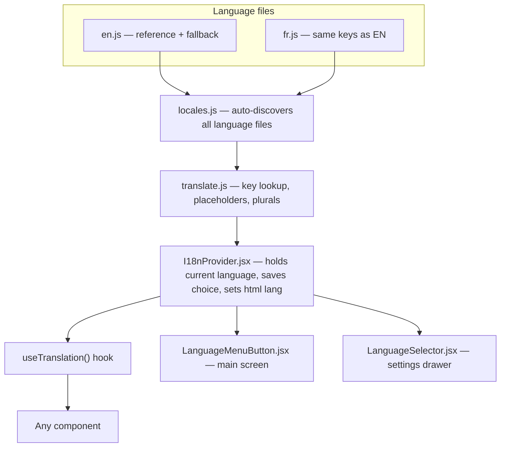
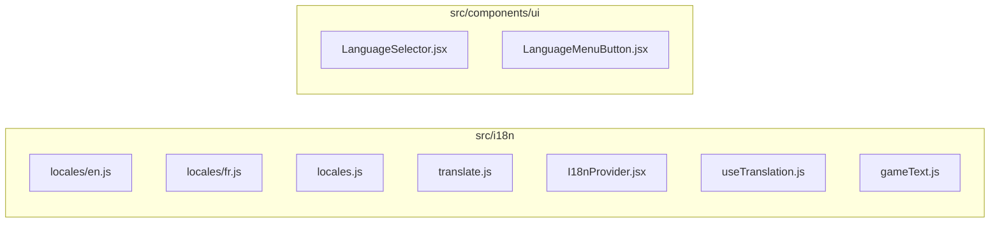
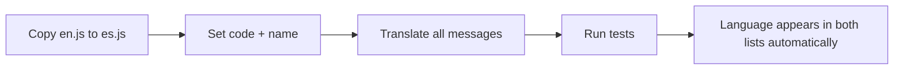

# Translation

> Mission issue: [#20](https://github.com/0x11semprez/codewash/issues/20) | Implementation: [#78](https://github.com/0x11semprez/codewash/pull/78) | Menu button: [#87](https://github.com/0x11semprez/codewash/pull/87) | Design: [ADR-012](../adr/012-translation.md)

The game ships in English and French. All text switches at once when the player picks a language, and the choice survives a page reload.

## Architecture



## Switching languages

Two ways, both use the same list:

1. **Main screen:** language button in the bottom left corner (translation icon). Opens a short list, pick one, list closes.
2. **Settings drawer:** gear button (top left), "Language" section shows current language. Click to open list.

The main screen button is fully keyboard-accessible: Tab/Enter to pick, Escape to close. Screen readers hear "Change language (current: English)" and the open/closed state.

On first visit, the game matches the browser language if supported, otherwise defaults to English. The choice is saved in `localStorage`.

## Where the code lives



| File | Role |
| --- | --- |
| `src/i18n/locales/en.js` | English text, reference and fallback |
| `src/i18n/locales/fr.js` | French text, same keys as English |
| `src/i18n/locales.js` | Auto-discovers language files, reads saved/browser language |
| `src/i18n/translate.js` | Pure functions: key lookup, placeholders, plurals, fallback |
| `src/i18n/I18nProvider.jsx` | Holds current language, saves it, sets `<html lang>` |
| `src/i18n/useTranslation.js` | Hook that components use |
| `src/i18n/gameText.js` | Helpers for achievement, skill and mob text |
| `src/components/ui/LanguageSelector.jsx` | Language list in settings drawer |
| `src/components/ui/LanguageMenuButton.jsx` | Language button on main screen |

## Adding a language



1. Copy `src/i18n/locales/en.js` to a new file, e.g. `es.js`
2. Set `code` to `'es'` and `name` to `'Espanol'`
3. Translate every value in `messages`. Do not rename or remove keys
4. Keep every placeholder like `{{level}}` exactly as-is (you can move it in the sentence)
5. Run the tests (see below)

No other file needs to change. The new language appears in both lists automatically. Missing keys fall back to English with a dev warning. Tests fail until the file is complete.

## Adding a string

1. Pick a key in the right group, e.g. `settings.musicVolume`
2. Add it to `en.js` and every other language file
3. Use the hook in a function component:

```jsx
import { useTranslation } from '../../i18n/useTranslation';

const MyPanel = ({ level }) => {
    const { t } = useTranslation();
    return <h2>{t('menu.level', { level })}</h2>;
};
```

4. Or the context in a class component:

```jsx
import { I18nContext } from '../../i18n/I18nContext';

class MyBoundary extends React.Component {
    static contextType = I18nContext;
    render() {
        return <p>{this.context.t('errors.title')}</p>;
    }
}
```

### Placeholders

Write `{{name}}` in the text, pass `{ name: value }` to `t`:

```js
t('loot.levelReached', { level: 20 }); // "LEVEL 20 REACHED!"
```

### Plurals

Add `key_one` and `key_other` keys, pass a number as `count`:

```js
// en.js
failed_one: '{{count}} CRITICAL IMAGE COULD NOT LOAD.',
failed_other: '{{count}} CRITICAL IMAGES COULD NOT LOAD.',

// component
t('loading.failed', { count: failedCount });
```

The form is chosen with `Intl.PluralRules`, so each language follows its own rules. In French, 0 uses the `_one` form.

### Game data

Achievements, skills, badges, border effects and auras keep their ids in constants. Their text lives in dictionaries under the same id:

- `achievements.<id>.name`, `achievements.<id>.description`, `achievements.<id>.tiers.<index>`
- `skills.<id>.name`, `fantasyName`, `actionName`, `taskDescription`
- `badges.<title>`, `borders.<id>.name`, `borders.<id>.description`, `auras.<aura>`

When you add an achievement, skill, badge or aura, add its text to the dictionaries too. A test checks this.

## What stays untranslated

- **Creature names** — saves and achievements use them as ids, the spelling game uses them as words
- **Theme names and skill texts** — translated per theme in each theme's JSON file (`"translations"` block). See [themes guide](themes.md#7-translate-the-theme-optional). Falls back to theme text, then dictionary text
- **Loading screen wordmark**
- **Network error details** — come from the browser, stay in its language
- **Reading words, writing words, math problems** — game data, see ADR-012

## Tests

```sh
npx vitest run src/__tests__/i18n
```

| Test file | Coverage |
| --- | --- |
| `translate.test.js` | Key lookup, placeholders, plurals, English fallback, missing keys, browser language |
| `locales.test.js` | Every language has same keys and placeholders as English, English covers all game data ids |
| `I18nProvider.test.jsx` | Saved choice, browser default, `<html lang>`, selector switching text |
| `LanguageMenuButton.test.jsx` | Main screen button, list, Escape, click outside, focus |
| `translatedScreens.test.jsx` | Main screens rendered in French |

Run the full suite before a merge:

```sh
npx vitest run --dir src
npm run lint
npm run format:check
```

### Manual checklist

- [ ] Click language button (bottom left), switch to Francais. Skill cards and title change, list closes
- [ ] Open list with keyboard (Tab to button, Enter), press Escape. List closes, button keeps focus
- [ ] Open settings drawer, switch back to English. Drawer, skill cards and title all change
- [ ] Reload page. Game stays in French
- [ ] Open achievements drawer. Names, descriptions and tiers are in French
- [ ] Open "Effacer la progression". Modal asks to type EFFACER
- [ ] Clear site data, set browser to French. Game starts in French
- [ ] Check that `<html lang>` follows selected language in DevTools
