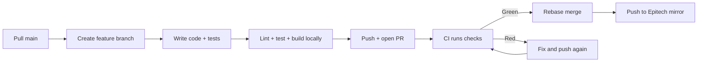
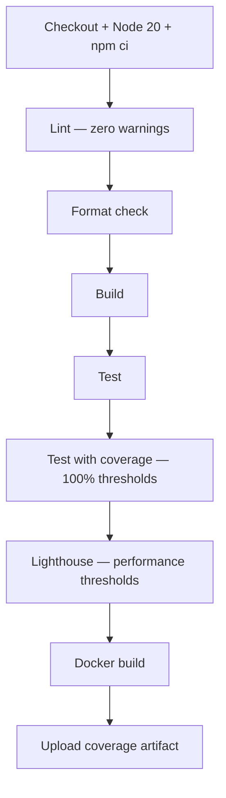

# Development Playbook

A step-by-step guide for every common task on Level Up RPG. Follow these instructions to keep the codebase clean and CI green.

Last updated: 2026-11-28.

## Development workflow



## CI pipeline



## Setup

```bash
git clone https://github.com/0x11semprez/codewash.git
cd codewash
npm install
npm run dev          # http://localhost:5173
```

Node.js 20+ and npm 10+ required. The Epitech mirror is `EpitechBachelorPromo2028/B-ING-300-PAR-3-1-codewash-21`.

## Daily workflow

1. **Pull main** before starting work: `git pull origin main`.
2. **Create a feature branch**: `git checkout -b <type>/<short-name>` where type is `feat`, `fix`, `perf`, `test`, `docs` or `refactor`.
3. **Write code and tests together.** Coverage is 100% — untested code fails CI.
4. **Run locally before pushing:**
   ```bash
   npm run lint           # zero warnings
   npm test               # all suites green
   npm run build          # no build errors
   ```
5. **Push and open a PR** against `main`. CI runs lint, build, test, coverage and Docker build.
6. **Never merge on red.** Branch protection enforces a green `build-and-test` check.
7. **Rebase merge** to keep a linear history. Delete the branch after merge.

## Adding a test

Tests live in `src/__tests__/`. Follow existing patterns:

- Component tests: `@testing-library/react` with `render`, `screen`, `fireEvent`.
- Hook tests: `renderHook` with a wrapper.
- Mock `soundManager` and `useTranslation` as needed. See `Drawers.test.jsx` for examples.
- Mock `IntersectionObserver` with `installFakeIntersectionObserver()` from `helpers/`.

Run a single file: `npx vitest run src/__tests__/components/MyFile.test.jsx`.

## Adding a theme

See [docs/features/themes.md](../features/themes.md) for the full guide with sizes and licenses.

Short version:
1. Create `public/assets/themes/<id>/` with all required images.
2. Create `src/themes/<id>.json` following an existing theme JSON.
3. The game auto-discovers theme JSON files. No code change needed.
4. Run `npx vitest run src/__tests__/themeFiles.test.js` to validate.

## Optimizing assets

Animated WebP files should stay under 500 KB. To re-encode:

```bash
magick -coalesce input.webp /tmp/frames/frame_%04d.png
# Keep every Nth frame
magick -delay 8 -loop 0 /tmp/frames/frame_*.png -quality 60 output.webp
```

Static images: 256x256 for sprites, 1280x720 for backgrounds, 1200x300 for logos, 400x600 for card backs.

## Measuring metrics

```bash
npm run metrics              # current state
npm run metrics -- --ref HEAD~5   # compare with 5 commits ago
```

Output: files, lines, complexity, duplication, dead files, coverage, lint warnings. Results are in `docs/DEBT.md` section 8.

## Updating documentation

| What changed | What to update |
| --- | --- |
| New feature or fix | `CHANGELOG.md` under Unreleased |
| Architecture change | `docs/ARCHITECTURE.md` |
| New debt or resolved debt | `docs/DEBT.md` |
| Subject requirement addressed | `docs/SUBJECT_MAP.md` |
| Operational concern | `docs/handover/RUNBOOK.md` |

## Pushing to Epitech mirror

```bash
git remote add epitech https://github.com/EpitechBachelorPromo2028/B-ING-300-PAR-3-1-codewash-21.git
git push epitech main
```

Only push `main`. Feature branches stay on `origin`.

## Docker

```bash
docker build -t codewash .
docker run --rm -p 8080:80 codewash   # http://localhost:8080
```

CI builds the image on every PR. A broken Dockerfile fails checks.

## Electron

```bash
npm run electron:dev         # dev mode with DevTools
npm run electron:build       # package the desktop app
```

## Troubleshooting

| Symptom | Fix |
| --- | --- |
| `npm test` hangs | Kill zombie Node processes: `pkill -f vitest` |
| Coverage below 100% | Write tests for the uncovered lines. `npm run test:coverage` shows the report |
| Lint fails | `npx eslint src/ --fix` auto-fixes most issues |
| Docker build fails | Check that `npm ci` works in a clean environment |
| Theme images wrong size | Run `npx vitest run src/__tests__/themeFiles.test.js` for exact errors |
