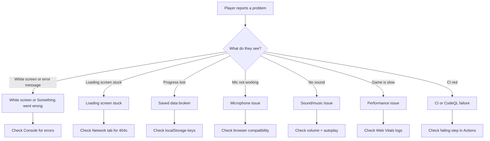

# Runbook

This page is for the person on duty when Level Up RPG breaks during a school day. You do not need to know React. Each incident gives the symptoms, a quick check, a fix, and when to open an issue.

Last checked against the code: 2026-11-28.

## Incident triage



## Before you start

Most checks use the browser developer tools (DevTools). In Chrome or Edge, press F12 or Ctrl+Shift+I.

- The Console tab shows errors and the game's own log lines.
- The Application tab, under Local storage, shows the saved data.
- The Network tab shows files that failed to load (status 404 or red lines).

The game saves everything in the browser's localStorage. There is no server and no account. Each address keeps its own saves: `http://localhost:5173` (`npm run dev`), `http://localhost:4173` (`npm run preview`), `http://localhost:8080` (Docker) and the Electron app do not share progress.

In the packaged Electron app, the code blocks F12, Ctrl+Shift+I and Ctrl+Shift+C, so you cannot open DevTools there. Reproduce the problem in a browser or with `npm run electron:dev` instead.

## Incidents

### White screen or "Something went wrong"

Symptoms:

- The whole page shows "Something went wrong", an error message and a "Try Again" button.
- Inside a battle, the card shows "Game crashed!" and a "Retry" button.
- The page is completely white.

Quick check:

1. Open the Console. The full-page screen logs `[ErrorBoundary]` with the error. A crashed mini-game logs `[GameError] <game name>:` (for example `[GameError] math:`).
2. Copy the first red error and its stack.
3. The game also keeps the last 20 errors in `localStorage`, so they are still there after a crash or a reload. In the Console, run `JSON.parse(localStorage.getItem('errorLog_v1'))`. Each entry has the time, the `source` (`window`, `promise`, `react` or `game:<name>`), the message, the stack and how many times it happened. Delete the key to start clean.

What the screens do:

- "Something went wrong" comes from `src/components/ui/ErrorBoundary.jsx`. It wraps the whole app in `src/main.jsx`. "Try Again" renders the app again from scratch.
- "Game crashed!" comes from `src/components/ui/GameErrorBoundary.jsx`. It wraps the mini-game inside each skill card. "Retry" ends the battle and the rest of the game keeps working.
- Error boundaries only catch errors while React draws the screen. An error in a click handler does not show either screen. It only appears in the Console as `Uncaught ...`, and in the saved error list with the source `window`.

Fix:

1. Press "Try Again" or "Retry" once.
2. If the same screen comes back right away, reload the page.
3. If it still comes back, the saved data is probably broken. Two keys are read at startup without any error handling: `heroProfileNames_v1` and `heroParentStatus_v1` (`src/hooks/useGameState.js`, lines 101 to 106). If either one is not valid JSON, the app crashes on every start and "Try Again" cannot help. Back up the saves, then delete the broken key (see [Saved data is broken or lost](#saved-data-is-broken-or-lost)). The game rebuilds it with the default names "Player 1" to "Player 3".
4. A white page with no error screen usually means the JavaScript did not load at all. Check the Network tab for red lines, then restart the server or rebuild (`npm run build`).

Escalate when the crash comes back after a reload with clean saved data, or when one mini-game crashes every time. Include the Console error and stack, the skill name, the theme, and the browser.

### Loading screen stuck or "critical images could not load"

Symptoms:

- The loading screen shows "LOADING INCOMPLETE" and the message "N CRITICAL IMAGE(S) COULD NOT LOAD. The game can continue with missing visuals." with a "CONTINUE" button.
- The percentage stops moving.

How loading works: `src/components/LoadingGate.jsx` shows the loading screen while `src/utils/preloadStartupAssets.js` loads the critical images of the saved theme. Those are the background, the logo, the memory card back, the six skill icons and the mob pictures on screen. The game waits for every one of them to load or fail. Sounds load in the background and never block the screen. Music is not preloaded.

Quick check:

1. Open the Network tab, filter on "Img" and look for 404 errors.
2. Open the Console. A failed sound shows `Optional startup sounds failed to preload:`. A failed style file shows `Global game styles failed to load:`. A crash of the preload step shows `Startup asset preload failed:`.
3. Look at the saved theme. Every theme lists its files in `src/themes/<id>.json` and keeps them in `public/assets/themes/<id>/`. Run `npx vitest run src/__tests__/themeFiles.test.js`: it names any missing file. See [the themes guide](../features/themes.md).

Fix:

1. Press "CONTINUE". The game works, with a missing logo or a missing memory card back.
2. To stop the message, open the Cosmetics panel and pick the Blocks theme (the default). The next start will not report failed images.
3. If the percentage is stuck on a slow network, wait. There is no timeout on images, so the screen waits until the browser gives up on each one. If it never ends, reload.

Escalate when a theme reports failed images, or when the screen stays stuck after a reload on a normal network. Include the list of 404 files from the Network tab and the theme name.

### Saved data is broken or lost

Symptoms:

- A player's levels, XP or badges are back to the start.
- Profile names are back to "Player 1", "Player 2", "Player 3".
- The app crashes at startup (see the first incident).

Where the data lives (all in localStorage, set in `src/hooks/useGameState.js` and `src/components/PhantomEvent.jsx`):

| Key | Content |
| --- | --- |
| `currentProfile_v1` | Number of the active profile: 1, 2 or 3 |
| `heroSkills_v23_p1`, `heroSkills_v23_p2`, `heroSkills_v23_p3` | One JSON object per profile: `skills`, `theme` and `stats` |
| `heroSkills_v23` | Older save format. Read for profile 1 only, when `heroSkills_v23_p1` is missing |
| `heroProfileNames_v1` | JSON object with the three profile names |
| `heroParentStatus_v1` | JSON object: whether a parent verified each profile |
| `borderEffect_p{id}`, `borderColor_p{id}` | Chosen card border and color, plain text |
| `phantomEvent_lastSpawn_v1` | Time of the last phantom event |

The music and sound effect volumes are not saved. They go back to 30% and 50% each time the game starts.

Quick check:

1. Make sure you are on the same address and the same browser as before. A different port, the Electron app, a private window or cleared site data all start with empty saves.
2. Check `currentProfile_v1`. The player may simply be on another profile. Switch profiles in the Settings panel.
3. In the Console, look for `Failed to parse saved skills:` or `Failed to parse stats:`. These mean `heroSkills_v23_p{id}` was not valid JSON.

Back up the saves before you change anything. In the DevTools Console (Chrome or Edge):

```js
copy(JSON.stringify(localStorage))
```

This copies every key to the clipboard. Paste it into a text file. To restore it later, replace `PASTE_BACKUP_HERE` with the whole content of the file, as is, with no quotes around it:

```js
const backup = PASTE_BACKUP_HERE;
Object.entries(backup).forEach(([key, value]) => localStorage.setItem(key, value));
```

Then reload the page.

Fix:

- To repair one broken key, delete it and reload. The game recreates it with default values:

  ```js
  localStorage.removeItem('heroProfileNames_v1')
  ```

  You can also right-click the key in Application > Local storage and choose Delete.
- If `heroSkills_v23_p{id}` is broken, the game starts that profile from zero and then saves over the broken value. The old progress is gone unless you have a backup. Restore the backup, or accept the reset.
- `localStorage.clear()` deletes all three profiles. Only use it when the player agrees to lose everything.

Since [DEBT-018](../DEBT.md#debt-018-unsafe-jsonparse-in-handlereset-p3-done-) ([#58](https://github.com/0x11semprez/codewash/pull/58)), a broken saved value no longer crashes the game. The game starts with default values and the Console shows a `[storage] Ignoring corrupted ...` warning. A broken skills save is copied once to `<key>_corrupted_backup` before the game overwrites it. Use that key to recover the player's progress by hand.

Escalate when saves disappear without any of the causes above. Include the backup text (with the player's permission), the browser, the address, and what the player did just before.

### Microphone or speech recognition not working

Only the Reading skill uses the microphone. Details: [docs/features/microphone.md](../features/microphone.md).

Symptoms:

- The mic does not start when a Reading battle starts.
- The text under the mic shows "Mic not available" or "Mic permission denied".
- The mic is listening but the word is never accepted.

Quick check:

1. Check the browser. The game uses `webkitSpeechRecognition`, which exists in Chromium browsers such as Chrome and Edge. In a browser without it, the mic does not start and the mic button shows "Mic not available".
2. Check the permission. Click the lock icon next to the address and allow the microphone. Also check the system microphone settings.
3. Check the language. Recognition is set to English (`en-US`) in `src/hooks/useVoiceRecognition.js`. The player has to say the English word on screen.
4. Open the Console. The code only logs `[Speech Recognition] Failed to start:` and `[Speech Recognition] Error stopping:`. The feature page lists more log lines than the code prints today.

Fix:

1. Switch to Chrome or Edge.
2. Allow the microphone, then close and reopen the Reading battle.
3. Test the microphone in another app and choose the right input device in the system settings.
4. In the Electron app, check the system microphone permission for the app. Then try the same thing in Chrome to see if the problem is specific to Electron.

Escalate when the mic fails in Chrome with permission granted, or works in Chrome but not in Electron. Include the browser or Electron version, the text shown under the mic, and the Console output.

### No sound or no music

How sound works (`src/services/soundManager.js` and `src/hooks/useAudio.js`):

- Music starts the first time a battle starts. There is no music on the menu before that.
- Music is a random track from the playlist of the current theme, in `public/assets/themes/<id>/music/`. Tracks are not preloaded, so the first track can take time to start on a slow network.
- Every sound call ends with `.catch(() => {})`. When the browser refuses to play a sound, for example because of its autoplay rules, nothing appears in the Console.
- After the first attempt to start the music, the game counts the music as playing, even if the browser refused. It does not try again until the page is reloaded.

Quick check:

1. Open the Settings panel and check "Music Volume" and "SFX Volume". The defaults are 30% and 50%.
2. Check that the browser tab is not muted and that the system volume is up.
3. In the Network tab, look for 404 errors on `.wav` files.
4. In the Console, `Optional startup sounds failed to preload:` lists sound effects that could not be loaded.

Fix:

1. Unmute the tab and raise the volume.
2. Click anywhere on the page, then reload and start a battle again.
3. If `.wav` files return 404, check that `public/assets/sounds/` is complete in your copy of the repository.

Escalate when `.wav` files return 404, or when there is still no sound in Chrome after a reload and a battle. Include the browser and the Network tab result.

### The game is slow

Quick check:

1. Open the Console. `src/main.jsx` prints Web Vitals lines such as `[web-vitals] FCP: 523 (good)`. FCP prints during loading. LCP and CLS only print when the tab is hidden, so switch to another tab and back to see them.
2. Read the rating in brackets: `good`, `needs-improvement` or `poor`. The limits are in `src/utils/webVitals.js`: FCP good up to 1800 ms, LCP good up to 2500 ms, CLS good up to 0.1.
3. Check how the game is running. `npm run dev` is a development build and is slower. Measure with `npm run build` then `npm run preview`.

Fix:

1. Close other tabs and programs on the machine.
2. Use the built version (`npm run preview`, Docker or the Electron app) instead of `npm run dev`.
3. Compare with the measurements in the [performance report](../missions/performance.md), section [4.4 Web Vitals reporting](../missions/performance.md#44-web-vitals-reporting).

Escalate when the ratings are `poor` on the built version. Include the `[web-vitals]` lines, the theme, the browser and the machine.

### CI is red on a pull request

CI is the GitHub Actions workflow in `.github/workflows/ci.yml`. It runs on every pull request to `main` and every push to `main`, with Node 20. `main` is protected: GitHub blocks the merge until `build-and-test` passes on a branch that is up to date with `main`. Admins can bypass the rule. Do not do it.

Quick check:

1. Open the pull request, then the "Checks" tab, and find the first red step. From a terminal: `gh pr checks <number>`, then `gh run view <run id> --log-failed`.
2. Reproduce locally. Run the same commands as CI, in the same order:

   ```bash
   npm ci
   npm run lint -- --max-warnings 0
   npm run format:check
   npm run build
   npm run test
   npm run test:coverage
   docker build -t codewash:ci .
   ```

Fix, by failing step:

| Step | Common cause | What to do |
| --- | --- | --- |
| Install dependencies | `package-lock.json` does not match `package.json` | Run `npm install` and commit the updated lock file |
| Lint and complexity ceilings (zero warnings) | Any ESLint warning fails the job. A message such as `has a complexity of 59. Maximum allowed is 58` means a function got more complex than the worst one in the code today | Fix the warning shown in the log. For a complexity message, split the function (move a branch into a helper or a child component). Do not raise the limit in `eslint.config.js` |
| Format check | A file is not formatted with Prettier | Run `npm run format` and commit the result |
| Build | Import error or syntax error | Run `npm run build` locally and read the first error |
| Test | A test fails | Run `npm test` locally. Check whether the change broke the behavior or the test needs an update |
| Docker build | A file the build needs is listed in `.dockerignore`, or `npm ci` fails inside the image | Run `docker build -t codewash:ci .` locally and read the first error |
| Test with coverage | Coverage below 100% (lines, statements, branches or functions), the thresholds in `vitest.config.js` | Open `coverage/index.html` or read the "Uncovered Line #s" column, then add tests for those lines |

The coverage report is attached to each run as the `coverage-report` artifact for 14 days.

Escalate when CI fails but every command passes locally with Node 20, or when `main` itself is red. Include the pull request link and the failing step log.

### CodeQL is red on a pull request

CodeQL is the static analysis in `.github/workflows/codeql.yml` ([ADR-014](../adr/014-codeql-static-analysis.md)). It reads the code in `src/` and `electron/` and looks for security problems and quality problems, such as user text that reaches `innerHTML`, code that can never run, or a comparison that is always true. It runs on every pull request to `main`, on every push to `main`, and every Monday.

A pull request shows two CodeQL checks:

- `Analyze (javascript-typescript)` is the job. When it is red, CodeQL could not run. The cause is in the job log, not in your code.
- `CodeQL` is the result. When it is red, the pull request adds at least one new alert of severity "error", or a security alert of severity "high" or "critical".

Quick check:

1. Open the pull request, then the "Checks" tab, and see which of the two checks is red.
2. For `CodeQL`, open the "Files changed" tab. Each new alert is shown on its line, with the rule name and a short explanation.
3. To see every alert, open the repository on GitHub, then Security > Code scanning. From a terminal: `gh api repos/0x11semprez/codewash/code-scanning/alerts --jq '.[] | [.number, .rule.id, .rule.severity, .most_recent_instance.location.path, .most_recent_instance.location.start_line] | @tsv'`.

How to read an alert:

- The title is the rule, for example "Client-side cross-site scripting" or "Unused variable".
- The severity says how bad it is: "error", "warning" or "note" for quality rules, and "critical", "high", "medium" or "low" for security rules.
- The file and line show where the problem ends. For a data flow alert, "Show paths" lists each step, from where the data comes in (the source) to where it is used (the sink). The fix is usually on the path, before the sink.
- "Show more" opens the rule help, with a bad example and a good example.

Fix:

| Check | Common cause | What to do |
| --- | --- | --- |
| `Analyze (javascript-typescript)` | A GitHub outage, a CodeQL action error, or the default setup was turned on | Re-run the job once. If it fails again, read the log. If it says that default setup is enabled, turn it off in Settings > Code security > Code scanning: this repository uses the workflow file instead |
| `CodeQL` | The change adds an alert | Fix the code on the line shown and push again. The check runs again and the alert closes by itself when the problem is gone |
| `CodeQL` | The alert is a false alarm, or it is in code that only tests use | Ask a second person to look. If both agree, open the alert and choose "Dismiss alert" with the reason "False positive" or "Used in tests", and write one sentence on why. Never dismiss an alert only to get a green check |

Escalate when a security alert of severity "high" or "critical" appears on `main`, or when the `Analyze` job fails twice in a row. Include the alert link and the job log.

### npm install fails with ERESOLVE

Symptoms: `npm install` or `npm ci` stops with `npm error code ERESOLVE` and `ERESOLVE could not resolve`.

Cause: a package was added or upgraded, and its peer dependency range does not match another package. For example, `@testing-library/jest-dom` 8 wants Vitest 5, and the project uses Vitest 3.

Fix: read the npm error. It names the package and the version it wants. Pick a version of that package that accepts what the project already has (`npm view <package>@<version> peerDependencies`), then run `npm install` and commit `package.json` and `package-lock.json`. Do not add `--legacy-peer-deps`: it hides the conflict, and the Docker build does not use it.

Also check `node -v` (20 or later) and `npm -v` (10 or later).

Escalate when no version fits. Include the full npm error and your Node and npm versions.

### Docker build fails

Symptoms: `docker build -t codewash .` stops with an error. CI shows a red "Docker build" step.

Cause: most often `npm ci` fails inside the image (see the ERESOLVE section above), or a file the build needs is listed in `.dockerignore`.

Fix:

- Run `docker build -t codewash .` locally and read the first error.
- To serve the game while you fix it:

  ```bash
  npm ci
  npm run build
  npm run preview   # http://localhost:4173
  ```

Escalate if the build fails for another reason. Include the full `docker build` output.

### Electron app does not start or does not build

How it works: `electron/main.cjs` opens a 1280 by 720 window and loads `dist/index.html`. The window needs a web build in `dist/` first.

Symptoms and fixes:

| Symptom | Cause | Fix |
| --- | --- | --- |
| Empty white window | `dist/` is missing or old | Run `npm run electron:dev`. It runs `npm run build` before it opens the window |
| `npm install` fails while installing `electron` | The `electron` package downloads its binary during install. A school network can block the download | Install on another network, or ask the network admin |
| DevTools do not open | The packaged app blocks F12, Ctrl+Shift+I and Ctrl+Shift+C | Use `npm run electron:dev`, where the app is not packaged and the code does not block them |
| `npm run electron:build` fails | The build targets Windows only (portable, x64), configured under `build` in `package.json` | Build on a Windows machine. The output is `release/LevelUpRPG-Portable.exe` |
| Progress missing in the app | The app keeps its own saves, separate from the browser | See [Saved data is broken or lost](#saved-data-is-broken-or-lost) |

No CI job builds the Electron app. The old `build-exe.yml` workflow was removed in commit `881859e`.

Escalate when `npm run electron:dev` shows a white window after a successful build. Include the terminal output and your operating system.

## Useful commands

| Command | Use it to |
| --- | --- |
| `npm install` | Install dependencies |
| `npm ci` | Clean install from `package-lock.json`, like CI |
| `npm run dev` | Start the game at http://localhost:5173 |
| `npm run build` | Build the web version into `dist/` |
| `npm run preview` | Serve the built version at http://localhost:4173 |
| `npm test` | Run all tests once |
| `npm run test:coverage` | Run tests and check coverage thresholds |
| `npm run lint -- --max-warnings 0` | Run ESLint the way CI does |
| `npm run electron:dev` | Build, then open the Electron window |
| `npm run electron:build` | Build the Windows portable `.exe` into `release/` |
| `docker build -t codewash .` | Build the Docker image (broken today, see above) |
| `docker run --rm -p 8080:80 codewash` | Run the image at http://localhost:8080 |
| `gh pr checks <number>` | See the CI status of a pull request |
| `gh run view <run id> --log-failed` | Read the log of the failed CI step |

## How to report an incident

1. Check whether an issue already exists: <https://github.com/0x11semprez/codewash/issues>. Many known problems are listed in [DEBT.md](../DEBT.md#6-tracking-summary).
2. If not, open a new issue with `gh issue create` or on GitHub. Put the symptom in the title, for example "Loading screen reports 2 failed images with Spy theme".
3. In the body, include:
   - what the player was doing and what they saw;
   - the steps to reproduce, if you found them;
   - the browser and version, or "Electron app", and the operating system;
   - the address or command used (`npm run dev`, `npm run preview`, Docker, `.exe`);
   - the theme and profile number;
   - the Console errors, copied as text;
   - the commit you ran (`git rev-parse --short HEAD`);
   - what you already tried from this runbook.
4. Never paste a child's real name or personal details. Replace profile names with "Player 1" and so on.
5. If the incident blocks the class, say so in the first line of the issue.
