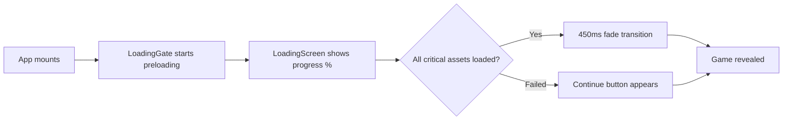
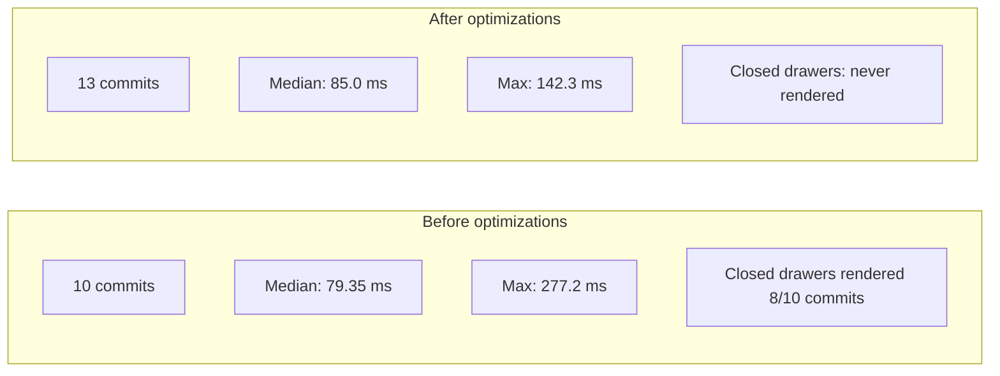
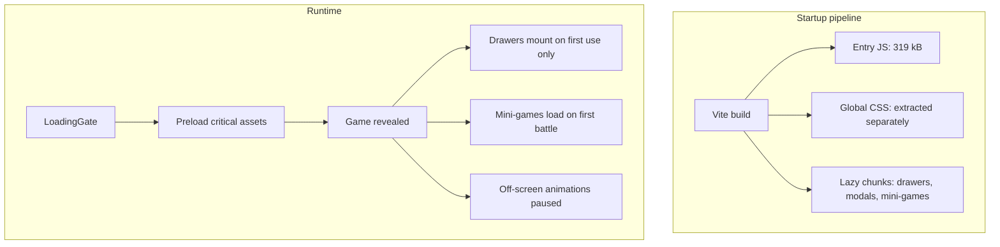

# Performance report

> Mission issue: [#18](https://github.com/0x11semprez/codewash/issues/18) | Epitech mirror: [#18](https://github.com/EpitechBachelorPromo2028/B-ING-300-PAR-3-1-codewash-21/issues/18)
>
> Related PRs: [#51](https://github.com/0x11semprez/codewash/pull/51) (loading screen), [#64](https://github.com/0x11semprez/codewash/pull/64) (music compression), [#75](https://github.com/0x11semprez/codewash/pull/75) (WebP sprites), [#76](https://github.com/0x11semprez/codewash/pull/76) (animation pause), [#89](https://github.com/0x11semprez/codewash/pull/89) (fair comparison), [#99](https://github.com/0x11semprez/codewash/pull/99) (asset re-encoding), [#100](https://github.com/0x11semprez/codewash/pull/100) (layout fix), [#101](https://github.com/0x11semprez/codewash/pull/101) (aura pause)
>
> ADRs: [ADR-010](../adr/010-pause-offscreen-animations.md) (animation pause), [ADR-011](../adr/011-animated-webp-instead-of-gif.md) (WebP sprites)

## At a glance

The game loads 26% faster, transfers 37% less data, and the Lighthouse performance score went from 38.5 to 57.5. Details and methodology are in section 4.2.

**Compared versions**

| Label | Commit | Used in |
| --- | --- | --- |
| Received | `a4f337f` (first commit `f12cd74` + original assets) | Section 4.2, fair comparison |
| Current | `4e0388a` (`main`) | Section 4.2, fair comparison |
| Before / After | `866aaff` / `666c69c` | Sections 2 and 4.1, measured when loading screen was added |

## Summary

| Section of the issue | Status | Outcome |
| --- | --- | --- |
| Loading screen | Done | Full-screen loader with progress, critical asset preloading |
| Performance profiling | Done | Profiles captured, re-renders identified, FCP baseline recorded |
| Optimizations | Done | Memoization, lazy loading, extracted CSS, deferred images, paused animations, WebP sprites |
| Measurement | Done | Same-theme Lighthouse comparison ([#89](https://github.com/0x11semprez/codewash/pull/89)), rerunnable script |
| Tests | Done | Loading screen, loading gate, preload, lazy components, Web Vitals, regression guard |

**Key results** (medians of 4 runs each, same conditions):

- Game usable 26% sooner: 3.16 s vs 4.27 s (loading screen included)
- Lighthouse performance: 38.5 to 57.5, LCP from 2.87 s to 1.42 s, TBT from 2.22 s to 1.03 s
- First load transfer: 1.34 MB vs 2.13 MB (-37%)
- Two regressions: more requests (33.5 vs 24, from lazy chunks and separate files) and slightly larger startup JS (107.9 kB vs 102.2 kB, from added features)

**Later optimizations (2026-11-28)**

- Animated WebP sprites re-encoded: 50 MB to 42 MB, book.webp from 8.3 MB to 572 KB ([#99](https://github.com/0x11semprez/codewash/pull/99))
- Viewport-relative layout with `clamp`/`min`/`vh`, no more overflow on small viewports ([#100](https://github.com/0x11semprez/codewash/pull/100))
- Aura CSS animations pause when not in battle, reducing GPU paint work ([#101](https://github.com/0x11semprez/codewash/pull/101))
- Lighthouse CI added to GitHub Actions pipeline

---

## 1. Loading screen

### Problem

React tree rendered directly at startup. No feedback while images and sounds loaded. Main menu could appear with missing visuals.

### Solution



- Progress bar with percentage and `role="progressbar"` + `aria-valuenow`
- Failed critical images show a **Continue** action instead of blocking
- Elapsed load time passed to game, unlocks "So... So fast !?" achievement
- Reduced-motion preferences honored

**Preloaded assets:**

| Category | Blocking | Content |
| --- | --- | --- |
| Images | Yes | Theme background, logo, card back, six skill icons, viewport mob sprites |
| UI sounds | No | Eight short effects, warmed in background |
| Background music | No | Not preloaded (MP3 since [#64](https://github.com/0x11semprez/codewash/pull/64)) |

**Files:**

| File | Role |
| --- | --- |
| `src/components/ui/LoadingScreen.jsx` | Loader view and accessible progress indicator |
| `src/components/LoadingGate.jsx` | Coordinates preload state, global styles and elapsed time |
| `src/utils/preloadStartupAssets.js` | Loads critical images, warms optional sounds |
| `src/main.jsx` | Mounts gate inside error boundary |

---

## 2. Performance profiling

**Tool:** React DevTools Profiler on Vite dev server. **Scenario:** captures around Skip / Manual Success interaction.



**Root cause:** closed drawers stayed mounted for slide transitions, so every parent update re-rendered them. Settings drawer alone rendered three `ProfileCard` instances.

Earlier FCP baseline: 522.9 ms (single Opera GX measurement on production preview). Lighthouse figures for hook extraction in [section 4.3](#43-earlier-lighthouse-runs-debt-001).

---

## 3. Optimizations



| Optimization | Problem solved | Files | PR |
| --- | --- | --- | --- |
| Memoized closed drawers | Re-rendered on every parent update | `SettingsDrawer`, `MenuDrawer`, `CosmeticsDrawer` | [#51](https://github.com/0x11semprez/codewash/pull/51) |
| `React.memo` on display components | Re-renders with unchanged props | `SafeImage`, `PixelHeart`, `MobWithAura` | [#51](https://github.com/0x11semprez/codewash/pull/51) |
| `React.lazy` + `Suspense` for drawers/modals | All in startup import graph | `src/App.jsx` | [#51](https://github.com/0x11semprez/codewash/pull/51) |
| `useMemo` on carousel items | List rebuilt every render | `src/App.jsx` | [#51](https://github.com/0x11semprez/codewash/pull/51) |
| Global CSS extracted | Styles injected from JSX, font `@import` on each mount | `GlobalStyles.css`, `LoadingGate.jsx` | [#51](https://github.com/0x11semprez/codewash/pull/51) |
| Deferred off-screen images | Eagerly loaded outside viewport | `SafeImage`, `PhantomEvent`, `preloadStartupAssets` | [#51](https://github.com/0x11semprez/codewash/pull/51) |
| `React.lazy` for mini-games | Six games bundled with skill card | `SkillCard.jsx` | [#51](https://github.com/0x11semprez/codewash/pull/51) |
| Music WAV to MP3 | 191 MB uncompressed music | `public/assets/sounds/bgm/` | [#64](https://github.com/0x11semprez/codewash/pull/64) |
| CSS split into five files | One 1,781-line stylesheet | `src/styles/` | [#65](https://github.com/0x11semprez/codewash/pull/65) |
| Font + textures hosted locally | Requests to Google Fonts and transparenttextures.com | `src/assets/fonts/`, `src/assets/textures/` | [#68](https://github.com/0x11semprez/codewash/pull/68) |
| Animated GIF to WebP | 36.9 MB of GIF sprites | `public/assets/` | [#75](https://github.com/0x11semprez/codewash/pull/75) |
| Off-screen animation pause | 40 infinite animations running always | `GlobalStyles.css` | [#76](https://github.com/0x11semprez/codewash/pull/76) |
| WebP re-encoding with fewer frames | book.webp still 8.3 MB after lossless | `public/assets/` | [#99](https://github.com/0x11semprez/codewash/pull/99) |
| Viewport-relative sizing | Overflow on small viewports | Layout components | [#100](https://github.com/0x11semprez/codewash/pull/100) |
| Aura CSS pause outside battle | GPU paint work on carousel | CSS aura classes | [#101](https://github.com/0x11semprez/codewash/pull/101) |

### Behavior details

- Drawers and modals mount on first use, stay mounted after for slide transitions
- Memoized drawers skip updates while closed, use current props when opened
- Global styles load during loading screen, before game reveal
- Startup sprite preloading limited to viewport-visible sprites

### Code splitting per skill type

Each mini-game in `src/components/skills/games/` loaded with `React.lazy` from `SkillCard.jsx`. Each becomes its own chunk (0.95-3.31 kB, 0.62-1.58 kB gzip) fetched on first battle. Saving at startup is small because games are tiny; no speedup claimed.

While adding this, a missing import of `GameErrorBoundary` in `SkillCard.jsx` was found and fixed (it made every battle crash).

---

## 4. Measurement

### 4.1 Bundle size

Source: `npx vite build` on each commit. Sizes are deterministic.

| Asset | Before | After | Change |
| --- | --- | --- | --- |
| Entry JS (startup) | 392 kB (111 kB gzip) | 319 kB (100 kB gzip) | -18.6% (-10.6% gzip) |
| Global CSS (startup) | 61 kB (11 kB gzip) | 63 kB (12 kB gzip) | +2.8% |
| Global styles extracted | inlined in JS | `GlobalStyles.css`, 22 kB (5 kB gzip) | loaded under loading screen |
| Drawers (Settings, Menu, Cosmetics) | in entry JS | 3 lazy chunks, 28 kB (9 kB gzip) | fetched on first opening |
| Modals (Reset, Bug report) | in entry JS | 2 lazy chunks, 3.7 kB (1.6 kB gzip) | fetched on first use |
| Mini-games (6) | in entry JS | 6 lazy chunks, 10.9 kB (5.8 kB gzip) | fetched on first battle |

The JavaScript needed to show the menu shrank by about 73 kB (12 kB gzip). The CSS grew slightly because the global stylesheet is now loaded separately, not because there is more of it.

### 4.2 Fair comparison: received vs current

An earlier attempt compared runs on two different themes, so its figures were removed. These runs use the same theme and setup for both versions.

**Conditions:**

| Item | Value |
| --- | --- |
| Versions | Received: `a4f337f`. Current: `4e0388a` |
| Theme | Default theme of each version (same theme renamed: `minecraft` to `blocks`). New browser profile per run |
| Build | `npm ci`, `npm run build`, `npx vite preview` on ports 4301/4302 |
| Browser | Chromium 155 headless, 1280x720 |
| Lighthouse | 13.6.0, `--preset=desktop`, Performance only |
| Runs | 4 per version, alternated (received, current, received, current...) |
| Machine | 8 cores, load average 11.9-24.8 during runs |

**Lighthouse results:**

| Metric | Received | Current | Change |
| --- | --- | --- | --- |
| Performance score | 38.5 | 57.5 | **+19 pts** |
| First Contentful Paint | 563 ms | 339 ms | **-40%** |
| Largest Contentful Paint | 2,872 ms | 1,418 ms | **-51%** |
| Total Blocking Time | 2,224 ms | 1,032 ms | **-54%** |
| Cumulative Layout Shift | 0.166 | 0.076 | **-54%** |
| Speed Index | 5,390 ms | 4,132 ms | **-23%** |
| Main thread work | 4,950 ms | 3,963 ms | **-20%** |
| Bytes transferred | 2,134 kB | 1,344 kB | **-37%** |
| Requests | 24 | 33.5 | +40% |
| Startup JS (transferred) | 102.2 kB | 107.9 kB | +5.7% |

Score per run: received 34, 43, 40, 37; current 49, 57, 58, 64. Current scored higher in every pair.

**Time until game is usable:**

| Run | Received | Current |
| --- | --- | --- |
| 1 | 6,760 ms | 3,235 ms |
| 2 | 4,198 ms | 3,694 ms |
| 3 | 4,343 ms | 3,077 ms |
| 4 | 2,704 ms | 2,023 ms |
| **Median** | **4,271 ms** | **3,156 ms** |

Current was usable sooner in every pair (-26% on median). Received transfers more bytes on first screen (2.13 MB vs 1.34 MB), mostly GIF sprites that are now smaller WebP files and off-screen images that now load later.

**What got worse:**

- Requests: 33.5 vs 24. Drawers, modals, stylesheet and font are now separate files
- Startup JS: 107.9 kB vs 102.2 kB transferred. Lazy loading removed drawers/modals/games, but translations and new features added since

**How to rerun:**

```sh
git worktree add ../cw-received a4f337f
git worktree add ../cw-current main
(cd ../cw-received && npm ci --legacy-peer-deps && npm run build && npx vite preview --port 4301 --strictPort --host 127.0.0.1) &
(cd ../cw-current && npm ci && npm run build && npx vite preview --port 4302 --strictPort --host 127.0.0.1) &
CHROME_PATH=/usr/bin/chromium node tools/lighthouse-compare.mjs http://127.0.0.1:4301/ http://127.0.0.1:4302/ 5 perf-results
```

The script alternates versions, waits for load average below `MAX_LOAD` (default 4), writes `runs.json` and `summary.json`.

### 4.3 Earlier Lighthouse runs (DEBT-001)

These measure the hook extraction from [#45](https://github.com/0x11semprez/codewash/pull/45), before the loading screen. Different tool settings and server than section 4.2.

| Metric | Before DEBT-001 | After DEBT-001 |
| --- | --- | --- |
| Performance score | 71 | 90 |
| FCP | 1.5 s | 1.6 s |
| LCP | 1.5 s | 1.6 s |
| TBT | 2,390 ms | **380 ms** |
| CLS | 0 | 0.033 |
| Speed Index | 1.8 s | 1.6 s |
| Main thread work | 8.1 s | **4.8 s** |

Before extraction, `App.jsx` had 32 `useState` and 12 `useEffect` in one component. Any state change re-rendered the whole tree. TBT drop is attributed to the extraction: each hook now owns its own state.

### 4.4 Web Vitals reporting

`src/utils/webVitals.js` reports FCP, LCP and CLS with Core Web Vitals rating. `src/main.jsx` logs each: `[web-vitals] FCP: 523 (good)`.

### 4.5 Background music

The six background tracks were uncompressed WAV files. They were encoded to MP3 with LAME (VBR quality 2, about 132 kb/s), dropping from 191 MB to 18 MB total.

| Track | WAV | MP3 |
| --- | --- | --- |
| `calm1` (4:20) | 43.8 MB | 4.1 MB |
| `calm2` | 33.9 MB | 3.5 MB |
| `calm3` | 38.7 MB | 3.6 MB |
| `piano1` | 11.5 MB | 0.7 MB |
| `piano2` | 15.1 MB | 1.4 MB |
| `piano3` (4:41) | 47.3 MB | 4.5 MB |
| **Total** | **191 MB** | **18 MB** |

Music is not preloaded, so the gain is in download size, build size and Docker image, not startup time.

### 4.6 Paused off-screen animations

The global styles have about 40 `infinite` CSS animations. At least 20 animate `filter` or `box-shadow`, which the browser repaints every frame. Before this change, they all ran even when off-screen. Now each animation pauses (`animation-play-state: paused`) when its element is outside the viewport or when the page is hidden. About half of all animations are paused at any time. Design in [ADR-010](../adr/010-pause-offscreen-animations.md).

| Mode | Animations | Running | Paused |
| --- | --- | --- | --- |
| Before | 37 | 37 | 0 |
| After | 33-37 | 15-18 | 15-19 |

### 4.7 Animated sprites

All 32 animated GIFs were converted to lossless animated WebP, cutting sprites from 36.9 MB to 21.5 MB (-42%). In a second pass ([#99](https://github.com/0x11semprez/codewash/pull/99)), the seven heaviest files were re-encoded with fewer frames and lossy quality 60, bringing total assets from 50 MB to 42 MB. The book sprite alone went from 8.3 MB to 572 KB. Design in [ADR-011](../adr/011-animated-webp-instead-of-gif.md).

| Folder | GIF | WebP | Change |
| --- | --- | --- | --- |
| `items/` | 18.03 MB | 12.25 MB | -32% |
| `mobs/` | 16.78 MB | 8.29 MB | -51% |
| `skills/` | 2.10 MB | 0.99 MB | -53% |
| **Total** | **36.91 MB** | **21.53 MB** | **-42%** |

Top 10 files:

| File | GIF | WebP | Change |
| --- | --- | --- | --- |
| `items/book` | 12.21 MB | 8.34 MB | -32% |
| `items/axe` | 2.15 MB | 1.42 MB | -34% |
| `items/hoe` | 2.07 MB | 1.42 MB | -31% |
| `mobs/axolotl/axolotl_pink` | 1.81 MB | 0.82 MB | -55% |
| `mobs/boss/enderdragon` | 1.29 MB | 1.05 MB | -18% |
| `items/chests/ender_chest` | 1.25 MB | 0.84 MB | -33% |
| `mobs/axolotl/axolotl_red` | 1.11 MB | 0.54 MB | -52% |
| `mobs/axolotl/axolotl_green` | 1.10 MB | 0.56 MB | -49% |
| `mobs/axolotl/axolotl_brown` | 1.09 MB | 0.51 MB | -53% |
| `mobs/axolotl/axolotl_black` | 1.08 MB | 0.47 MB | -57% |

**How to rerun conversion:**

```sh
node scripts/convert-gifs.mjs --dry-run   # print sizes, change nothing
node scripts/convert-gifs.mjs             # convert, delete GIFs, update paths
npx vitest run --dir src src/__tests__/assetPaths.test.js
```

---

## 5. Automated tests

| Test file | Protection |
| --- | --- |
| `LoadingScreen.test.jsx` | Percentage, progress bar, ready state, Continue action |
| `LoadingGate.test.jsx` | Reveal after loading, failed-image path, preload crash |
| `preloadStartupAssets.test.js` | Progress to 100%, failed images listed, corrupted saved theme |
| `app.test.jsx` | Drawers not mounted before first opening, lazy loading on click, startup toast |
| `SkillCard.test.jsx` | Right mini-game renders per skill, none outside battle |
| `webVitals.test.js` | Metric collection and rating thresholds |
| `performanceBudget.test.js` | Drawers/modals/games stay lazy, global styles out of App, images lazy by default |
| `useAnimationPause.test.jsx` | Off-screen and hidden-page attributes, shared observer cleanup |
| `assetPaths.test.js` | Every image path in gameData/src exists, no GIF above 200 KB |

---

## 6. Open work

| Item | Notes |
| --- | --- |
| Frame time on main menu | Run `tools/lighthouse-compare.mjs` on a quiet machine, add frame figures to 4.2 |
| Fewer startup requests | Inline or merge small files loaded on first screen |
| Missing theme images | Tracked as [DEBT-021](../DEBT.md#debt-021-missing-theme-assets-p2-open) |
